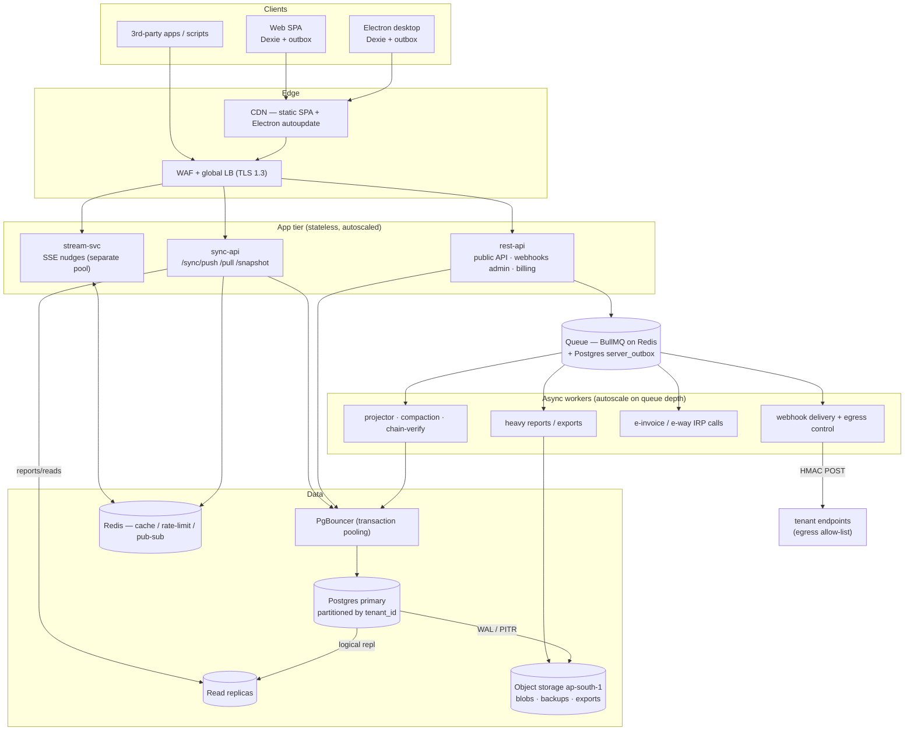
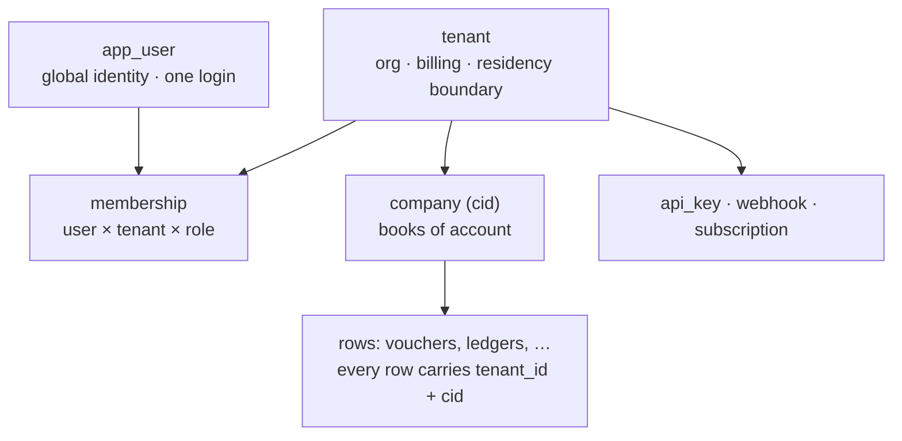
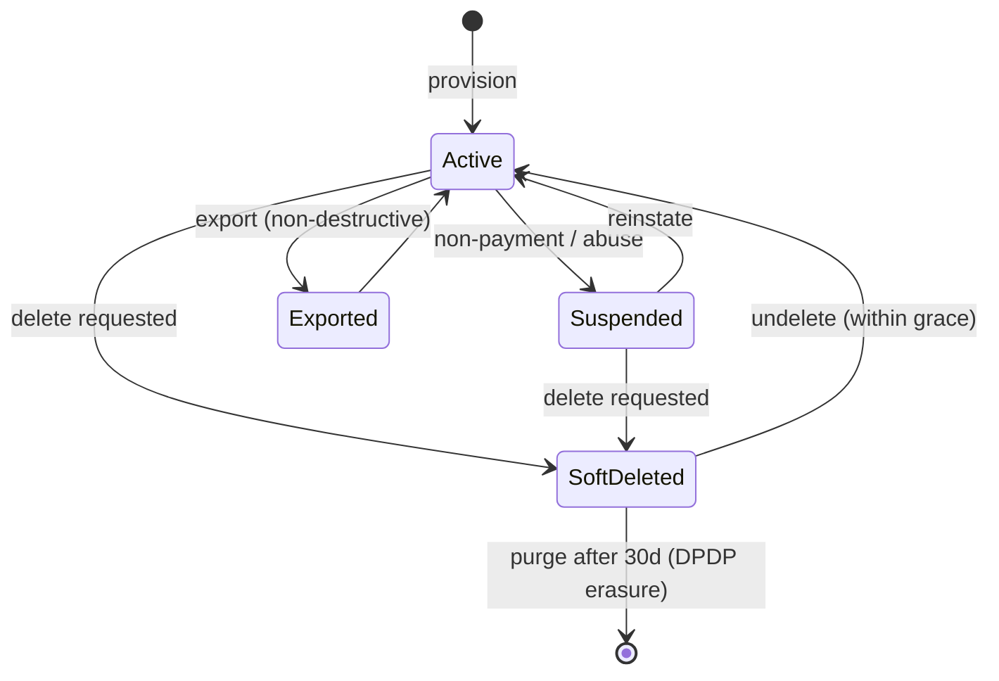
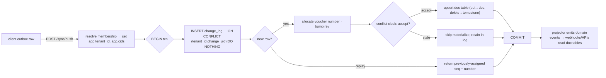
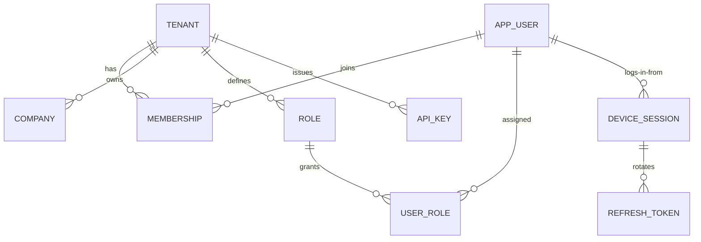
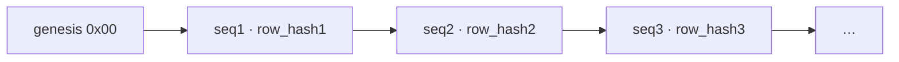

# Comsky Books — Cloud Backend Architecture

This document designs the evolution of the Comsky Books backend from today's single-account,
~260-line Node + `node:sqlite` sync server into a multi-tenant, horizontally-scalable,
secure cloud system of record for Indian-SMB accounting data. It preserves the
local-first / offline-first experience intact and lays the foundation for the
beyond-Tally SaaS epics (open APIs, webhooks, custom fields, collaboration, billing,
HRMS/CRM).

**Status: design (pre-build). Owner: Akshay. Date: 2026-07-09.**

> This design **gates the online SaaS epics** in `docs/ROADMAP.md`: none of the
> multi-tenant, API, webhook, or collaboration epics start building until the decisions
> here are ratified, because they all sit on the tenancy, isolation, and sync-protocol
> foundations defined below.

---

## 1. Goals & Non-Goals

### Goals

- **Hard multi-tenant isolation.** One customer's books can never be read or written by
  another, enforced structurally by the database, not by code discipline.
- **Horizontal scale, including whale tenants.** Thousands of tiny SMB tenants share a
  pool cheaply; a single large reseller/CA client can be promoted to dedicated capacity
  without a redesign.
- **Preserve local-first / offline-first.** Dexie + the `outbox` change-log stay the
  client's working store; every device functions fully offline and converges on
  reconnect. The cloud becomes the durable system of record it syncs against.
- **Better-than-LWW conflict resolution.** Move past blind whole-document last-write-wins
  to domain-aware merge that protects double-entry invariants and master-data coupling.
- **Server-assigned voucher numbers** to end per-device offline numbering collisions,
  reconciled honestly with GST Rule 46 and the offline-first contract.
- **A foundation for the SaaS epics** — open REST API, webhooks, custom fields (UDF),
  collaboration (comments/approvals), and billing — that reuses the sync spine rather
  than bolting on parallel plumbing.
- **DPDP Act 2023 compliance and Indian data residency** — India-region hosting,
  consent/retention/erasure, and a reconciliation between right-to-erasure and the
  immutable statutory ledger.
- **SOC 2 (Type II) posture** — Security, Confidentiality, and Availability controls
  designed in from the start.

### Non-Goals

- **Not re-implementing the pure client engines server-side on day one.** `src/core/*`
  (accounting, inventory FIFO/avg, GST, TDS, payroll) stay client-side; the server
  materializes queryable document tables and defers a server-side report engine until a
  concrete need (large-tenant reports or a public reporting API).
- **Not abandoning Dexie/IndexedDB.** The local store, the `outbox`, and the `cid`
  partitioning are retained; the wire shape stays backward-compatible.
- **No big-bang rewrite.** The migration is phased behind protocol version negotiation so
  a deployed client never breaks; client and server roll independently (§10, §13).
- **Not multi-currency, voucher-class, or full job-work** — those remain product-parity
  work, out of scope for the backend design.

---

## 2. Guiding Principles & The Local-First Invariant

### The local-first invariant

Everything below is subordinate to one rule: **the client keeps working offline and the
cloud is additive.**

- Dexie/IndexedDB remains the client's system of record for the companies it holds. Every
  mutation still appends an `outbox` row `{ts, cid, table, op, docId, payload, user}`.
- The sync path treats `payload` as **opaque `jsonb`**. This decoupling is the single
  biggest zero-downtime lever: the Dexie schema can evolve (v3 → vN, its own migration)
  without a coordinated server deploy, and vice-versa.
- A cloud outage degrades Comsky Books to **offline mode, not data loss** — every device is a
  warm, complete replica of its own companies. (This "moat" has one sharp edge — a
  server-side PITR restore — addressed by the re-anchoring protocol in §9.)
- The cloud becomes the **authoritative, queryable system of record**: it holds the
  canonical change log, server-assigned voucher numbers, billing state, and webhook
  delivery state — data that has no client replica and therefore needs its own durability
  guarantees.

### Defense in depth for isolation

Tenant isolation is never a single check. It is layered so that any one layer failing
still fails safe:

1. **`tenant_id` is never an input** — it is resolved only from a signature-verified token
   or a hashed API-key lookup, never from a request body, query param, or the
   client-supplied `cid`.
2. **Postgres Row-Level Security (RLS)** is the structural backstop (§4): even a forgotten
   `WHERE` or a SQL-injected query cannot cross tenants.
3. **Repository-level scoping** — no code path reaches the database without a resolved
   `TenantContext {tenant_id, actor_id, role, cids}`.
4. **CI cross-tenant-read tests** (§8) are a release blocker: adding a table without its
   isolation test fails the build.

---

## 3. System Overview

The target is a stateless app tier fronting a partitioned Postgres primary with read
replicas, Redis (cache / rate-limit / pub-sub), an async worker fleet fed by a queue, and
object storage — all in an India region.



**Walk-through.** A client (web, Electron, or a 3rd-party integration) reaches the app
tier through a CDN/WAF/LB. The **sync-api** handles the hot `/sync/*` path — it resolves
the caller's `TenantContext`, sets the tenant GUC, appends to the canonical `change_log`,
allocates voucher numbers, and materializes document tables, all inside one transaction
against the Postgres primary (through PgBouncer in transaction mode). Reads and heavy
reports route to **read replicas**. The **rest-api** serves the public API and webhook
admin and enqueues background work. A separate **stream-svc** holds long-lived SSE
connections and pushes lightweight "changes waiting" nudges via Redis pub/sub; the client
then runs its normal pull. **Async workers** deliver webhooks (with egress control),
render heavy reports/exports to object storage, make rate-limited IRP calls for real
e-invoicing, and run the projector/compaction/chain-verification housekeeping. Everything
is in an India region for DPDP residency; DR is a second India **region** (§9).

Sections 4–10 detail each subsystem. The RLS/`tenant_id`/GUC mechanism is introduced once
(§4) and referenced thereafter; the canonical `change_log` DDL lives once (§5).

---

## 4. Tenancy & Isolation

### The entity that is missing today

Today's server has two levels: a `users` row (one login) and the `cid` string every
`changes` row carries. There is no entity above the login, so "an account = one login
holding all its companies" is the whole model. That conflates three concepts:

- **Billing / ownership / residency boundary** — who pays, whose DPDP obligations apply,
  what gets exported or erased as a unit.
- **Identity** — a human who logs in.
- **Company / books-of-account (`cid`)** — a bare string with no server-side parent.

We separate them by introducing a **`tenant`** (organization) as the top boundary, with
identity and companies both hanging off it:



### Multi-tenant-per-login is mandatory, not optional

The buyer is a **Tally reseller / CA practice** — Akshay works at a Tally partner. In
India, one accountant logs in once and services **many** client organizations. Therefore:

- **`app_user` is a global identity** (tenant-independent), and access is granted by a
  **`membership(tenant_id, user_id, role)`** join row. A human has **one** login and
  belongs to N tenants.
- The access token carries a **selected active tenant** (`tid`), chosen at login or via a
  tenant-switch; `tenant_id` is derived from the verified token, never from the body.
- **Rejected: user-belongs-to-one-tenant** (the simpler `app_user.tenant_id NOT NULL`,
  `UNIQUE(tenant_id,email)`, single-value token). It forces a duplicate login per client
  org and is extremely expensive to unwind once email-uniqueness, FKs, and a single-tenant
  token are baked in — and it directly breaks the reseller use case that justifies the
  whole system.

Tenant-switching has a real client cost (see the cursor-reset rule below and in §6): a
single browser logged into two tenants must clear/reload Dexie on switch, because Dexie
partitions only by `cid` today. The token/cursor gains a tenant dimension; this is an
accepted, deliberate consequence of getting multi-tenancy right.

```sql
CREATE TABLE tenant (
  id            uuid PRIMARY KEY DEFAULT gen_random_uuid(),
  name          text NOT NULL,
  data_region   text NOT NULL DEFAULT 'ap-south-1',   -- DPDP residency
  status        text NOT NULL DEFAULT 'active',        -- active|suspended|soft_deleted
  isolation     text NOT NULL DEFAULT 'pool',          -- 'pool' | 'silo'
  plan          text NOT NULL DEFAULT 'trial',
  source_user_id uuid,                                 -- migration provenance (see §10)
  deleted_at    timestamptz,
  created_at    timestamptz NOT NULL DEFAULT now()
);

CREATE TABLE app_user (          -- global identity; auth columns detailed in §7
  id            uuid PRIMARY KEY DEFAULT gen_random_uuid(),
  email         citext UNIQUE NOT NULL,                -- globally unique (not per-tenant)
  created_at    timestamptz NOT NULL DEFAULT now()
);

CREATE TABLE membership (
  tenant_id     uuid NOT NULL REFERENCES tenant(id) ON DELETE RESTRICT,
  user_id       uuid NOT NULL REFERENCES app_user(id) ON DELETE RESTRICT,
  role          text NOT NULL DEFAULT 'member',        -- owner|admin|member|accountant|auditor
  created_at    timestamptz NOT NULL DEFAULT now(),
  PRIMARY KEY (tenant_id, user_id)
);
```

> `ON DELETE RESTRICT`, not `CASCADE`: an append-only, statutory audit log must never be
> silently deleted by an FK cascade. Tenant/user teardown is an explicit, logged workflow
> (§4 lifecycle, §8 erasure), never a cascade side-effect.

**Two-tier authorization, precedence defined.** The coarse `membership.role` governs
**tenant-level** actions (invite, billing, provision company, export, delete). The
existing app rights matrix — `Role.rights: RightArea[]` and per-company scope (§7) —
governs **data access**. Precedence: tenant-role gates org actions; the fine
rights + `cids` scope gates every sync/report/API data operation, and is the **more
restrictive** of the two whenever they overlap (an org `member` with company `full` rights
still cannot invite users; an org `admin` still cannot read a company outside their `cids`
scope). This resolves the "two authz systems can disagree" risk by making data access
always the intersection.

### A first-class server-side company entity

`cid` must not remain a bare client-minted string. Without a server registry there is no
way to (1) invite an auditor or external accountant to **one** company (the core reseller
workflow), (2) enforce plan limits like "N companies", or (3) scope a membership to
specific companies. We add a `companies` table (DDL in §5) and scope authorization to a
set of `cids` (§7). Companies are a **sub-partition inside a tenant, not a security
boundary** — the tenant is the only hard isolation boundary — but `cid` **is** an
authorization scope for reads and writes.

### Isolation model: shared-schema pool + RLS, with silo promotion for whales

**Chosen: shared schema, one set of tables, every row stamped `tenant_id`, isolation
enforced by Postgres Row-Level Security keyed on a per-connection GUC `app.tenant_id`.**
This is the *pool* model.

| Model | Verdict for Indian-SMB shape (thousands of tiny tenants, a long tail, a few whales) |
|---|---|
| **Shared schema + RLS (chosen)** | One migration, one connection pool, cheap per-tenant cost. RLS gives DB-enforced isolation even if a query forgets a `WHERE`. Cross-tenant ops/analytics stay possible (via an audited privileged role, below). |
| Schema-per-tenant (bridge) | Rejected as default: thousands of schemas explode `pg_catalog`, migrations fan out, pooling degrades. Buys little over RLS + `tenant_id`. |
| Database-per-tenant (silo) | Rejected as default (per-DB overhead × thousands is uneconomic) but **kept as the on-demand promotion target** for a whale. |

The model is therefore formally **pool by default, silo on demand**, routed by a small
`tenant_routing(tenant_id → dsn)` table the API layer consults per request.

### RLS: the isolation mechanism (defined once, referenced everywhere)

Every domain table carries `tenant_id uuid NOT NULL` **in addition to** `cid` (the
ownership key is `(tenant_id, cid, id)`). The app authenticates the request, resolves
`tenant_id` from the verified token + membership, and sets it as a **transaction-local
GUC** as the *first statement* of every request transaction:

```sql
-- first statement of every request transaction, after JWT verification:
SELECT set_config('app.tenant_id', $1, true);   -- true = transaction-local
SELECT set_config('app.cids',      $2, true);    -- comma list, or '*' for all-company roles
```

RLS then makes isolation structural:

```sql
ALTER TABLE change_log ENABLE ROW LEVEL SECURITY;
ALTER TABLE change_log FORCE ROW LEVEL SECURITY;      -- applies even to the table owner

CREATE POLICY tenant_isolation ON change_log
  USING      (tenant_id = current_setting('app.tenant_id', true)::uuid)
  WITH CHECK (tenant_id = current_setting('app.tenant_id', true)::uuid);
```

The same policy pattern is applied to `change_log`, `companies`, every materialized
document table, `app_user`/`role`/`api_key`, etc. Operational rules that make this
*actually* provide isolation (each omitted in a naive draft, each load-bearing):

- **`WITH CHECK`, not just `USING`.** `USING` filters reads/updates; `WITH CHECK` blocks an
  `INSERT`/`UPDATE` that stamps another tenant's id. Both are required.
- **`FORCE ROW LEVEL SECURITY` + a non-owner, non-superuser app role.** Table owners and
  superusers bypass RLS unless `FORCE` is set and the app connects as a dedicated role
  without `BYPASSRLS`. Omitting either makes the policy a silent no-op.
- **`current_setting(..., true)` + fail-closed guard.** The `true` second arg returns
  `NULL` instead of throwing when the GUC is unset; the policy comparison against `NULL`
  fails closed (denies). A request that fails JWT verification never sets the GUC, so RLS
  denies by default.
- **Transaction-pooling discipline.** With PgBouncer, the pool **must** be in
  *transaction* mode and every query **must** run inside an explicit transaction whose
  first statement sets the GUC. A session-pooled or autocommit path leaks the GUC across
  clients — a cross-tenant leak, not a demo-visible bug. A connection-wrapper guarantees
  this; the CI isolation suite (§8) runs as the real app role to prove it.
- **Company scope in RLS for sensitive tables.** Tenant RLS alone lets a company-scoped
  clerk pull the *whole* tenant. For read-sensitive tables (`vouchers`, payroll) a second
  predicate enforces `cid = ANY(string_to_array(current_setting('app.cids', true), ','))`
  unless the scope is `'*'`. This closes the pull-side authorization hole (§7).
- **A separate, tightly-audited `BYPASSRLS` service role** exists for the operations RLS
  *must not* block: schema migrations, cross-tenant analytics/ops, the whale silo-copy,
  and background workers that legitimately span tenants. Its use is logged and its grants
  are minimal; the request-path app role never has it.

**Rejected: relying on `WHERE tenant_id = $1` in application code** — one forgotten clause
is a cross-tenant leak. RLS is defense-in-depth a code review cannot regress.

### Whale promotion (pool → silo)

Promote a tenant to a dedicated database when any of: sustained storage > ~25 GB, > ~50
concurrent devices, contractual isolation/residency, or noisy-neighbor load. Because the
transport is an append-only change log, promotion is mechanical — **but it needs a cutover
fence to avoid split-brain data loss:**

1. **Freeze writes** for the tenant: flip to read-only; `push` returns `409 retry`. Drain
   in-flight transactions.
2. **Snapshot at a watermark seq** `S` = current `MAX(seq)` for the tenant.
3. **Copy** the tenant's `change_log` (and derived tables) filtered by `tenant_id`, up to
   `S`, into the provisioned silo (identical schema). The privileged `BYPASSRLS` role does
   the cross-boundary read.
4. **Flip** the tenant's `home_shard`/DSN in `tenant_routing`; re-open writes.
5. **Clients re-anchor**, not "re-pull from 0 blindly": the silo's `seq` space is a fresh
   sequence, so no pool cursor is portable. Clients keep their `outbox` `synced` flags
   (they are **not** reset), rely on `change_uid` idempotency (§6) so no history is
   re-pushed, and re-bootstrap read state via snapshot+tail (§6) against the new home. The
   `push`/`pull` responses carry a `home` DSN hint that triggers the redirect.

This clean promotion **depends on** the `change_uid` idempotency key and a cutover fence;
without them the "filtered copy + flip" loses any row pushed between snapshot and flip.

### Tenant lifecycle



- **Provision** — insert `tenant` (+ `data_region`), create the owner `membership`, mint
  the first token. In the pool this is a single row insert.
- **Suspend** — flip `status='suspended'`. Auth refuses to set `app.tenant_id`, so
  `push`/`pull` return `402/403`, but the client stays **fully functional offline**; the
  outbox accumulates and drains on reinstatement. Suspension must never mean data loss for
  an SMB behind on a bill.
- **Export** — `SELECT … WHERE tenant_id = $1` across `change_log` + derived tables → a
  signed bundle reusing the client's existing `exportCompany`/`tallyweb-backup-v2` shape,
  aggregated per tenant for DPDP data-portability.
- **Delete** — two-phase for DPDP erasure: soft-delete (`deleted_at`, hidden from normal
  traffic, 30-day grace) then hard purge (`DELETE … WHERE tenant_id = $1`, or `DROP
  DATABASE` for a silo). Purge is logged to an append-only compliance audit outside the
  tenant partition, and is reconciled with statutory retention and actor pseudonymization
  (§8).

---

## 5. Data Storage (Postgres + RLS)

The client contract does not change: the browser keeps appending outbox rows and shipping
them to `/sync/push`. The server turns that append-only stream into two durable per-tenant
assets: an **authoritative change log** (the system of record) and **materialized document
tables** that make the data queryable for reports, APIs, and webhooks. Every table is
tenant-partitioned and RLS-guarded per §4.

### Decision: hybrid jsonb-doc store + extracted generated columns

Each document table stores the full document as `jsonb` **plus** a handful of
`GENERATED ALWAYS AS (...) STORED` columns pulled out of the jsonb for indexing, company
scoping, and cheap SQL aggregates.

- **Rejected — full normalization** (`voucher_entries`, `inventory_lines`,
  `bill_allocations`, …). The `Voucher` shape (`src/types.ts`) is deeply nested and *still
  actively growing* — Phases 5–7 added `optional`, `postDated`, `rcm`, `placeOfSupply`,
  `supplierInvNo`, `irn`, `altQty`, `discountPct` as bare optional fields. Normalization
  means a migration and a fan-out/fan-in mapper for each, and the client already ships
  whole documents, so a normalized server would immediately reassemble them to answer a
  pull. The doc is the natural, loss-free landing zone for a whole-document `put`.
- **Rejected — pure jsonb blob.** Then every report/API filter is a jsonb path scan, RLS
  can't key on a plain column, and per-company indexes are awkward.

The generated columns are a *projection*, never a second source of truth — Postgres
recomputes them on any doc change, so they cannot drift. **They must use parse-or-NULL safe
expressions, not strict casts** (see the hot-path wedge warning below).

### The authoritative change log (canonical DDL — defined here, referenced elsewhere)

Direct descendant of SQLite `changes`. Renames: `userId` → `(tenant_id, actor_id)`;
`payload TEXT` → `payload jsonb`; adds the **`change_uid` idempotency key**, a per-doc
**`rev`**, and `op:'patch'`.

```sql
CREATE TABLE change_log (
  seq         bigint GENERATED ALWAYS AS IDENTITY,   -- global total order; the LWW/pull cursor
  tenant_id   uuid   NOT NULL,                        -- isolation key (RLS, §4)
  cid         text   NOT NULL,                        -- company (books boundary inside a tenant)
  change_uid  uuid   NOT NULL,                        -- client-generated idempotency key
  actor_id    uuid,                                   -- app_user OR api_key that wrote it (audit)
  device_id   text   NOT NULL,                        -- echo suppression (unchanged semantics)
  tbl         text   NOT NULL,
  op          text   NOT NULL CHECK (op IN ('put','patch','delete')),
  doc_id      text   NOT NULL,
  rev         bigint NOT NULL DEFAULT 0,              -- per-(tenant,cid,doc_id); conflict clock (§6)
  payload     jsonb,                                  -- full doc | field-delta | NULL on delete
  ts          timestamptz NOT NULL DEFAULT now(),     -- server receive time (authoritative)
  client_ts   bigint,                                 -- client wall-clock (tiebreak ONLY, never primary)
  PRIMARY KEY (tenant_id, seq),
  UNIQUE (tenant_id, change_uid)                      -- push dedupe: ON CONFLICT DO NOTHING
) PARTITION BY HASH (tenant_id);

-- 32 hash partitions to start (headroom to 64); bounded count, even spread, NO per-tenant DDL.
CREATE TABLE change_log_p00 PARTITION OF change_log FOR VALUES WITH (MODULUS 32, REMAINDER 0);
-- … p01 … p31

CREATE INDEX ON change_log (tenant_id, cid, seq);     -- the pull hot path (company-scoped)
CREATE INDEX ON change_log USING brin (seq) WITH (pages_per_range = 32);  -- cheap append-only scans
```

**Why HASH(tenant_id) over LIST(tenant_id):** LIST needs one partition (and DDL) per
tenant — untenable at thousands of SMBs. HASH caps partition count and spreads load, and
is the key Citus will distribute on later (§9), so scaling out is a re-home, not a
re-model. A whale flagged `isolation='silo'` moves to its own database (§4).

**`seq` — one global sequence, restated for the distributed case.** Through the Seed and
Growth tiers, `seq` is a single `IDENTITY`, which keeps the client cursor contract
identical to the SQLite lift (the cursor is "the highest `seq` seen"). This is a shared
insertion point but is comfortably within a single primary's budget at SMB volume. At the
Scale/Citus tier a single global monotonic sequence is neither cheap nor correct across
shards; the plan is **per-tenant local `seq` + a per-(tenant, cid) client cursor** (§6).
That transition is an explicit, tested migration that translates the cursor space — not a
silent change (see risk register, §12).

The tamper-evidence hardening of this table (per-org hash chain, INSERT/SELECT-only
grants, WORM anchoring) is described in §8 and applied to this same table.

### Core tenancy + company tables

`tenant`, `app_user`, and `membership` are defined in §4. Companies:

```sql
CREATE TABLE companies (
  tenant_id   uuid NOT NULL REFERENCES tenant(id),
  cid         text NOT NULL,                          -- the client's Company.id
  doc         jsonb NOT NULL,
  name        text GENERATED ALWAYS AS (doc->>'name') STORED,
  seq         bigint NOT NULL,
  updated_at  timestamptz NOT NULL DEFAULT now(),
  deleted     boolean NOT NULL DEFAULT false,
  PRIMARY KEY (tenant_id, cid)
);
```

### Materialized document tables (the query surface)

One table per synced Dexie table (`ledgers`, `vouchers`, `stock_items`, …). Extracted
columns are chosen from the exact fields reports/APIs filter on. Note the
**parse-or-NULL** casts:

```sql
CREATE TABLE vouchers (
  tenant_id   uuid NOT NULL,
  cid         text NOT NULL,
  doc_id      text NOT NULL,                           -- Voucher.id
  doc         jsonb NOT NULL,
  -- extracted, indexed projections — safe casts (bad/empty values project to NULL, never throw):
  base        text    GENERATED ALWAYS AS (doc->>'base')                                        STORED,
  vdate       date    GENERATED ALWAYS AS (NULLIF(doc->>'date','')::date)                       STORED,
  party_id    text    GENERATED ALWAYS AS (doc->>'partyId')                                     STORED,
  number      text    GENERATED ALWAYS AS (doc->>'numberStr')                                   STORED,
  optional    boolean GENERATED ALWAYS AS (COALESCE((doc->>'optional')::boolean, false))        STORED,
  rev         bigint  NOT NULL,
  seq         bigint  NOT NULL,                         -- change_log.seq that last wrote this row
  updated_at  timestamptz NOT NULL DEFAULT now(),
  deleted     boolean NOT NULL DEFAULT false,           -- tombstone (delete op)
  PRIMARY KEY (tenant_id, cid, doc_id)
) PARTITION BY HASH (tenant_id);

CREATE INDEX ON vouchers (tenant_id, cid, vdate)    WHERE NOT deleted;
CREATE INDEX ON vouchers (tenant_id, cid, party_id) WHERE NOT deleted;
CREATE INDEX ON vouchers (tenant_id, cid, base)     WHERE NOT deleted;
CREATE INDEX ON vouchers USING gin (doc jsonb_path_ops);   -- ad-hoc API filters (HSN, GSTIN, irn, batch)

CREATE TABLE ledgers (
  tenant_id   uuid NOT NULL,
  cid         text NOT NULL,
  doc_id      text NOT NULL,
  doc         jsonb NOT NULL,
  name        text GENERATED ALWAYS AS (doc->>'name')    STORED,
  group_id    text GENERATED ALWAYS AS (doc->>'groupId') STORED,
  gstin       text GENERATED ALWAYS AS (doc->>'gstin')   STORED,
  rev         bigint NOT NULL,
  seq         bigint NOT NULL,
  deleted     boolean NOT NULL DEFAULT false,
  PRIMARY KEY (tenant_id, cid, doc_id)
) PARTITION BY HASH (tenant_id);
CREATE INDEX ON ledgers (tenant_id, cid, group_id) WHERE NOT deleted;
-- name-uniqueness is enforced at merge time, NOT as a hard constraint that could wedge a
-- push (two offline devices creating "HDFC Bank" is a conflict to resolve, §6 — not a
-- 500 that strands a batch). A non-unique index supports the lookup:
CREATE INDEX ON ledgers (tenant_id, cid, lower(name)) WHERE NOT deleted;
```

`deleted` is a **tombstone**, not a physical delete: conflict resolution (§6) must be able
to compare a stale re-put against a prior delete, so the row and its clock survive.

### Write path: log first, then materialize

`/sync/push` is **synchronous** at Seed/Growth volume — append to `change_log` and upsert
the doc table in one transaction. The log is the WAL; materialization is a deterministic
fold, so a pull can never see a materialized row the log doesn't justify.



```sql
-- per accepted change, inside the push transaction (conflict guard baked into the upsert):
INSERT INTO vouchers AS v (tenant_id, cid, doc_id, doc, rev, seq, deleted)
VALUES ($tenant, $cid, $docId, $payload, $rev, $seq, $op = 'delete')
ON CONFLICT (tenant_id, cid, doc_id) DO UPDATE
  SET doc = EXCLUDED.doc, rev = EXCLUDED.rev, seq = EXCLUDED.seq,
      deleted = EXCLUDED.deleted, updated_at = now()
WHERE EXCLUDED.rev > v.rev
   OR (EXCLUDED.rev = v.rev AND EXCLUDED.seq > v.seq);   -- see §6 for the full conflict rule
```

**Hot-path wedge warning (why safe casts and an async fallback matter).** Synchronous
materialization couples push latency and durability to the doc-table upsert. If a generated
column used a *strict* cast — `(doc->>'date')::date` — a single edge doc (a blank date on an
order/draft, or any future field drift the doc-store model explicitly expects) would throw
and roll back the **entire atomic push**, and the client's poll would retry the same batch
forever: a permanent all-or-nothing sync outage for that company. Mitigations, both
adopted:
1. **Parse-or-NULL safe expressions** on every generated column (shown above), so a bad
   value projects to `NULL` instead of aborting the transaction.
2. **An async projector with a dead-letter queue** for the Scale tier and for whales
   (§9): the `change_log` insert stays synchronous and durable; materialization moves to a
   worker so projection *correctness* is decoupled from log *durability*. When async, the
   projector applies the same conflict guard (`WHERE incoming.rev/seq > row`), and the
   snapshot high-water handoff (§6) prevents onboarding data loss.

### Where the engines run: client now, server later

`src/core/*` engines stay **client-side** for v1 — they exist, are battle-tested against
the parity board, and must run offline. The server ships materialized doc tables so REST
APIs/webhooks can serve documents and simple SQL aggregates without an engine. A
server-side report engine is deferred until a concrete need; when it lands, the
`optional`/`postDated` exclusion guard (canonical in `postsToLedgers`) becomes a SQL
predicate (`WHERE NOT optional`) and heavy rollups precompute into per-company summary
materialized views keyed on `(tenant_id, cid, vdate)`. The storage layer is thus
engine-agnostic: doc tables are correct and queryable regardless of *where* the math runs,
so engines can move server-side incrementally without reshaping the schema.

> **Honest note on "canonical relational tables."** Server-side analytics that need to
> filter/aggregate *inside* a voucher (per-line, per-tax) require either shredding
> `entries[]`/`inventory[]` into child tables at ingest (a validate + schema-evolution
> burden) or accepting jsonb `gin`-indexed queries. v1 takes the jsonb path; the ingest-time
> shred is deferred and flagged (§12) as the real cost when line-level server analytics
> become a requirement.

---

## 6. Sync & Conflict Resolution

This evolves the outbox → `change_log` protocol into a tenant-partitioned, **idempotent**,
domain-aware sync. **The local-first contract is preserved:** Dexie stays the working
store, every mutation still appends to `outbox`, the client runs fully offline. What
changes is the wire protocol (negotiated v2), the server's role (now system of record),
and the conflict rules.

| Concern | Today (v1) | v2 |
|---|---|---|
| Local store | Dexie + `outbox` | **unchanged** |
| Server model | one SQLite append log | Postgres `change_log` + materialized doc tables (§5) |
| Scope key | one cursor per `(server, email)` | **per-`(tenant, cid)` cursor map** |
| Idempotency | none (retry = duplicate rows) | **client `change_uid` + server UNIQUE dedupe** |
| Conflict | blind LWW by insertion `seq` | **domain-aware** (vouchers doc-atomic by `rev`; masters per-field) |
| Payload | full doc every time | **delta for masters**, full for vouchers (compat path) |
| Numbering | per-device sequential (collisions) | **server-assigned** per (cid, type, series, FY); client provisional |
| Transport | 30 s poll | **SSE seq-nudge** + jittered poll fallback |

### 1. Idempotency (the fix everything else depends on)

Today a retry (server commits, HTTP response lost) re-appends the same rows at new,
**higher** `seq` values. Because conflict order *is* seq order, a re-pushed stale `put(v1)`
can land above a newer `put(v2)` and **win** — a resurrected/rolled-back voucher, not a
harmless duplicate. It also double-fires webhooks. Fix:

- The client stamps each outbox row with a stable **`change_uid`** (UUID) at mutation
  time, before any network. (The local `outbox.++seq` already exists as a fallback key.)
- The server upserts on `UNIQUE (tenant_id, change_uid)` with `ON CONFLICT DO NOTHING`, and
  on a replay **returns the previously-assigned `seq` and voucher number** (persisted on
  the row) rather than allocating again. The counter `INSERT` is skipped on replay.
- Push is processed in one transaction ordered by outbox `seq`, so a batch fully lands or
  fully retries, preserving local causal order.

```ts
// db.ts — OutboxRecord gains changeUid; putDoc/deleteDoc set it
changeUid: crypto.randomUUID(),
```

### 2. Per-(tenant, company) cursors, bootstrap, and the join rule

The v1 client persists one cursor `syncCursor:<url>|<email>`. In v2 the client tracks a
**cursor map** `{ [cid]: seq }` under `syncCursor:<tenant>`, and pull is company-scoped.

- **The cursor map travels in the POST body, never the URL.** An accountant tenant can hold
  hundreds of companies; a `?cursors={…}` query string blows past proxy/CDN URL limits and
  gets logged/truncated. `/v2/sync/pull` takes a JSON body.
- **New-device bootstrap = snapshot + tail.** A fresh device must not replay unbounded
  history. `GET /v2/sync/snapshot` (POST body for the cid set) streams the current doc set
  from the materialized tables (keyset-paginated for large companies) and returns the exact
  `snapshotSeq` it reflects. The device bulk-loads into Dexie, sets `cursor[cid] =
  snapshotSeq`, then tails via normal pull from **exactly** that seq (re-apply is
  idempotent). Tailing from a live `MAX(seq)` instead would silently skip everything
  between the snapshot's high-water and live — the snapshot-handoff bug is avoided by
  pinning to `snapshotSeq`.
- **Joining a tenant forces a cursor reset for that tenant.** This corrects the single
  most dangerous cursor bug: when a second user joins an existing tenant, their device
  carries an old tenant-of-one cursor — a global `seq` *higher* than most of the joined
  tenant's history — so `WHERE seq > cursor` would skip that history **forever**. Joining
  (or switching to) a tenant MUST discard that tenant's cursor and re-bootstrap via
  snapshot+tail. The migration's "cursor still valid" claim holds **only** for the 1:1
  backfill, not for joins (§10).

### 3. Domain-aware conflict resolution

Blind whole-doc LWW is wrong in two opposite directions, so v2 splits by document kind and
— critically — **does not use the untrusted client wall-clock as the primary merge key.**
SMB Windows boxes have skewed clocks (minutes to days); a fast clock must never let a stale
edit win. The authoritative ordering is **server-assigned** (`rev`, then `seq`);
`client_ts` is a last-resort tiebreak only.

**Vouchers (and payroll/attendance vouchers) — document-atomic, revision-based.** A
voucher's `entries[]` must stay balanced (double-entry) and its `inventory[]` consistent;
field-merging two writers corrupts the document. A voucher is an **event with a monotonic
`rev`** incremented server-side per `(tenant, cid, doc_id)` on each accepted put. The
highest `rev` wins (tie → `seq`); superseded revisions stay in `change_log` as the audit
trail. To avoid *silent* loss of a genuine concurrent edit, v2 adds **optimistic
concurrency**: the client sends `baseRev` (the rev it edited from); if the server's current
rev is higher, the write is not blindly overwritten — it is **quarantined and surfaced** as
a conflict artifact for human resolution, not discarded. A merged/accepted voucher is
**re-validated for invariants** (Dr = Cr, header total = line sum, tax basis consistent with
lines) before it materializes; failure quarantines rather than writing a silently-corrupt
statutory record.

**Masters (ledgers, groups, stock items, company, …) — per-field merge with declared
atomic groups.** These are long-lived and edited from multiple devices. v2 carries
`op:'patch'` field-deltas and merges per field — but:

- **Ordering is server-receive order / a hybrid-logical clock, not raw `client_ts`.** The
  server clamps or ignores implausible client timestamps; a device's clock skew cannot make
  its stale edit win.
- **Coupled fields move as atomic groups.** Per-field LWW is only safe for genuinely
  independent fields. Masters have coupled fields that must merge together or produce a
  fresh-per-field-but-jointly-invalid row: `gstin` embeds state-code + PAN (couple
  `gstin`+`state`+`pan`); `registrationType='Composition'` vs a regular-scheme state-wise
  tax breakup; opening-balance Dr/Cr split; parent-group vs nature; unit vs rate. v2 ships
  an explicit **field-group policy** per object type: listed groups move atomically, the
  rest merge independently. Getting these boundaries right is a correctness requirement
  (adversarial concurrent-edit tests gate it — §8, §12).

```jsonc
// op:'patch' payload for a ledger — only changed fields; server orders, not the client clock
{ "baseRev": 7,
  "fields": {
    "gstin": { "v": "27ABCDE1234F1Z5" },   // in the gstin+state+pan atomic group
    "state": { "v": "27-Maharashtra" },
    "creditLimit": { "v": 500000 }          // independently mergeable
} }
```

**Deletes — tombstones with delete-dominance, not raw seq.** A naive `EXCLUDED.seq >
v.seq` guard **resurrects** deletes: `seq` is stamped at server *arrival*, not client edit
time, so a device that edited a voucher offline and syncs *after* another device deleted it
gets a higher seq and un-deletes it. v2 uses causal metadata (the per-doc `rev` the edit
was based on) plus explicit **delete-dominance**: a delete tombstones the doc, and a `put`
whose `baseRev` predates the delete loses (stays deleted) rather than winning on arrival
order. Referential safety on delete cannot rely solely on client-side `checkDelete` (it
can't see cross-device races); the server re-checks references at merge and, if a delete
would orphan live references created concurrently, quarantines it for resolution.

Every resolved conflict leaves an audit artifact; genuine same-field/same-doc races surface
a conflict UX rather than vanishing.

### 4. Voucher numbering — the honest tradeoff

Per-device sequential numbering collides the moment two offline devices both create "Sales
#43". Server-assignment fixes collisions but **cannot simultaneously deliver
offline-immediate + gap-free + date-monotonic + stable-once-printed** — these genuinely
conflict, and pretending otherwise is the biggest trap in the naive design. The chosen
position, stated plainly:

- **The server owns the counter, via a serialized counter *row*, not a Postgres
  `SEQUENCE`.** A `SEQUENCE` is non-transactional — `nextval()` does not roll back and
  cached blocks are lost on crash — so it produces holes on every aborted/crashed push,
  which is exactly the GST Rule 46 gap-free violation we are trying to avoid. Instead:

```sql
CREATE TABLE voucher_counters (
  tenant_id uuid, cid text, voucher_type_id text, series text, fy smallint,
  next_no   bigint NOT NULL DEFAULT 1,
  PRIMARY KEY (tenant_id, cid, voucher_type_id, series, fy)
);
-- committed in the SAME transaction as the change_log insert; rolls back with the push:
UPDATE voucher_counters SET next_no = next_no + 1
 WHERE (tenant_id,cid,voucher_type_id,series,fy) = ($t,$cid,$vt,$series,$fy)
 RETURNING next_no - 1 AS assigned;
```

- **`fy` is derived from `Voucher.date`** against `Company.finYearFrom` (`dates.ts`),
  matching Tally's per-FY restart; a post-dated next-FY voucher lands in the correct FY
  series. **Multiple series per voucher type** (branch/prefix) are first-class via the
  `series` key.
- **Cancellation is Tally-style: the number is retained and the voucher marked
  `Cancelled`** — never reclaimed — so the series stays gap-free even when a document is
  voided. A rejected/quarantined voucher never consumes a number (allocation is inside the
  accepted-write transaction).
- **The offline UX and the printing policy.** The client creates the voucher locally with a
  **provisional** `numberStr` (e.g. `"Prov/43"`, `numberStatus:'provisional'`), fully
  usable offline. On push the server assigns the authoritative number and echoes it back
  via the `applyRemote` path (no re-log → no echo loop); the client flips to `'final'`.
  **The unresolved tension:** silently renumbering an invoice that was *already printed and
  handed to a customer* desynchronizes the legal document from the books. Comsky Books'
  position: **a provisional-numbered invoice is marked provisional on its print and is not
  a valid tax invoice until finalized** — issuing a GST tax invoice requires the final
  (synced) number. For a customer who must issue invoices while offline for long stretches,
  the alternative "client-reserved number blocks per device per series" is the escape
  hatch, at the cost of intra-series gaps if a block is partially used. This is a
  per-tenant policy choice, documented, not a silent rewrite. (See §12 — this remains a
  flagged product/legal decision.)

### 5. Delta vs full-doc, with a compat path

- **Vouchers** — always full-doc `op:'put'` (atomic). No change from v1.
- **Masters** — new clients emit `op:'patch'` field-deltas; a one-field ledger edit ships a
  few bytes, not the whole record.
- **Backward compatibility** — protocol negotiated via `X-Sync-Proto: 2` (absent ⇒ 1). A
  v1 `op:'put'` full-doc for a master is losslessly interpreted as "every field changed",
  merging correctly under the per-field rule. On pull the server echoes **full docs by
  default**, sending deltas only to clients that send `Accept-Delta: 1`, so an un-upgraded
  client always receives something it can `put` straight into Dexie. v1 and v2 clients
  coexist during rollout.

### 6. Write-time authorization and rejected-row handling (no silent data loss)

Authorization is enforced at write time, but **not** by silently dropping already-committed
local rows — in an offline-first app the user may have entered days of vouchers before the
first sync, and a role change (an Owner demotes them) or a scope gap must not evaporate that
work.

- **Fail fast in the client UI**: the local rights matrix blocks a forbidden action *before*
  it enters the outbox, so the common case never reaches the server.
- **Pull is authorized, not just tenant-filtered** (closes the biggest confidentiality
  hole): `/sync/pull` filters by the user's `cids` scope and area read rights (via the
  `app.cids` RLS predicate, §4), so a company-scoped clerk or an auditor can never pull the
  whole tenant's change-log — including payroll, which is a **distinct sensitivity tier**
  gated even within an allowed company.
- **`/sync/push` enforces per row** (not per batch): it maps each row's `tbl` →
  `RightArea` and checks `cids` scope. A rejected row is returned as an explicit
  `{accepted, rejected}` result and surfaced to the user as a **hard, actionable error**
  with a resolution flow — never a silent skip that leaves rows permanently `synced:0` with
  no UX. Role changes that retroactively invalidate queued work produce a visible
  reconciliation prompt.

### 7. Server-authoritative invariants the system of record must own

Because the server is now canonical — and because OPEN APIs will let third-party clients
write — the server enforces the accounting invariants a "dumb log" cannot:

- **Structural validation on API/REST writes**: double-entry balance (Dr = Cr), referenced
  ledger/stock-item existence, schema shape. Sync writes from a trusted first-party client
  are validated lazily per local-first, but the same validator runs on the untrusted API
  surface.
- **Period-lock / books-closure** is a first-class server concept: a locked FY/period
  rejects back-dated edits, mirrored by the client rights matrix. This did not exist and is
  essential for audited books.
- **Approval gating — honestly a soft control for the client engines.** A `pending`
  voucher's exclusion from statutory reports can be *enforced* only where the server
  computes the report (the P4 REST-materialized reports). The product's own reports are
  **pure client-side functions over the local Dexie log** (`src/core/*`), so an offline
  client can compute a trial balance that includes a not-yet-approved voucher regardless of
  server state. We therefore state plainly: client-side approval gating is a **soft control**
  (bypassable by a determined offline user / crafted client); the **hard** guarantee exists
  only on the server-computed API/report surface. We do not promise an enforcement the
  local-first architecture cannot deliver.

### 8. Realtime: SSE seq-nudge

Replace the 30 s poll's latency with a **Server-Sent Events** channel that pushes
lightweight seq-bumps; the client debounces and runs its normal `/sync/pull`. SSE (not
WebSocket) because the need is one-directional server→client, it rides plain
HTTP/proxies/CDNs, and reconnects via `Last-Event-ID`. Push stays an HTTP `POST` (writes
must be durable/transactional).

```
GET /sync/events   Bearer, Accept: text/event-stream
  ← event: bump   data: {"cid":"c_9f…","seq":91423}
```

- **Subscription model** (must be explicit): on connect, and whenever the user opens a
  company, the client sends its active `cid` set; the stream fans out bumps only for those
  companies. The set is updatable on the open connection.
- **Fan-out needs Redis pub/sub**, not bare Postgres `LISTEN/NOTIFY`, which does not fan
  out at large tenant counts. On push, the API `PUBLISH`es to a per-`(tenant,cid)` channel;
  `stream-svc` subscribes and forwards. Operational consequences (separate service,
  autoscaling signal, reconnect jitter) are in §9.
- The 30 s `setInterval` becomes a **jittered safety-net poll** (60–120 s) plus the
  `online` event, used when SSE is unavailable or after reconnect gaps.

### 9. API v2 shapes

```http
POST /v2/sync/push        Bearer  X-Sync-Proto: 2
{ "deviceId":"d_…",
  "changes":[
    { "changeUid":"u1","cid":"c_9f","tbl":"ledgers","op":"patch",
      "docId":"c_9f-l-acme","baseRev":7,"payload":{"fields":{"gstin":{"v":"27…"}}},"clientTs":1720512000123 },
    { "changeUid":"u2","cid":"c_9f","tbl":"vouchers","op":"put",
      "docId":"v_7b…","payload":{ /* full voucher */ },"clientTs":1720512050000 }
  ] }
→ 200 { "results":{
    "u1":{ "seq":91423, "rev":8 },
    "u2":{ "seq":91424, "rev":1, "number":44, "numberStr":"GST/26-27/0044" }
  },
  "rejected":[] }
```

```http
POST /v2/sync/pull   Bearer
{ "cursors":{"c_9f":91400,"c_2a":88000}, "deviceId":"d_…" }
→ 200 { "changes":[ {"seq":91423,"cid":"c_9f","tbl":"ledgers","op":"patch","docId":"…","payload":{…},"rev":8}, … ],
        "cursors":{"c_9f":91424,"c_2a":88010},
        "more":false }
```

Echo suppression stays `device_id <> own`. `cursors` advance per company; `more:true` ⇒
keep paging (replaces the "page == 500" heuristic).

### 10. Sequence

```mermaid
sequenceDiagram
    participant U as User (offline edit)
    participant D as Dexie + outbox
    participant C as sync.ts client
    participant S as Sync API (Postgres)
    participant O as Other devices
    U->>D: putDoc / new voucher (provisional #)
    D->>D: append outbox row {changeUid, op, payload, clientTs}
    Note over C,S: online / SSE bump / poll tick
    C->>S: POST /v2/sync/push {deviceId, changes[]}
    S->>S: dedupe on (tenant, changeUid)
    S->>S: allocate voucher no.; merge masters per-field; bump rev; validate invariants
    S-->>C: results{ changeUid → seq, rev, number } + rejected[]
    C->>D: mark accepted synced; rewrite provisional→final #; surface rejected
    S-->>O: SSE bump {cid, seq}
    O->>S: POST /v2/sync/pull {cursors}
    S-->>O: changes[] + new cursors (cids/rights scoped)
    O->>O: applyRemote (domain-aware resolve) → reload
```

### Client changes required (`sync.ts`, `db.ts`)

- `OutboxRecord` gains `changeUid`; `op:'patch'` + field-delta payloads for masters.
- Cursor: replace the single string with a per-tenant `{cid:seq}` map; **reset on tenant
  join/switch**.
- `pushOutbox`: consume `results` to write back server-assigned numbers; handle
  `{accepted, rejected}` (leave rejected unsynced **and** surface an error); keep
  batch-transactional retry.
- `applyRemote`: domain-aware resolve (per-field masters, `rev` vouchers, delete-dominance
  tombstones); v1 payloads still work via the all-fields interpretation.
- 401 → `/auth/refresh` → retry interceptor (§7).
- SSE subscription in `startSyncLoop`; demote the interval to a jittered fallback.
- Voucher UI shows `numberStatus:'provisional'` until push confirms; provisional prints are
  watermarked not-a-tax-invoice.

---

## 7. Identity, Auth & Authorization

Replaces the opaque-token + `SHA256(salt+password)` scheme with a multi-tenant identity
layer that keeps the local-first client intact. Every request now carries a verifiable
tenant identity that drives the RLS GUCs (§4).



### Passwords: Argon2id, with a concurrency cap

Replace `SHA256(salt+password)` with **Argon2id** (`m=64MiB, t=3, p=1`, tuned ~250 ms on
the target instance). Store the full PHC string so cost can be raised and rehashed on login
without a migration. Rejected: bcrypt (no memory-hardness), scrypt (weaker side-channel).
Migration: on first login after cutover, verify against the legacy SHA256 hash and, if it
passes, transparently rehash with Argon2id and null the legacy column — no forced reset,
with a **sunset/forced-reset policy for dormant accounts** so legacy hashes don't live
forever.

> **Two deployment truths, stated (not hand-waved):** (a) Argon2id needs a native/WASM
> addon — this **ends the "zero-dependency Node" server**, which is fine but explicit. (b)
> `m=64MiB` at 250 ms is a trivial memory/CPU DoS: 100 concurrent logins ≈ 6.4 GB and
> pinned CPU. There is a **login-concurrency limiter/queue** in front of Argon2, sized to
> the instance, in addition to the request-rate bucket.

```sql
ALTER TABLE app_user
  ADD COLUMN pw_hash    text,                 -- argon2id PHC string; NULL for SSO-only
  ADD COLUMN status     text NOT NULL DEFAULT 'active',   -- active|disabled|invited
  ADD COLUMN mfa_totp   bytea;                -- KMS-envelope-encrypted TOTP secret (§8)
```

### Rate limiting keyed for the Indian market

The current server has **none** — a brute-force and DoS hole. IP-only throttling is wrong
here: Indian offices and mobile users are heavily behind CGNAT/shared NAT, so per-IP limits
false-positive whole legitimate offices while distributed brute-force just rotates IPs.
Therefore:

- **Primary key = account/email**, with exponential per-account lockout/backoff on repeated
  auth failure.
- **A global/IP backstop** as a secondary limiter, not the primary.
- General API limits are token-bucket in Redis keyed by `tenant_id` + key/session id (e.g.
  `standard` 600 req/min). Return `429` + `Retry-After`.

### Tokens: short-lived access JWT + rotating refresh, with a cheap revocation check

| Token | Lifetime | Form | Client storage | Revocable |
|---|---|---|---|---|
| **Access** | 15 min | signed JWT (EdDSA/Ed25519, rotating JWKS `kid`) | in-memory | via session-revoked check + `jti` denylist |
| **Refresh** | 30 days, sliding | opaque 256-bit, **hashed** at rest | Dexie `meta` (Electron: OS keychain) | yes — per row, reuse-detected |

Access JWT is stateless and verified without a DB hit; asymmetric so an edge/gateway can
verify without the signing secret. Claims:

```jsonc
{ "iss":"https://api.tallyweb.in", "sub":"usr_…", "tid":"tnt_…",   // active tenant → RLS GUC
  "roles":["accountant"], "scope":"sync:rw reports:r gst:rw",
  "cids":["c_9f","c_2a"],                                          // company scope → app.cids GUC
  "sid":"dev_…", "jti":"…", "iat":…, "exp":… }
```

**Refresh rotation with reuse detection** (OWASP pattern): each `/auth/refresh` consumes the
presented token and issues a new one in the same `device_session`, forming a chain.
Presenting an already-consumed token means theft/replay → revoke the **entire session
chain** and force re-auth. Rejected: long-lived opaque tokens (today's model — a leak is
permanent and invisible).

**The 15-minute staleness gap is closed cheaply.** Baking `roles`/`scope`/`cids` into a
15-min JWT means revoke/demote/disable would otherwise lag up to 15 minutes — a compromised
device keeps posting vouchers after "revoke". Since **every `/sync` call already hits the
server**, the sync path performs a cheap **session-revoked / membership-changed check**
(one indexed lookup, cacheable in Redis) so revocation and demotion take effect on the next
sync, not at token expiry. Security-sensitive changes therefore propagate in seconds.

```sql
CREATE TABLE device_session (
  id uuid PRIMARY KEY DEFAULT gen_random_uuid(),
  tenant_id uuid NOT NULL REFERENCES tenant(id),
  user_id uuid NOT NULL REFERENCES app_user(id),
  device_id text NOT NULL,             -- the client's existing TW_DEVICE_ID (shared with echo-suppression)
  device_label text,                   -- "Akshay — MacBook", shown in the Security screen
  created_at timestamptz NOT NULL DEFAULT now(),
  last_seen_at timestamptz,
  revoked_at timestamptz,
  UNIQUE (user_id, device_id)
);
CREATE TABLE refresh_token (
  id uuid PRIMARY KEY DEFAULT gen_random_uuid(),
  session_id uuid NOT NULL REFERENCES device_session(id),
  token_hash bytea NOT NULL,           -- sha256 of the high-entropy opaque token
  prev_id uuid REFERENCES refresh_token(id),
  consumed_at timestamptz,
  expires_at timestamptz NOT NULL
);
```

The Security screen lists sessions and offers "revoke" — the missing "log out other
devices" capability.

### MFA — an actual flow, not just a column

`mfa_totp` is a column *and* a flow: `/auth/login` returns an `mfa_required` challenge
(not tokens) when MFA is enabled; the client posts the TOTP code to `/auth/mfa`; tokens are
minted only on success. Backup/recovery codes and an optional "remember this device" (a
long-lived, revocable device-trust record) are part of the flow. TOTP secrets and recovery
codes are KMS-envelope-encrypted (§8).

```
POST /auth/login    {email, password, deviceId, deviceLabel} -> {access, refresh} | {mfa_required, mfaToken}
POST /auth/mfa      {mfaToken, code, deviceId}                -> {access, refresh}
POST /auth/refresh  {refresh, deviceId}                       -> {access, refresh}
POST /auth/logout   {refresh}                                 -> 204
POST /auth/register {email, password, orgName}                -> creates tenant + owner user
POST /auth/switch   {tenantId}                                -> re-mints access JWT for a different active tenant
```

### RBAC: reuse the app's rights model, enforce it server-side

The app already ships `Role.rights: RightArea[]` (`full | accounting | inventory | reports
| masters | payroll | gst | admin | audit`) and per-company `User` scope — currently
**advisory** (client-side). We lift the *same model* to the server as the authority. Roles
become tenant-scoped rows; assignment is scoped to companies:

```sql
CREATE TABLE role (
  id uuid PRIMARY KEY DEFAULT gen_random_uuid(),
  tenant_id uuid NOT NULL REFERENCES tenant(id),
  slug text NOT NULL,       -- owner|accountant|dataentry|auditor|<custom>
  rights text[] NOT NULL,   -- RightArea[], identical vocabulary to src/types.ts
  reserved boolean DEFAULT false
);
CREATE TABLE user_role (
  user_id uuid REFERENCES app_user(id),
  role_id uuid REFERENCES role(id),
  cids    text[] NOT NULL DEFAULT '{*}',   -- company scope within the tenant
  PRIMARY KEY (user_id, role_id)
);
```

This is the migration the old per-`cid` `User`/`Role` records demand: local per-company
users become **global identities + memberships + company-scoped role assignments**. The
`cids` on `user_role` is exactly how a firm invites an auditor or external accountant to
**one** company. Rights map to JWT `scope` and `cids`; each server operation declares the
scope it needs.

| Role | `rights` | Effective scope | Sync mutation |
|---|---|---|---|
| Owner | `['full']` | `*` | all |
| Accountant | `accounting, inventory, reports, gst` | `sync:rw reports:r gst:rw` | vouchers, ledgers, stock |
| Data Entry | `accounting, inventory` | `sync:rw` (masters read-only) | vouchers only |
| Auditor | `reports, audit` | `sync:r reports:r audit:r` | **nothing** (read-only) |

Enforcement is **per row on push** (map `tbl` → `RightArea`, reject the row not the batch,
via the `{accepted, rejected}` result of §6) **and per row on pull** (`cids` + read rights
via the `app.cids` RLS predicate). This closes both the accept-any-table write hole and the
pull-everything read hole.

### Machine auth: scoped API keys + OAuth2 client-credentials

For the open API / webhooks / integrations, two machine-auth paths land on the **same**
claims/RLS/RBAC pipeline:

```sql
CREATE TABLE api_key (
  id uuid PRIMARY KEY DEFAULT gen_random_uuid(),
  tenant_id uuid NOT NULL REFERENCES tenant(id),
  label text,
  key_hash bytea NOT NULL,          -- sha256(secret); prefix twk_live_… for leak-scanning; shown once
  scopes text[] NOT NULL,           -- subset of the RBAC vocabulary
  cids text[] NOT NULL DEFAULT '{*}',
  rate_tier text NOT NULL DEFAULT 'standard',
  created_by uuid REFERENCES app_user(id),
  expires_at timestamptz, revoked_at timestamptz, last_used_at timestamptz
);
```

**A key can never exceed its creator's rights** — scopes are validated as a subset at
creation *and* re-checked at use. An API-key request synthesizes the same claims (`tid`,
`scope`, `cids`) and sets the same GUCs, so machine and human auth are literally one
enforcement path.

### SSO / SAML / OIDC for larger tenants

Per-tenant SP-initiated SSO — **OIDC** (Google Workspace, Microsoft Entra) and **SAML 2.0**
(enterprise). Config stored on the tenant; encrypted secrets are KMS-envelope-encrypted
(§8). SSO login mints the same access+refresh pair, so `/sync`, RLS, and RBAC are
auth-method-agnostic. JIT provisioning creates the `app_user` on first login with a default
role; SCIM deprovisioning flips `status='disabled'`, which fails the sync-path revocation
check within seconds.

```sql
CREATE TABLE tenant_idp (
  tenant_id uuid PRIMARY KEY REFERENCES tenant(id),
  protocol text NOT NULL,                       -- oidc | saml
  issuer text, client_id text, client_secret_enc bytea,  -- oidc; enc = KMS envelope
  metadata_xml text,                             -- saml
  domain text,                                   -- auto-route @firm.co.in logins
  jit_default_role uuid REFERENCES role(id)
);
```

### Threat note: tenant-id spoofing

The single most dangerous failure is a caller choosing its own tenant and reading another
customer's books. Layered defenses: (1) `tenant_id` is read **only** from a
signature-verified `tid` claim or a hashed key lookup — never from body/param/`cid`; (2)
RLS is the fail-closed backstop (§4); (3) the GUC is set from claims only, transaction-local;
(4) `cid` is authorized (each `cid` verified ∈ `tid` and ∈ token `cids`), not trusted; (5)
signing-key hygiene — EdDSA, rotating `kid`/JWKS, `alg` pinned (reject `none`/RSA/HMAC
confusion), short `exp`, `iss`/`aud` validated. Net: even a fully compromised client — the
local-first threat model, where the attacker owns the device and forges request bodies —
cannot escape its own tenant, because the only tenant assertion it can influence is one it
cannot sign.

---

## 8. Security & Compliance

Scope: harden the backend into a multi-tenant system of record for Indian-SMB accounting
data — GSTINs, PANs/TANs, party and employee PII, and the financial ledger — while
preserving the offline-first client. Isolation (RLS, defense-in-depth), auth hardening
(Argon2id, tokens, rate limiting), and tenancy (org > company) are covered in §4 and §7;
this section adds encryption, tamper-evidence, DPDP, threat modeling, and SOC 2.

### Encryption

- **In transit:** TLS 1.3 (1.2 floor) with HSTS preload at the load balancer; internal
  service-to-DB hops also TLS. The current `Access-Control-Allow-Origin: *` is replaced with
  an explicit allow-list of app origins.
- **At rest:** Postgres storage, automated backups, and WAL archives encrypted with a **CMK
  in a managed KMS (AWS KMS, `ap-south-1`)** — audited rotation and India residency without
  hand-rolled key custody. Rejected: app-only encryption with cleartext disk/backups.
- **Field-level PII envelope encryption** (below) sits *on top of* at-rest encryption so
  disk encryption is not the only control and per-subject erasure is possible.

### Key management (KMS envelope — the crux, made concrete)

Every "encrypted" column (`mfa_totp`, `client_secret_enc`, PII envelopes) uses **envelope
encryption**: a KMS-held **KEK** (per-tenant CMK) wraps **DEKs**; plaintext is encrypted
with a DEK, and the wrapped DEK is stored beside the ciphertext. Key hierarchy: KMS CMK
(per tenant, region-pinned) → wrapped DEKs (rotated on a schedule) → per-subject DEKs for
PII (below). Rotation re-wraps DEKs without re-encrypting data; CMK rotation is KMS-managed
and audited. DEKs are never written to logs or the client bundle.

### Audit logging — tamper-evident hash chain (applied to `change_log`)

The outbox is *already* a user-stamped, append-only change log, so it is the natural audit
substrate — no parallel audit table. The server-side `change_log` (§5) is made
**tamper-evident** by chaining each row's hash to its predecessor:

```
row_hash = SHA256(prev_hash ‖ tenant_id ‖ actor_id ‖ cid ‖ tbl ‖ op ‖ doc_id ‖ payload_repr ‖ ts ‖ seq)
prev_hash(seq_n) = row_hash(seq_{n-1})     -- genesis uses a fixed per-chain seed
```



- **Immutability enforcement:** the app DB role has `INSERT`/`SELECT` on `change_log` but
  **no `UPDATE`/`DELETE`** (revoked at grant level). Any correction is a *new* compensating
  `op` row — matching Tally's "no destructive edit of the day book" stance.
- **External anchoring:** the daily chain-head `row_hash` is written to append-only object
  storage with Object Lock (WORM), so even a DBA cannot rewrite history undetected — a
  rewrite breaks the published head. A scheduled verification worker re-walks each chain
  against the anchors and pages security on mismatch (SOC 2 CC7 evidence).
- **Contention, addressed:** chaining off a single per-org head serializes every write for
  a busy multi-device reseller. v2 chains **per `(tenant, cid)`** (companies rarely have
  concurrent writers within one company) or computes the chain **asynchronously** in the
  projector, decoupling durability from chaining. Which one is a load-test decision (§12).
- **Honest scope of the chain:** it proves the log was **not altered after the fact**. It
  does **not** prove document contents are authentic — an authorized insider can push a
  valid higher-`rev` overwrite. Fraud detection on *authorized* content (e.g. anomalous
  amount edits) is a separate concern; we do not oversell the chain as anti-fraud, only as
  anti-tampering. Likewise "token bound to `device_id`" is not a security control
  (`device_id` is a client-chosen string, trivially forged) — real device binding would
  need mTLS/DPoP and is out of scope; the claim is dropped.

### DPDP Act 2023 — residency, consent, retention, erasure

**Residency is a governance model, not a `region` label.** A `data_region` column alone
satisfies nothing if all hash partitions live in one cluster. The controls: all primary
storage, backups, KMS keys, and logs stay in an **India region**; JWKS/Redis/IdP
integrations are region-pinned; a tenant requiring a different region is silo-promoted
(§4). **Webhook egress is a cross-border data channel** and is governed: outbound webhook
URLs are subject to an **egress allow-list / transfer-control policy** (a webhook to a
foreign endpoint would otherwise defeat the residency pin), with per-tenant consent for
external transfer.

**Consent & purpose.** A `consent_records(tenant_id, data_subject, purpose, granted_at,
withdrawn_at, source)` table captures the processing basis for employee/party personal
data. The app already collects the PII columns (`Ledger.pan/gstin/email/phone`,
`Employee.pan`, `Company.pan/tan`), so the Data Principal registry is built by indexing
known PII columns, not scanning free text. Breach-notification and DPO/grievance-contact
hooks are part of the tenant record.

**The core tension — right-to-erasure vs. an immutable, hash-chained, statutorily-retained
ledger.** Reconciled with **field-level crypto-shredding + a statutory carve-out + actor
pseudonymization**, with an explicit acknowledgement of the local-first limit:

1. PII fields are stored as **per-`(subject, field)` envelopes** — `Enc(DEK_subject,
   plaintext)` — *inside* the doc payload. The financial *structure* (amounts, ledger ids,
   dates) is not PII and stays cleartext. Crucially, the DEK granularity is **per subject
   per field**, not per document: a sales voucher embeds buyer + consignee, a payroll
   voucher embeds many employees, so a single shared-row key could never shred one subject.
2. **Erasure = destroy the subject's DEK(s).** Ciphertext remains, so `row_hash` and the
   chain stay intact and verifiable, but the personal data is cryptographically
   unrecoverable. Immutability of the *ledger* and erasure of the *person* both hold.
3. **Statutory carve-out:** DPDP erasure yields to other law — GST (~6 yr) and Income-tax
   (up to 8 yr) require retaining books and their GSTIN/PAN. Erasure shreds contact/identity
   PII **not** legally required; the response to the Data Principal states retained
   categories and legal basis. (Which PII is "legally required" is a legal judgment call
   needing counsel sign-off — §12.)
4. **Actor pseudonymization.** A user's `actor_id` is stamped on years of statutory
   vouchers and legally cannot be deleted. Erasure of a *person* pseudonymizes the actor
   (retain the stable opaque `actor_id`, erase the `app_user`→person PII mapping) while
   retaining the books — never an FK cascade delete.
5. **The local-first honesty:** destroying the server DEK does not erase copies already
   pulled to offline devices, which hold PII in IndexedDB. True erasure therefore
   **propagates an erasure tombstone through the outbox** instructing every device to wipe
   the subject's fields locally, and the client understands field-level PII. This
   *contradicts the "dumb opaque log" ideal* — the client and server must know each doc
   type's PII fields — and that cost is accepted as the price of a defensible erasure story
   (§12).
6. An `erasure_requests` workflow row records the request, decision, DEKs destroyed, and
   retention justification — itself a chain audit event.

Rejected: physically deleting/rewriting ledger rows on erasure — shatters the chain,
destroys tamper-evidence, violates retention duties. Retention runs as scheduled per-category
shredding jobs on the same crypto-shred path; the unbounded log is **time/retention
partitioned** so aged, statutorily-expired data is prunable.

### GST / e-invoice data sensitivity

GSTINs, IRN/QR payloads, and turnover are commercially sensitive and regulator-facing:
inside the PII envelope where they identify a party; GST reports gated by the `gst`
`RightArea` **server-side** (not just UI); outbound IRP/GSP calls for real IRN signing go
through a dedicated **egress proxy** with pinned certs and KMS-held credentials, never
client-reachable. `Company.vaultPin` remains a UI convenience gate, **documented as not a
security control** — server authorization never trusts it.

### STRIDE threat model (top risks)

| Threat | Comsky Books vector | Mitigation |
|---|---|---|
| **Cross-tenant leakage** (Info disclosure) | Missing `tenant_id`/`cid` filter on a new endpoint; forged `cid` | RLS `FORCE` + non-BYPASSRLS role + `WITH CHECK` (§4); repository `TenantContext`; CI cross-tenant tests block release |
| **Token theft** (Spoofing) | Bearer token exfiltrated from localStorage/logs | Short-lived JWT + revocable/reuse-detected refresh; sync-path revocation check; TLS 1.3; no tokens in logs |
| **SQL injection** (Tampering) | Concatenated query on a new report/API path | Parameterized statements only; RLS is the second wall even if injection succeeds |
| **RLS bypass** (Elevation) | App connecting as owner/superuser; a migration forgetting a policy | Non-owner role, no BYPASSRLS on request path; `FORCE RLS`; CI policy-presence lint per tenant table |
| **Ledger tampering** (Repudiation) | Insider/DBA edits `change_log` to hide history | INSERT/SELECT-only grants; hash chain + WORM anchoring + verification job |
| **PII over-exposure** (Info disclosure) | GSTIN/PAN via backup theft or over-broad report/pull | Field-level envelope encryption; pull `cids`+rights scoping; payroll sensitivity tier; India-region encrypted backups |
| **Denial of service** | Unbounded push; auth spray; Argon2 CPU/mem exhaustion | 20 MB body cap; per-account+global rate limits; Argon2 concurrency cap; per-tenant quotas; page limits |
| **Malicious sync payload** (Tampering) | Client pushes rows for a `cid`/table it shouldn't, or an unbalanced voucher | `cid` ∈ tenant + role check per row; server invariant validation (Dr=Cr, refs, period-lock) on the API surface (§6.7) |

### SOC 2 posture (Type II — Security, Confidentiality, Availability)

- **CC6 Access:** SSO/MFA for staff; least-privilege IAM; server-enforced RBAC from the
  `role.rights` matrix; quarterly access reviews.
- **CC7 Operations:** structured logging (PII-redacted), chain-verification job,
  alerting/on-call, documented incident response.
- **CC8 Change management:** PR review, CI gates (cross-tenant isolation tests, RLS-policy
  lint, `tsc`/build green per project rules), migration review.
- **CC9 / A1 Availability:** backups + DR (§9), multi-AZ Postgres, RTO/RPO targets.
- **Confidentiality:** encryption in transit + at rest + field-level PII; data
  classification (financial-statutory vs PII vs operational); DPDP mapping above.
- **Vendor & residency:** India-region subprocessors; DPA in place. Note **RBI
  payment-data localization** is stricter than DPDP's negative-list cross-border model and
  applies once billing/payments land (§9, §12).

---

## 9. Scale, Infrastructure & Operations

Replaces the single-process `server/server.mjs` with a stateless, horizontally-scaled,
multi-tenant tier — without breaking the local-first contract.

### Design tenets

- **App tier is stateless; all state is in Postgres / Redis / object storage.** Any
  instance serves any request; scaling is adding pods.
- **Tenant (`tenant_id`) is the shard key.** All of a tenant's data colocates so
  consolidated multi-company reports never cross a shard. Rejected: sharding by `cid` — a
  reseller routinely runs group-consolidated P&L across companies; splitting them forces
  scatter-gather.
- **The sync path stays payload-opaque** (`payload` is `jsonb`), so Dexie schema versions
  evolve independently of server deploys — the biggest zero-downtime lever. (The one place
  this ideal is bent is field-level PII erasure, §8.)

### Compute / app tier

- **Containers on a managed orchestrator** (ECS Fargate / GKE Autopilot). Three logical
  services from one codebase: `sync-api` (hot path), `rest-api` (public API, webhook admin,
  billing), and **`stream-svc`** (SSE) — split so a runaway report API can't starve sync,
  and so long-lived SSE connections are isolated (below).
- **Node/TypeScript retained** — the protocol and engines are already TS; `server.mjs`
  becomes a Fastify service with `node:sqlite` swapped for `pg`. Rejected: a language
  rewrite (buys nothing).
- **Autoscaling signals:** request concurrency for `sync-api`/`rest-api` (sync is I/O-bound,
  CPU is a poor signal) plus worker **queue depth**. Target ~60 % headroom to absorb a
  reconnect thundering herd.

### SSE at scale (footguns, addressed)

- **SSE connections are long-lived and must be excluded from the concurrency autoscale
  signal.** Every idle client holds one; counting them would drive `sync-api` to scale up
  forever. `stream-svc` runs as a **separate service** with its own scaling signal
  (connection count / memory), and PgBouncer does not help here (these are app-tier holds,
  not DB connections).
- **SSE worsens the thundering herd it solves** unless managed: on every rolling deploy or
  pod cycle, all SSE connections drop and reconnect *simultaneously*, each triggering a
  pull — a synchronized stampede the jittered 30 s poll never had. Mitigation: reconnect
  **jitter/backoff** and an accept-rate cap on `stream-svc`.
- **Fan-out is Redis pub/sub**, not bare `LISTEN/NOTIFY` (which does not fan out at scale).

### Data tier — Postgres

- **PgBouncer in transaction mode** in front of every DB. Stateless pods open thousands of
  short connections; Postgres tolerates hundreds. Non-negotiable, and required for the RLS
  GUC discipline (§4).
- **`change_log` and materialized doc tables** are HASH(tenant_id)-partitioned (§5). The
  pull query is partition-pruned **only because `tenant_id` is in the predicate** (derived
  from the authenticated token, then `WHERE tenant_id=? AND cid=? AND seq>? AND
  device_id<>?`). A query missing `tenant_id` cannot prune — the predicate is mandatory.
- **Cold-start = snapshot from the materialized doc tables (a.k.a. `doc_state`)**, then
  tail from the exact `snapshotSeq` (§6). The projector applies the same conflict guard
  (`WHERE incoming.rev/seq > row`) the client uses, or a cold-start device diverges from a
  full-replay device — so the **projector is correctness-critical, not housekeeping**, and a
  periodic **drift detector** reconciles `doc_state` against the log.
- **Read replicas** serve heavy reports and public read APIs via a separate PgBouncer pool;
  the sync write path always hits primary.
- **Sharding growth path:** single primary + declarative hash partitioning carries the
  product through the Growth tier. At Scale, adopt **Citus** distributing by `tenant_id` —
  a re-home, not a re-model. **Restate the seq contract for Citus:** a single global
  IDENTITY is neither cheap nor monotone across shards, so the Scale-tier cut-over moves to
  **per-tenant local `seq` + a per-(tenant, cid) client cursor**, translated in a tested
  migration (§5, §12). This also removes the global-sequence write hotspot.
- **Whale isolation:** detect via per-tenant row-count/QPS; pin to a dedicated shard/DB by
  `tenant_id` (§4 promotion). Guard against a sudden bulk import saturating a shared shard
  before rehome with a **bulk-push admission throttle** (per-tenant token bucket in Redis).

### Queue & background workers

**BullMQ on Redis** for latency-sensitive fan-out, fed by a **Postgres transactional
outbox**: when a webhook-triggering change commits, a `server_outbox` row is written *in the
same transaction*; a dispatcher tails it and enqueues. This mirrors the client's own outbox
pattern end-to-end and guarantees a job is never lost nor double-fired on a mid-commit
crash. Rejected: SQS (no local-dev parity), Kafka (too heavy for SMB work-queue needs).

> **Exactly-once webhooks require the idempotency key.** The transactional outbox is
> exactly-once only if the *source* is: duplicate `change_log` rows (from a non-idempotent
> push) produce duplicate `server_outbox` rows → double webhook fires. The `change_uid`
> dedupe (§6) is what makes this hold. **And to keep the sync writer payload-opaque, domain
> webhook events (`voucher.created`) are emitted by a downstream typed projector off the
> doc tables — not by the opaque sync insert.** Otherwise the sync path would have to parse
> the payload to know what is webhook-worthy, contradicting the opacity tenet.

| Queue | Work | Why async |
|---|---|---|
| `webhooks` | Deliver + retry (backoff, DLQ) with egress control | External, slow, must not block sync |
| `reports` | Heavy/consolidated reports, large exports → object storage | CPU/IO heavy, bursty |
| `irp` | e-invoice IRN + e-way IRP calls | 3rd-party latency + strict rate limits; single-flight |
| `projector` | Materialize doc tables, emit domain events, chain-hash, compaction | Housekeeping + correctness |

### Redis, attachments

One managed Redis (+ replica) does triple duty: rate-limiting, cache (session/revocation
lookups, hot masters), and pub/sub for SSE. **`Company.logo` and attachments move out of
row payloads into object storage** (store only a key/URL) — today the base64 data-URL
bloats every sync of that company.

### Observability

- Structured JSON logs correlated by `trace_id` + `tenant_id`.
- OpenTelemetry traces across LB → api → PgBouncer → PG, and api → queue → worker.
- SLO metrics that matter: `sync_push_latency_p99` / `sync_pull_latency_p99` (SLO p99 < 300
  ms), **`outbox_lag`** (pending unsynced rows — client health), `queue_depth` per class,
  `webhook_delivery_success_rate` + DLQ size, `pg_replication_lag`, pool saturation,
  per-tenant QPS (whale detection), SSE connection count. Alert on replication lag, DLQ
  growth, and pool exhaustion before users feel them.

### Backup / PITR / DR — and the re-anchoring protocol that makes the moat real

- **Continuous WAL archiving + nightly base backups → PITR to any second**, India-region,
  KMS-encrypted, retention aligned to GST/IT windows.
- **RPO ≤ 5 min, RTO ≤ 1 hr** for the cloud tier — deliberately generous *because
  local-first means every device is a warm replica*.
- **But the moat is false without client re-anchoring.** Today `pushOutbox()` marks rows
  `synced:1` after a 200 and never re-sends; a PITR restore to before recently-pushed
  changes would strand those rows `synced:1` forever — the data is *gone* despite "warm
  replicas". Fix: the server advertises its **high-water `seq` per (tenant, device)**; the
  client detects a **cursor regression / seq gap** on next sync and **re-pushes from a local
  low-water mark** (safe because of `change_uid` idempotency). Server-only state (assigned
  numbers, billing, webhook-delivery) has **no client replica** and carries its own,
  separately-stated RPO — the moat covers books, not server-authoritative metadata.
- **DR is a second India *region* (ap-south-2 Hyderabad), not just a second AZ.** Multi-AZ
  is HA; an `ap-south-1` region/control-plane outage is a total outage under an AZ-only
  design. A second region keeps data resident and is rehearsed quarterly (a restore never
  tested is not a backup). Object storage is versioned + cross-region replicated within
  India. (RBI payment-data localization applies to billing/payment data — §8, §12.)

### Zero-downtime migrations

- Stateless app → rolling deploy behind the LB.
- **Schema expand/contract:** additive columns first, backfill via the projector, drop old
  only after all pods are on the new version. `CREATE INDEX CONCURRENTLY`; partitions
  created ahead of need. **Beware STORED generated-column changes** — they force a
  full-partition rewrite and one bad historical row can block it; safe casts (§5) and the
  async-projector option keep this tractable.
- **Client/server decoupling is the safety net:** the opaque `jsonb` sync path lets Dexie
  ship a new schema version without a coordinated server deploy.

### Cost / scale envelope (managed India region, order-of-magnitude USD/mo)

| Tier | Tenants / companies | Peak change rows/day | App | Postgres | Redis | Async | Storage | ~ Total/mo |
|---|---|---|---|---|---|---|---|---|
| **Seed** | 100 / ~300 | ~50 K | 2 small pods | 1× 2 vCPU/8 GB + replica | 1 small | shares app | 50 GB + backups | **$0.4–0.8 K** |
| **Growth** | 2 K / ~6 K | ~1–2 M | 3–6 pods | 1× 8 vCPU/32 GB + 2 replicas, PgBouncer | 1 std + replica | 2 worker pods | ~1 TB | **$2.5–4 K** |
| **Scale** | 20 K / ~60 K | ~20 M | 10–20 pods | Citus (1 coord + 3–4 workers) or 16 vCPU + replicas | HA cluster | autoscaled pool | 10 TB+ tiered | **$12–20 K** |

Single-primary partitioned Postgres carries the product comfortably through **Growth**;
**Citus enters at Scale or when the first whale lands** — and because `tenant_id`
hash-partitioning is baked in, that transition is a data re-home, not a redesign.

---

## 10. Migration Path & SaaS-Epic Hooks

The rollout moves from today's single-account Node+SQLite server to the multi-tenant
Postgres backend **without ever breaking a deployed client**. The lever: the current wire
protocol is tiny and opaque, and every phase preserves it byte-for-byte behind version
negotiation.

### Protocol versioning (the invariant that makes this safe)

Freeze today's endpoints as **v1**. `GET /health` advertises capability so clients discover
support without guessing:

```json
{ "ok": true, "protocols": [1, 2], "features": ["delta", "assign-numbers", "stream", "api", "udf"] }
```

Existing clients keep calling `POST /sync/push` / `GET /sync/pull` forever; the server
treats a v1 request as **tenant-of-one**. New capability lives at `/v2/...`. The client
reads `protocols` on first contact, persists the negotiated version, and only upgrades its
request shape when both sides agree. **Client and server roll independently — no flag day.**
Rejected: a hard cutover.

### The migration's hard problem: resellers must not collapse into one tenant

The naive "one tenant per legacy login" backfill is **wrong for the exact customer the
system is for.** Today a reseller login already holds many end-customers' companies (many
`cid`s) with no server record of which company belongs to which customer. Blindly making
that login one tenant lumps distinct customers into one billing/erasure/export/residency
unit — the opposite of the isolation this design argues for; a client firm could never
exercise DPDP erasure or portability in isolation. Therefore:

- The migration requires a **real `cid` → tenant mapping decision** (likely one tenant per
  client company or per client group), driven by a reseller-assisted mapping step, not a
  blind 1-login = 1-tenant `INSERT`.
- Capture a proper **`source_user_id` FK on `tenant`** during the insert (not a fragile
  `JOIN … ON t.name = u.email`).
- A single-firm SMB (one login, its own books) still migrates cleanly to a tenant-of-one;
  only the reseller shape needs the mapping step.

### Phase table

| Phase | Theme | Server | Client (`sync.ts` / `db.ts`) | Protocol | Exit criteria |
|---|---|---|---|---|---|
| **P1** | Harden + Postgres lift-and-shift | `node:sqlite` → Postgres behind the **identical** v1 wire; Argon2id (+ concurrency cap); JWT access + rotating refresh; account-keyed rate limit; sync-path revocation check | 401→refresh→retry interceptor only | v1 | Old build syncs against Postgres unchanged; tokens expire+rotate; load test 1 account / 1M changes < 200 ms p95 pull; nightly `pg_dump` + PITR restored in staging |
| **P2** | Tenancy + isolation | `tenant`/`app_user`/`membership`/`companies`; RLS (`FORCE`, non-owner role, `WITH CHECK`) on every table; company-scoped pull; reseller-assisted `cid`→tenant mapping | cursor becomes per-`(tenant,cid)` map; **reset on tenant join/switch**; tenant selector | v1 (+`/v2/tenants`, `/v2/invite`, `/auth/switch`) | Two users in one tenant see shared `cid`s; A provably cannot read B (CI isolation suite as the app role); reseller's clients land in **separate** tenants; a company-scoped clerk cannot pull other companies/payroll; per-account cursor replay verified |
| **P3** | Delta sync + authoritative numbers + realtime | `op:'patch'` + per-doc `rev`; domain-aware merge + field-group policy + invariant re-validation; serialized voucher-counter row; period-lock; SSE via Redis pub/sub | patches for master edits; applies assigned numbers via `applyRemote`; SSE + jittered poll fallback; conflict/rejection UX; provisional-number prints | **v2** | One-field voucher edit ships < 1 KB; concurrent different-field master edits both survive; **zero duplicate/gap voucher numbers under offline-collision + cancellation test**; delete-vs-edit race is deterministic (no resurrection); edits land on a 2nd device < 2 s online; rejected rows surface, none silently lost |
| **P4** | Open platform | Versioned REST + API keys (subset-of-creator scopes); webhook event bus via typed projector; UDF registry + `jsonb`; comments/approvals; server report materializer | adds `udf` to payloads; renders custom fields; comments/approvals as synced tables (Dexie v4) | v2 + `/v1/api` | External key CRUDs a voucher via REST and it appears on all devices; `voucher.created` delivered + HMAC-verified with retry (no double-fire on push replay); a UDF round-trips web↔API↔webhook; an approval blocks posting on the **server** report surface |

### P1 detail

The `changes` log ports almost verbatim; AUTOINCREMENT `seq` → `BIGSERIAL`/`IDENTITY`, which
**preserves the entire cursor contract**. Auth fixes are server-only except the transparent
refresh-on-401 retry.

### P2 detail — cursor continuity is the highest-risk step

Because `seq` stays a single global sequence and v1 pull switches its filter from `userId=?`
to `tenant_id=? AND device_id<>?`, a **1:1-migrated** client's persisted cursor is still
valid — same monotonic space, echo-suppression intact. The only new observable behavior:
two clients in one tenant now see each other's rows (the point). **But the "cursor still
valid" claim holds only for the 1:1 backfill** — a user *joining* an existing tenant must
force a cursor reset + full re-sync of that tenant (§6), and the not-full-page
fast-forward optimization must be disabled across a join. A per-account replay test gates
rollout.

### P3 detail

Delta sync, server-assigned numbers, and realtime are specified in §6. The merge-boundary
field-group policy and invariant re-validation are a correctness minefield for accounting
and are gated by adversarial concurrent-edit tests.

### P4 — beyond-Tally epic hooks

All four epics reuse one insight: **the `change_log` is already the system of record and
the sync fan-out.** Anything that appends to it propagates to every device for free.

**Versioned REST API** — `/v1/api/{tenant}/...`, authenticated by API keys (§7). A REST
write is just another change-log row (`device_id NULL`, `actor_id = api_key`), so it shows
up on every client's next pull with no special handling. Reports require the server-side
report materializer — the one net-new server component P4 needs (and the one that makes
server-side approval gating meaningful, §6.7). It must reproduce `src/core/*` exactly to
avoid divergence — the honest option is **compiling the same TS engines server-side**, not
re-porting them.

```
POST /v1/api/{tenant}/vouchers          -> validate (Dr=Cr, refs, period-lock), append op:'put', return doc
GET  /v1/api/{tenant}/ledgers?cid=...    -> read materialized state
GET  /v1/api/{tenant}/reports/trial-balance?cid=...&asOf=...
```

**Webhook event bus** — a typed projector (§9) maps doc-table changes to
`{tbl}.{created|updated|deleted}` events. Delivery is itself an outbox with backoff retries,
a DLQ, egress allow-listing (§8), and an `X-TW-Signature: sha256=<hmac(secret, body)>`
header.

```sql
CREATE TABLE webhooks           (id uuid PK, tenant_id uuid, url text, secret text, events text[], active bool DEFAULT true);
CREATE TABLE webhook_deliveries (id uuid PK, webhook_id uuid, event text, payload jsonb, status text, attempts int DEFAULT 0, next_retry_at timestamptz);
```

**Custom fields / UDF** — an opaque `udf` bag on object payloads + a tenant-scoped registry.
**Zero protocol change** because `payload` is already opaque: adding `udf?: Record<string,
unknown>` to `Ledger`/`Voucher`/etc. flows through push/pull untouched. The registry drives
client form rendering and server-side validation on REST writes.

```sql
CREATE TABLE field_defs (tenant_id uuid, object_type text, key text, label text,
                         datatype text CHECK (datatype IN ('text','number','date','bool','select')),
                         options jsonb, required bool DEFAULT false,
                         PRIMARY KEY (tenant_id, object_type, key));
```

**Collaboration (comments / approvals)** — modeled as ordinary synced objects (new Dexie
tables at schema **v4**, new `tbl` values), riding the whole existing pipeline. Comments are
CRDT-friendly appends. Approvals are the one place the server is authoritative for the
**server-computed** report surface (§6.7 states the local-first limit honestly).

```sql
CREATE TABLE comments  (id uuid PK, tenant_id uuid, cid text, object_type text, object_id text,
                        author_id uuid, body text, resolved bool DEFAULT false, created_at timestamptz);
CREATE TABLE approvals (id uuid PK, tenant_id uuid, cid text, object_type text, object_id text,
                        state text,                       -- draft|pending|approved|rejected
                        requested_by uuid, decided_by uuid, decided_at timestamptz, note text);
```

### Data residency

`tenant.data_region` defaults to India; Postgres, backups, and object storage are pinned to
an India region. The column keeps a future multi-region routing option open without a schema
change (§8 reframes residency as a governance model, not just this column).

---

## 11. Decision Log

| Decision | Choice | Rejected alternative | Rationale |
|---|---|---|---|
| Tenant model | `tenant` (org) as top boundary; global `app_user` + `membership` join; **multi-tenant per login**; token carries a selected active tenant | User-belongs-to-one-tenant (`app_user.tenant_id`, per-tenant email) | Reseller/CA serves many client orgs under one login; single-tenant bakes in FKs/uniqueness that are ruinous to unwind |
| Isolation model | Shared-schema **pool** + Postgres RLS on `SET LOCAL app.tenant_id` GUC | Schema-per-tenant; DB-per-tenant by default | One migration/pool, cheap per-tenant; RLS is DB-enforced defense-in-depth |
| Whale isolation | **Silo** (dedicated DB) as on-demand promotion, routed by `tenant_routing`, with a cutover fence | Silo by default; app-level sharding from day one | Uneconomic × thousands of SMBs; append-log makes promotion a fenced filtered-copy |
| RLS hardening | `FORCE RLS` + non-owner/non-BYPASSRLS app role + `WITH CHECK` + `current_setting(...,true)` fail-closed + txn-pooling; separate audited `BYPASSRLS` role for migrations/analytics/whale-copy | `USING`-only policy; owner connection; app-level `WHERE` | `WITH CHECK` blocks cross-tenant writes; owner/superuser silently bypass RLS without FORCE+non-owner |
| Company entity | First-class `companies(tenant_id, cid, …)` + `cids` scope on role assignments | `cid` as a bare client string | Needed to invite users to one company, enforce plan limits, scope reads/writes |
| Ownership key | `(tenant_id, cid, id)`; `cid` retained as company sub-partition | `cid` as the tenant | `cid`-as-tenant blocks multi-company consolidation and explodes tenant count |
| Storage shape | Hybrid: `jsonb` doc + `GENERATED STORED` **safe-cast** extracted columns | Full normalization; pure blob | Voucher shape is nested and grows every phase; client ships whole docs; extracted columns give indexes/RLS keys |
| `change_log` partitioning | HASH(`tenant_id`), 32→64 partitions | LIST(`tenant_id`) (per-tenant DDL) | Bounded partition count, even spread; is the Citus distribution key |
| Conflict clock | Server `rev`/`seq` authoritative; `client_ts` tiebreak only | Global-seq blind LWW; raw client wall-clock as merge key | Skewed SMB clocks would let a stale edit win; arrival order ≠ causal order |
| Conflict resolution | Domain-split: vouchers doc-atomic by `rev` + optimistic `baseRev` + invariant re-validation; masters per-field with declared atomic field-groups; delete-dominance tombstones; conflicts surfaced not dropped | Blind whole-doc LWW everywhere; naive `seq>` tombstone guard | Protects double-entry + coupled master fields; prevents silent financial-data loss and delete resurrection |
| Push idempotency | Client `change_uid` + `UNIQUE(tenant_id, change_uid)` `ON CONFLICT DO NOTHING`; return prior seq+number on replay | Seq-only dedupe (none) | Lost-ACK retries otherwise re-append at higher seq and can win LWW / double-fire webhooks |
| Voucher numbering | Server-assigned via serialized **counter row** per `(tenant, cid, type, series, FY)`, committed in the push txn; client provisional; cancellation retains number (Tally-style); provisional prints are not valid tax invoices | Postgres `SEQUENCE` (non-transactional → gaps); per-device counters (collisions); silent renumber of a printed invoice | Rule 46 needs gap-free per-series-per-FY; sequences hole on abort; a printed number can't be silently rewritten |
| Cursor | Per-`(tenant, cid)` map in the **POST body**; reset on tenant join/switch; snapshot+tail bootstrap from `snapshotSeq` | Single global cursor; cursor map in URL; "cursor still valid" on join | URL limits truncate the map; a stale tenant-of-one cursor skips a joined tenant's history forever |
| `seq` at scale | Global IDENTITY through Growth; per-tenant local seq + per-(tenant,cid) cursor at Citus/Scale (tested migration) | Single global sequence at Scale | Global sequence is a write hotspot and non-monotone across Citus shards |
| Realtime | SSE seq-nudge on a **separate** `stream-svc` + Redis pub/sub; jittered poll fallback; explicit subscription model | WebSocket; bare `LISTEN/NOTIFY` fan-out; SSE on the sync pods | One-directional need; LISTEN/NOTIFY doesn't fan out; SSE holds inflate sync autoscaling |
| Password KDF | Argon2id (PHC string, rehash-on-login) + login-concurrency cap; sunset legacy hashes | bcrypt/scrypt/SHA256; no concurrency limit | Memory-hardness; but Argon2 mem/CPU is a DoS without a cap |
| Rate limiting | Account/email-keyed + exponential lockout + global/IP backstop | IP-only | CGNAT/shared NAT false-positives whole offices; distributed brute-force rotates IPs |
| Tokens | 15-min EdDSA access JWT + 30-day rotating refresh (reuse-detected) + cheap sync-path revocation check | Opaque never-expiring tokens; expiry-only revocation | Bounds leak blast radius; revocation/demotion takes effect in seconds, not 15 min |
| RBAC | Reuse `RightArea`/`Role` as server authority; enforce per-row on push **and** pull (`cids` + read rights); payroll a distinct sensitivity tier | Client-advisory only; tenant-only pull filter | Closes accept-any-table write hole and pull-everything read hole |
| Machine auth | API keys as capability-attenuated delegates (subset of creator scopes) + OAuth2 client-credentials, same claims/RLS path; SSO (OIDC+SAML) mints same token pair | Reusing user session tokens; bespoke auth | One enforcement pipeline for human + machine; SSO auth-method-agnostic downstream |
| Key management | KMS-CMK envelope (KEK→DEK), per-tenant, region-pinned, rotated | "encrypted" columns with no KMS story | Auditable rotation + residency; enables field-level crypto-shred |
| Audit | Tamper-evident hash chain on `change_log` (INSERT/SELECT-only, WORM-anchored heads), chained per-(tenant,cid) or async to avoid a per-org write lock | Parallel audit table; single per-org chain head | Reuses the existing change log; per-org chaining serializes a busy reseller |
| DPDP erasure | Field-level per-`(subject,field)` crypto-shred + statutory carve-out + actor pseudonymization + erasure tombstone propagated to devices | Physical row delete/rewrite; per-document DEK; server-only shred | Reconciles erasure with the immutable, statutorily-retained ledger and offline device copies |
| Residency | India-region everything + webhook egress allow-list/transfer control; DR = 2nd India region | `region` column as the only control; DR = 2nd AZ | A label over a single cluster satisfies nothing; AZ-only is HA not DR; webhooks are cross-border egress |
| Queue | BullMQ on Redis + Postgres transactional `server_outbox`; domain events from a typed projector off doc tables | SQS; Kafka; emitting events from the opaque sync insert | Local-dev parity, one mental model; keeps sync writer payload-opaque |
| App tier | Stateless Node/TS (Fastify) on managed containers; PgBouncer transaction pooling | Language rewrite; per-tenant DB from day one | Protocol/engines already TS; per-tenant DB is an ops nightmare at SMB scale |
| Materialization | Log-then-materialize; synchronous with safe casts at Seed/Growth; async projector + DLQ + LWW guard + snapshot high-water + drift detector at Scale/whales | Permanent synchronous strict-cast materialization | A strict-cast on one edge doc wedges the whole atomic push forever |
| Engines | Client-side for v1; server materializes queryable doc tables; server report engine deferred (compile same TS, don't re-port) | Server-side engine rewrite on day one | Engines exist, must run offline, change every phase; re-port drifts from client |
| Blobs | `Company.logo`/attachments → object storage, key in payload | base64 data-URL in the row | Removes per-sync payload bloat |
| Server invariants | Server owns structural validation (Dr=Cr, refs, period-lock) on the API surface; approval gating honest as a **soft** control for client-side report engines | "System of record" that upserts anything; promised server-enforced approval | Client-side pure-function reports can't be server-gated; be honest about the boundary |
| Resilience | Client re-anchoring (server high-water seq; client detects regression, re-pushes from low-water) so PITR doesn't strand `synced:1` rows | RPO "moat" as-is | `synced:1`-never-resend means a restore silently loses pushed data without re-anchoring |
| Migration | Freeze v1, negotiate v2 via `/health`; reseller-assisted `cid`→tenant mapping with `source_user_id` FK | Flag-day cutover; blind 1-login=1-tenant | Independent roll-out; blind mapping collapses a reseller's clients into one tenant |
| Epic plumbing | REST writes + approvals ride the same `change_log`; UDF as opaque `jsonb` + registry; comments/approvals as synced tables (Dexie v4) | Parallel plumbing per epic | Anything appending to the log fans out to all devices for free |

---

## 12. Risks & Open Questions

Most substantive skeptical-review gaps are folded into the sections above; this register
tracks the residual risks and the genuinely open questions, each with a proposed direction.

### Resolved in-section (tracked for verification)

| Risk | Where addressed | Verification gate |
|---|---|---|
| Multi-tenant-per-login vs single-tenant; token can't pick one tenant | §4, §7 (active-tenant claim + `/auth/switch`) | CI: a user in 3 tenants switches and sees only the active tenant |
| Pull-side authorization missing (clerk pulls whole tenant + payroll) | §4 (`app.cids` RLS predicate), §6.6, §7 | CI isolation suite: company-scoped token cannot pull other companies/payroll |
| Silent write-rejection strands offline data | §6.6 (fail-fast + surfaced hard error + resolution flow) | UX test: role demotion mid-offline surfaces a reconciliation prompt, no silent loss |
| RLS footguns (USING-only, owner bypass, GUC unset throws, pool mode) | §4 (WITH CHECK, FORCE, non-owner, fail-closed, txn pooling, BYPASSRLS role) | CI: isolation test runs **as the app role**; policy-presence lint per table |
| Push non-idempotent → LWW corruption + double webhooks | §6.1 (`change_uid` + `ON CONFLICT DO NOTHING`, return prior seq+number) | Lost-ACK replay test: no duplicate rows, no double webhook, number stable |
| Tombstone resurrection (arrival ≠ causal order) | §6.3 (delete-dominance + `baseRev`, not raw seq) | Delete-vs-offline-edit race test is deterministic |
| Per-field merge on untrusted client clock | §6.3 (server/HLC ordering, skew clamp; `client_ts` tiebreak only) | Skewed-clock device cannot clobber a newer correctly-clocked edit |
| Coupled master fields desync under per-field LWW | §6.3 (declared atomic field-groups) | Adversarial concurrent-edit tests on gstin+state+pan, opening-balance, reg-type |
| Voucher number gaps from Postgres SEQUENCE; printed-invoice rewrite | §6.4 (serialized counter row; cancellation retains number; provisional prints not tax invoices) | Offline-collision + cancellation test: gap-free, no silent renumber of issued invoice |
| Cursor breaks on tenant join / multi-tenant membership | §6.2, §10 P2 (reset on join, disable fast-forward across join) | Per-account replay test before P2 rollout |
| Synchronous strict-cast materialization wedges sync | §5 (safe casts + async projector + DLQ) | Edge doc with blank date does not roll back the push |
| `doc_state` drift / snapshot high-water loss | §5, §6.2, §9 (LWW guard, tail from `snapshotSeq`, drift detector) | Cold-start device matches a full-replay device |
| Global seq hotspot + non-monotone under Citus | §5, §9 (per-tenant seq + per-(tenant,cid) cursor at Scale) | Cursor-completeness test on the distributed cut-over |
| SSE autoscaling / deploy stampede | §9 (separate service, excluded signal, reconnect jitter, Redis fan-out) | Deploy under load does not stampede; sync pods don't autoscale on idle SSE holds |
| DR = 2nd AZ is HA not DR; PITR moat false | §9 (2nd India region; client re-anchoring) | Region-loss game-day; PITR restore + client re-anchor recovers pushed rows |
| Argon2 DoS + IP-keyed limiting wrong for CGNAT | §7 (concurrency cap; account-keyed + global backstop) | Login-storm load test; office-behind-NAT not locked out |
| 15-min JWT staleness on revoke/demote | §7 (cheap sync-path revocation check) | Revoked device stops posting within seconds |
| KMS/MFA schema-only | §7, §8 (envelope scheme + MFA challenge/recovery flow) | MFA challenge + recovery path exercised; DEK rotation without data re-encrypt |
| Server SoR lacks validation/period-lock | §6.7 (structural validation + period-lock on API surface) | REST rejects an unbalanced voucher and a back-dated edit into a locked period |
| Webhook egress defeats residency | §8 (egress allow-list / transfer control) | Webhook to a non-allow-listed foreign endpoint is blocked/consented |
| Reseller clients collapsed into one tenant by migration | §10 (reseller-assisted `cid`→tenant mapping, `source_user_id` FK) | Migrated reseller's clients land in separate tenants; DPDP erasure isolates one client |
| Exactly-once webhook contradicts payload-opacity | §9 (typed projector off doc tables; idempotent source) | No double-fire on push replay; sync insert stays opaque |

### Open questions (proposed direction, needs a decision or spike)

- **Voucher numbering — the irreducible tradeoff.** You cannot have offline-immediate +
  gap-free + date-monotonic + stable-once-printed simultaneously. §6.4 picks gap-free +
  server-authoritative + provisional-not-a-tax-invoice, with client-reserved number blocks
  as an escape hatch for long-offline customers. **Open:** which default per plan/tenant,
  and the date-order-vs-push-order reconciliation (a Jan-3 invoice synced after a Jan-5 one
  can get a higher number). *Direction:* a book-time deterministic assignment from a
  reserved block for customers who print offline; document the intra-series gap tradeoff.
  Needs product + a GST-practitioner review.
- **Statutory-retention carve-out wording.** Which PII is "legally required" to retain vs
  shred on erasure is a legal judgment (GST/IT vs DPDP). *Direction:* counsel sign-off on
  retention categories and the Data-Principal response template before the first audit.
- **Local-first erasure completeness.** Crypto-shredding the server DEK doesn't erase copies
  on offline devices; §8 propagates an erasure tombstone, but a device offline past the
  tombstone-retention horizon may never receive it. *Direction:* define a minimum
  tombstone/erasure-instruction TTL ≥ max supported offline window, and a re-erase pass on
  reconnect.
- **Line-level server analytics vs jsonb.** v1 keeps vouchers as jsonb blobs; per-line/
  per-tax server analytics need an ingest-time shred+validate into child tables. *Direction:*
  defer until a concrete reporting-API need; when it lands, shred in the projector with a
  DLQ for docs that fail validation (never reject a sync push for it).
- **Server report-engine drift.** The P4 materializer must match `src/core/*` exactly.
  *Direction:* compile the same TS engines server-side rather than re-porting; add a
  golden-file cross-check (client report == server report) in CI.
- **Approval enforcement boundary.** Client-side reports can't be server-gated (§6.7).
  *Direction:* accept it as a soft control for the app UI; make it a hard guarantee only on
  the server-computed API/report surface, and document this to customers.
- **Hash-chain contention granularity.** Per-(tenant,cid) chaining vs async chaining is a
  load-test decision (§8). *Direction:* start async in the projector; only chain
  synchronously per-(tenant,cid) if the async lag proves unacceptable for audit SLAs.
- **RBAC/identity migration granularity.** Local per-`cid` `User`/`Role` records → global
  identities + memberships + company-scoped role assignments (§7) is a real data migration.
  *Direction:* map each per-cid user to a global identity by email where possible; where a
  reseller used shared logins, generate distinct invited identities during the P2 mapping
  step.
- **RBI payment-data localization.** Stricter than DPDP; applies once billing/payments land.
  *Direction:* scope payment-data storage to an India region with no cross-border copy, and
  keep payment processing behind a separate boundary from the accounting store.
- **32 hash partitions is a guess.** Growing past it is a heavyweight rehash. *Direction:*
  start at 64 with headroom; revisit only at the Citus cut-over, where distribution is
  re-homed anyway.

---

## 13. Phased Rollout

This is the build order **after** this design is ratified. Each phase preserves the local-
first contract and the v1 wire (§10), so client and server roll independently.

> **Build status (living).** The backend is being implemented in `backend/` (Fastify + `pg`,
> deployed on Internal-VM7 / Ubuntu 22.04, Postgres 16, systemd unit `comhard-backend` on
> `:1036`, serving the SPA + API same-origin).
> - **P1 — ✅ shipped + deployed (2026-07-09).** `backend/` replaces the `node:sqlite` interim:
>   Postgres `change_log` behind the identical v1 wire (`/auth/{register,login,refresh,logout}`,
>   `/sync/{push,pull}`), Argon2id passwords, JWT access + opaque rotating refresh with
>   reuse-detection (whole-family revocation), account+IP rate limiting, family-based revocation
>   check on every request. Verified end-to-end externally: unauth→401, push→seq, cross-device
>   pull with payload intact, device echo-suppression, refresh rotation, reuse→401. (`pg_dump`
>   PITR + 1M-row p95 load test still pending — tracked to M7.)
> - **P2 — ✅ shipped + deployed (2026-07-09).** `tenant` / `membership` / `company` tables;
>   `change_log` gains `tenant_id`; RLS enabled on all four, keyed on a per-request
>   `app.tenant_id` GUC set via `set_config` inside a `withTenant()` transaction (comhard_app is
>   RLS-subject; comhard_owner bypasses for migrations + user-scoped identity reads). Access JWT
>   carries `tid`; `token_family.active_tenant_id` re-embeds it on refresh; `/auth/switch`
>   re-scopes; register → own tenant + owner membership; sync is tenant-shared with device
>   echo-suppression; `/me` + `/tenants` added. Verified on the live VM: **tenant A cannot read
>   B's change_log and vice-versa** as the app role. (FORCE-RLS + a dedicated non-owner migration
>   role is deferred hardening; ENABLE already gives app-role isolation.)
> - **SaaS billing (M3) — foundation shipped + deployed (2026-07-09).** `plan` / `subscription`
>   / `invoice` tables (subscription + invoice RLS-scoped; plans seeded Starter/Pro/Business).
>   **Signup creates a 7-day free trial** (status `trialing`, Pro-level features); lazy status
>   transitions (trial→expired, active→past_due). `/api/billing/{status,plans,invoices}`.
>   Entitlement gate on `/sync/push`: expired/canceled → **402 read-only lockout** (pull still
>   works so data is never stranded; the local-first app keeps running offline). Verified on VM.
>   Subscription lifecycle shipped: provider abstraction (`billing/provider.js` → mock | razorpay),
>   `/api/billing/subscribe` (+ plan change), `/api/billing/cancel` (immediate or at period-end),
>   Razorpay REST adapter (plan+subscription→checkout URL) + HMAC-verified `/webhooks/razorpay`
>   (activate/renew/past_due/cancel), invoices. Mock auto-activates, so trial→active→cancel→
>   lockout→resubscribe is verified on the VM. **Remaining M3: the SPA signup/billing UI.**
> - **P3 — ✅ shipped + deployed (2026-07-09).** Server-authoritative voucher numbering:
>   `voucher_counter` (per tenant+type, RLS) + `POST /sync/next-number` with a row-serialized
>   monotonic allocation — verified gap-free/dupe-free under 12 concurrent callers. Realtime:
>   in-memory SSE hub `GET /sync/events` (`?access=` token) emits a `nudge` when the tenant's
>   `change_log` advances (verified: subscriber nudged after a cross-device push); Redis pub/sub
>   is the multi-process upgrade (§6.8). **Delta `op:'patch'` deferred** — the client still ships
>   full-doc (works); patch is the remaining size optimization.
> - **P4 — ✅ shipped + deployed (2026-07-09).** Scoped **API keys** (`api_key`, sha256-stored,
>   read/write scopes) with dual auth (`X-API-Key` or Bearer). **REST v1** (`/v1/:collection`
>   GET/POST/DELETE) materializes current state from the change log and appends writes — verified
>   an API-key `POST /v1/ledgers` appears in `/sync/pull` (writes sync to every device).
>   **Outbound webhooks** (`webhook_endpoint` + `webhook_delivery`): HMAC-SHA256 signed POST, 3×
>   retry, `UNIQUE(endpoint,event,seq)` dedupe (no double-fire on push replay) — verified
>   delivered; read-only scope → 403, bad key → 401. (Server report materializer + UDF-over-API
>   are the remaining P4 niceties.)
> - **Admin portal (M4) — ✅ shipped + deployed (2026-07-09).** `platform_admin` + `admin_audit`;
>   `/admin-api/*` (login, metrics = tenants/users/trialing/active/churned/MRR/new-7d, tenants
>   search + detail, extend-trial, set-plan, cancel, plan editing, **impersonate** [audited]).
>   Standalone Vite/React portal in `admin/` served by a zero-dep static server (systemd
>   `comhard-admin`) on **:1038**. Verified live incl. CORS origin-reflection (:1038→:1036).
> - **Deployment note:** `books.comhard.in:80/443` is a different app (Mattermost) on the shared
>   IP; only forwarded ports 1306/1036/1038 reach this VM. App is live at `http://books.comhard.in:1036`,
>   admin at `http://books.comhard.in:1038` (HTTP for now, per owner). TLS options (DNS-01 cert on
>   :1036, or provider routing 443→VM) remain open. **Ops:** nightly `pg_dump` cron installed;
>   WAL/PITR + the 1M-row p95 load test are the remaining hardening items.
> - **Remaining:** the customer SPA signup/billing screens (in progress), delta `op:'patch'`,
>   TLS, and PITR/load-test hardening.

| Phase | Theme | Exit criteria |
|---|---|---|
| ✅ **P1 — Harden + Postgres lift-and-shift** | `node:sqlite` → Postgres behind the identical v1 wire; Argon2id (+ concurrency cap); JWT access + rotating refresh; account-keyed rate limiting; sync-path revocation check. Client change limited to a 401→refresh→retry interceptor. | Old build syncs against Postgres with no code change; tokens expire + rotate; load test 1 account / 1M changes < 200 ms p95 pull; nightly `pg_dump` + PITR restored in staging. |
| ✅ **P2 — Tenancy + isolation** | `tenant`/`app_user`/`membership`/`companies`; RLS (`FORCE` + non-owner role + `WITH CHECK`) on every table; company-scoped pull; reseller-assisted `cid`→tenant mapping; cursor becomes a per-`(tenant,cid)` map that resets on join/switch. | Two users in one tenant see shared `cid`s; tenant A provably cannot read B (CI isolation suite **as the app role**); a reseller's client firms land in **separate** tenants; a company-scoped clerk cannot pull other companies or payroll; every legacy account backfilled with an owner membership; per-account cursor replay verified. |
| ✅ **P3 — Delta sync + authoritative numbers + realtime** _(numbers + SSE shipped; delta-patch deferred)_ | `op:'patch'` + per-doc `rev`; domain-aware merge + field-group policy + post-merge invariant re-validation; serialized voucher-counter row; period-lock; SSE via Redis pub/sub with jittered poll fallback; conflict + rejection UX. | A one-field voucher edit ships < 1 KB; concurrent different-field master edits both survive; **zero duplicate or gap voucher numbers under the offline-collision + cancellation test**; delete-vs-edit races are deterministic (no resurrection); edits land on a second device < 2 s online; rejected rows are surfaced, none silently lost. |
| ✅ **P4 — Open platform** _(REST + keys + webhooks shipped; report materializer pending)_ | Versioned REST + API keys (subset-of-creator scopes); webhook event bus via the typed projector; UDF registry + `jsonb`; comments/approvals (Dexie v4); the server-side report materializer (compiled TS engines). | An external key CRUDs a voucher via REST and it appears on all devices; `voucher.created` is delivered + HMAC-verified with retry and does **not** double-fire on push replay; a UDF defined in the registry round-trips web↔API↔webhook; an approval blocks posting on the server-computed report surface. |
| ⏳ **P4+ — Scale hardening** _(future)_ | Read replicas in the hot report path; Citus distribution by `tenant_id` with the per-tenant-seq + per-(tenant,cid)-cursor migration; whale silo-promotion runbook with the cutover fence; second-region DR; async projector + DLQ; client re-anchoring protocol. | First whale runs on a dedicated shard/DB without degrading neighbours; a region-loss game-day meets RTO ≤ 1 hr; a PITR restore + client re-anchor recovers pushed rows with no `synced:1` loss; cursor completeness holds across the distributed cut-over. |
