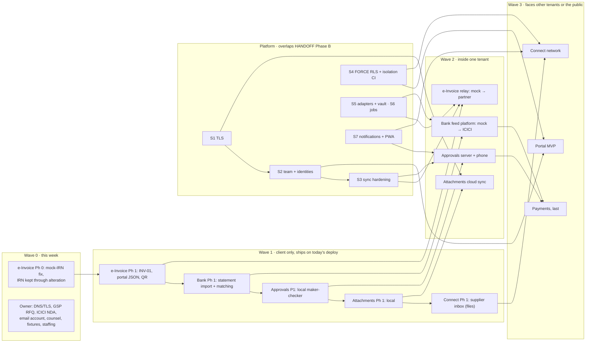

# Consultant asks of 2026-10-15: research synthesis and roadmap

> **Status:** synthesis only. Nothing in this folder is built. Written 2026-10-15.
> **Sources:** the six research docs in this folder (linked in the table below), plus `docs/HANDOFF.md` §2
> (trust map and the Phase B backlog) and `docs/ARCHITECTURE.md`.
> **Evidence:** external facts are as cited in the source docs, each of which marks what it verified and
> what it could not. This synthesis did not re-check them on the web. Codebase facts marked *(checked)*
> were re-verified against the working tree for this synthesis.
> **Classification:** approvals, attachments, the party portal and Comsky Connect are *Beyond Tally*
> capabilities. Track them under `beyond` in `docs/parity-data.json`, never in the parity percentage
> (CLAUDE.md). e-Invoicing and bank-statement import correspond to existing parity rows (`einvoice-irn`,
> `brs-auto-import`, `brs-format-config`).

---

## TL;DR

1. **All six asks have a useful MVP that needs no partner contract and no external credential.** External
   accounts are needed only for real IRNs (a GSP or IRP-integrator contract), live bank feeds (a bank or
   aggregator contract), payment links and payouts (gateway accounts), WhatsApp (Meta through a BSP), the
   Google Drive and OneDrive pickers (Google and Microsoft app registrations), and email (a cheap
   SES/ZeptoMail account).
2. **The blocker they share is ours, not a partner's.** All six run into the same gaps in our own stack:
   HTTP only, one login per tenant (no invites or roles), no `FORCE` RLS and no isolation tests or CI, no
   email sender, no secrets vault, no background jobs, and a client that never subscribes to SSE. Build
   that core once (S1–S7 below, about 8.5–11.5 engineer-weeks, mostly HANDOFF Phase B work) instead of
   six times.
3. **Sequence.** Wave 0 (this week): fix the mock-IRN compliance hazard and start every external clock.
   Wave 1: ship the client-only halves on today's deploy while the platform is built. Wave 2: the server
   features that stay inside one tenant. Wave 3: the two surfaces that face other tenants or the public
   (portal, Connect network), after an external security review. Anything that moves money comes last.
4. **Effort.** The six credential-free MVPs add up to 48–62 engineer-weeks as written, or about
   **40–57 once shared prerequisites and components are counted once**. That is roughly 6–8 months for two
   senior engineers, including integration slack. The first partner integration for each ask adds about
   10–16 engineer-weeks (payments, a second bank and cloud OCR excluded), but the calendar is set by the GSP
   contract and the bank's UAT and security review (estimated 2–3 months, unverified).
5. **Decide this week:** the TLS and hostname plan, staffing, the GSP RFQ, the pilot bank, and one voucher
   lifecycle and numbering model (pending, cancelled, burned numbers) that approvals and e-invoicing both
   depend on.

---

## 1. Roadmap at a glance

Order is the recommended start order. "W" = wave (section 4). "S" = shared platform piece (section 2).

| # | Ask → doc | Recommendation | MVP without credentials? | Owner must procure / decide | Effort: credential-free MVP → partner phases | Needs first |
|---|---|---|---|---|---|---|
| 1 | e-Invoicing → [einvoice-gsp](einvoice-gsp.md) | Stop mock IRNs reaching real prints now. Build an INV-01 v1.1 builder, a portal-assisted JSON round trip and real QR printing, then a server relay behind a GSP-agnostic adapter (mock first). Buy IRP access from one partner by RFQ. | **Yes** (Ph 0–2). Real IRNs need a contract. | GSP/IRP RFQ with an **ASP-pooled** minimum; pilot customer above ₹5 Cr AATO plus one real portal results file; `cancelled`-voucher model | 5–7 wk → +3–4.5 wk, plus 2–4 calendar weeks each for partner certification and pilot | W0 fix; W1 client half; relay in W2 after S1, S3, S5, S6 |
| 2 | Bank feeds → [live-bank-feeds](live-bank-feeds.md) | Statement import + matching + vouchers from unmatched lines first. Then the feed platform on a mock provider, and an ICICI pilot (Open as the multi-bank fallback). Not Account Aggregator. Promise "same-day", not "real-time". | **Yes** (import, matching, feed platform on mock). Live feeds need a bank contract. | Customer base by bank and entity type; ICICI developer registration + NDA; VAPT budget; confirm VM is in India; sample statements; XLSX library | 8.5–11.5 wk (+1.5–2 e-payment files) → +2–3 wk per bank adapter; bank calendar ~2–3 months | W1 import (client only); feed platform in W2 after S1, S5, S6 |
| 3 | Approvals → [approvals-workflows](approvals-workflows.md) | Maker-checker on the voucher: pending = the existing `optional` bit + an approval state, so every exclusion guard already applies. Rules are a synced master; the server is the only writer of approval state once a company syncs. Phone = PWA inbox + web push + email. | **Yes** (local + cloud in-app). Phone push needs HTTPS only; WhatsApp needs Meta. | CA view on holding sales invoices; numbering model; approver seat pricing; WhatsApp budget | 10–11 wk (P0–P2) +2.5 wk phone → +1–1.5 wk WhatsApp | W1 local; server + phone in W2 after S1, S2, S3, S7 |
| 4 | Attachments → [attachments-drives](attachments-drives.md) | Native, local-first, content-addressed files. Metadata syncs as an `attachments` table; bytes go on a separate upload channel, never `/sync/push`. Links now; Drive/OneDrive "pick and copy" later. Comsky Drive does not exist yet: build a provider seam. | **Yes** (local + VM-disk sync). Real customers' cloud uploads wait for TLS + off-box India backup; pickers need Google/Microsoft registrations. | Blob storage location + daily off-box backup in India; quotas per plan; Drive's role; Aadhaar/PAN policy | 3.6–5 wk (+1.2–1.6 wk QR/PDF capture, also credential-free) → pickers +1.5–2 wk (+ external verification); cloud OCR +1.6–2.4 wk | W1 local; cloud in W2 after S1, S9 |
| 5 | Party portal → [customer-vendor-portal](customer-vendor-portal.md) | Cloud-only, read-only, own origin, passwordless (invite → passkey or email OTP), separate identity and token audience. The server computes each party's view with our own `src/core` engines; the portal reads only that projection through a role with no access to `change_log`. | **Yes** on staging. Must not go live before TLS + own origin + external review. Email OTP needs an email account. | Portal hostname; plan gating; email provider; visibility defaults; payments route; counsel; 3–5 pilot parties | 11–14.5 wk → engagement +5–7 wk; payments +3.5–5 wk (+2–3 for Razorpay OAuth) | W3, after S1, S2, S4, S6, S10 and the external security review |
| 6 | Comsky Connect → [comsky-connect-network](comsky-connect-network.md) | Supplier Inbox from files first (e-invoice JSON and GSTR-2B rows become drafts, client-only). Then a Comsky-to-Comsky network by mutual invite; documents arrive as drafts and nothing posts without a person. GSP data (verified badge, IMS) later. | **Yes** (Ph 1–3). Only the GSTN-verified badge and IMS sync need a GSP. | Free-tier/pricing; beachhead cluster; same GSP RFQ as #1; counsel on the directory; discoverability | 10–13 wk (Ph 0–2), +4–6 wk Ph 3 → +3–5 wk GSP after contract | W1 file inbox; network in W3 after S1, S2, S4, S8, S12 |

**What "without credentials" does not mean:** none of these may carry real customers' cloud data, IRP
passwords, bank tokens or third-party parties' logins over today's HTTP-only deployment. "No credentials"
means engineering can start and be tested end to end now; it does not mean production-ready.

### Caveats per ask that change decisions

- **e-Invoicing.** Today, pressing G on the e-Invoice register writes a fabricated IRN and Ack No onto the
  real voucher, and the tax-invoice print shows them with no mock marker. Separately, altering an
  e-invoiced voucher silently drops its IRN. Tally and Zoho are each their own GSP, so their per-IRN cost
  is zero; ours is not. A per-GSTIN annual minimum would cost a small customer more than Tally's yearly
  subscription, so the pooled minimum is the make-or-break contract term. The customer picks our
  partner's name on the government portal, not "Comsky".
- **Bank feeds.** Comhard cannot be a Financial Information User on the Account Aggregator network: the
  technology provider "does not receive the consented encrypted data" ([Sahamati FAQ](https://sahamati.org.in/faq/)).
  Company, LLP and partnership accounts appear not to be live on AA (unverified), and one daily fetch costs
  about ₹150 per account per month. No Indian bank gives accounting software real-time feeds. Statement
  import alone closes parity rows and is what customers use most.
- **Approvals.** "Not in Tally" holds, but BUSY Enterprise ships approvals, so BUSY is the bar in the
  reseller channel. Holding every sales invoice for approval carries GST time-of-issue risk; gate sales
  orders, discounts or credit-limit breaches instead (CA to confirm).
- **Attachments.** [comsky.ai/drive](https://comsky.ai/drive) says Drive is "in design — no build, no
  beta". Supporting bills are books of account, so their storage and daily backup should be in India
  (Companies (Accounts) Rules as amended in 2022, per the doc's sources). A pasted Drive link is not
  evidence we hold.
- **Portal.** Among products Indian SMBs switch between, only Zoho ships a true self-service party
  portal, and its customer portal is on every plan ([Zoho pricing](https://www.zoho.com/in/books/pricing/)).
  Two security rules are non-negotiable: portal tokens must never be signed with today's `JWT_SECRET`
  without an `aud` claim, or a party could call `/sync/pull` and download the whole tenant; and raw
  vouchers never go to a party, because one bulk Receipt or Journal carries other parties' data.
- **Connect.** It does not replace GSTR-2B: input tax credit still depends on the invoice appearing there
  (s.16(2)(aa)), so Connect-booked bills stay flagged "awaiting 2B". The network is worth little until a
  cluster is on it, which is why the file inbox ships first. Cross-tenant tables must not copy the
  `ownerQ` pattern of `006_p4.sql`, which bypasses RLS.

---

## 2. Shared platform pieces (build once)

Every row below appears in two or more of the six designs, usually under a different name. Most of the
effort is already inside the per-doc estimates; building each piece once is where the de-duplication
saving in section 5 comes from. S1–S7 are the infrastructure core and overlap HANDOFF §2's Phase B list.

| ID | Piece | What it contains | Builds on (code) | Effort, and where the docs count it |
|---|---|---|---|---|
| S1 | **TLS and origins** | HTTPS on the API, HSTS, `Secure` cookies; a separate origin for the portal (and later for served user files); an explicit CORS allow-list; rate limits keyed on the socket address, because `clientIp()` trusts a spoofable `X-Forwarded-For` while `trustProxy: true` and no proxy is in front | HANDOFF Phase B #1; `backend/src/ratelimit.js:41`, `server.js:27` *(checked)* | 2–4 d dev + owner DNS action. Counted in every doc |
| S2 | **Team, identities, token audiences** | Tenant invites + member list; `requireTenantRole('owner','admin')`; `company_user_link` binding a company operator (PIN `User`) to a person's cloud account; `aud` on tenant tokens and a separate secret and audience for portal tokens; a separate `portal_identity` namespace for external parties; Connect endpoints as company-level identities | Only the owner membership is ever created (`backend/src/tenancy.js:10`); no invite route; no `aud` in `tokens.js` *(checked)* | 1.5–2 wk. Approvals P0, portal Ph 0 |
| S3 | **Sync hardening and server-authored rows** | `changeUid` idempotency on push; the v2 per-row `rejected[]` response; one push-transform hook that enforces **server-owned fields and tables** (`voucher.approval`, `einvoices`, feed-sourced `bankLines`) on both `/sync/push` and `POST /v1/:collection`; one helper that appends server rows to `change_log` (`device_id` `server` / `irp` / `bankfeed:<id>`, following REST's `api` precedent); the client subscribing to SSE; push sending the operator id | `backend/src/sync.js`, `rest.js`, `realtime.js` | 2.5–3 wk. Approvals P0/P2, e-invoice Ph 2, bank Ph 2 |
| S4 | **Isolation, audit and test harness** | `FORCE` RLS on every new table; writes that cross a boundary go through `SECURITY DEFINER` functions with a pinned `search_path`; dedicated roles (`comhard_portal`, `comhard_bankfeed`, a Connect function role); append-only audit tables with no UPDATE/DELETE grant; a cross-tenant isolation suite run against a scratch database as the **first backend CI** | `002_p2.sql` pattern; `006_p4.sql` is the anti-pattern; no `FORCE` anywhere today *(checked)* | 1–1.5 wk. Connect Ph 0, portal 1b. **Release gate for the portal and Connect** |
| S5 | **Provider adapters + secrets vault** | One convention for every external system: a registry per domain, a `mock` provider first, a shared outcome taxonomy (`ok / duplicate / rejected / auth / transient / unknown`), an append-only attempt log. One vault: AES-256-GCM envelope encryption, per-tenant data key, key-encryption key outside the database, write-only API, tenant id bound as associated data, KMS later | `backend/src/billing/provider.js` + `mock.js` (whose `verifyWebhook()` returns `true`, so it must never back an endpoint that marks money paid); vault designed in ARCHITECTURE §8, not built | ~1 wk core. e-invoice Ph 2, bank Ph 2, portal payments; also used by notifications, blob store, OCR, Connect's GSP |
| S6 | **Background jobs** | A Postgres-table queue claimed with `FOR UPDATE SKIP LOCKED` through a definer function, backoff, an advisory lock against double runs, optionally its own systemd unit; moves to the ARCHITECTURE §9 queue at scale | Nothing today | 3–5 d. e-invoice worker, bank fetch worker, portal projector, notification drain, attachment retention/GC, approval escalation |
| S7 | **Notifications + PWA shell** | A `notification_outbox` written in the same transaction as the event; channels: in-app SSE, web push (VAPID), email (SES Mumbai or ZeptoMail), WhatsApp later; per-user preferences and digest mode; minimal lock-screen payloads; links that open the app and never act on GET. Plus a manifest, service worker and phone layout | `backend/src/realtime.js` (the client does not subscribe today); no email sender in `backend/` *(checked)* | 1.5–2 wk + owner email account and SPF/DKIM. Approvals P3, portal 1.5, Connect Ph 3, e-invoice Ph 5 |
| S8 | **One Inbox** | A single keyboard-first Inbox screen with tabs by source: Approvals, Supplier documents (Connect, e-invoice JSON, 2B rows), Portal requests, e-Invoice "needs review", Bank feed exceptions. One sidebar "Awaiting you" count, one phone view | Approvals and Connect both claim the `G I` chord (section 3) | ~1 wk on top of the first inbox built |
| S9 | **Blob store** | Per-tenant content-addressed files (SHA-256), `FsBlobStore` then an S3-compatible store behind one adapter, streaming upload with server-side hash check, short-lived signed links, a storage quota (the first enforced plan limit), a nightly off-box backup in India, retention-based purge | Nothing today; `Company.logo` is a base64 data URL synced whole | Inside attachments Ph 2 (10–14 d). Later used by portal vendor uploads and server PDFs, Connect's page for non-Comsky buyers, the bill on an approval card |
| S10 | **Server-side engines and per-party ledgers** | An esbuild bundle of `src/core` for Node (as `scripts/assert/run.mjs` already does), `engine_version` stamping, a `change_log` index on `(tenant_id, tbl, doc_id, seq DESC)` (the portal and the bank feed both ask for it) plus an optional GIN index on voucher payloads. First consumer: the portal projector. Later: Connect balance statements, approval re-validation, the sync mismatch report, the ARCHITECTURE P4 report materializer | ARCHITECTURE decision log: "compile same TS, don't re-port" | 1–1.5 wk shared part; the projector itself is in the portal estimate |
| S11 | **Voucher lifecycle, numbering and drafts** | One `isInBooks(v)` exclusion helper covering optional, pending approval and cancelled; a cancelled state that keeps its number; numbers burned by e-invoicing never reissued; the client actually calling `/sync/next-number`, with the counter re-keyed to (tenant, company, type, series, FY); IRP-safe number formats (no leading 0, ≤16 characters, case-insensitive); one `draftId` prefill route into VoucherScreen for drafts from Connect, OCR, bank lines and portal payment claims | `postsToLedgers` (`src/core/accounting.ts`); `nextVchNo`/`formatVchNo` (`src/state/store.ts`); the client never calls `next-number` *(checked)* | 1.5–2 wk + one owner decision. Approvals P0/P1, e-invoice Ph 1, Connect Ph 1, bank Ph 1 |
| S12 | **One invoice document model** | A pure INV-01 v1.1 builder and validator lifted out of `src/ui/gst/einvoice.tsx` `buildPayload` (state codes via `stateCodeOf`); signed-QR decoding; e-invoice JSON and GSTR-2B parsers | `einvoice.tsx`, `src/core/gstStates.ts`, `src/ui/gst/gstr2b.tsx` | Counted in e-invoice Ph 1 and Connect Ph 1; doing it once saves about 1 wk |
| S13 | **Entitlements and metering** | Feature gates and quotas beyond `canSync`: storage, portal, Connect sending, approver seats, IRN volume, a bank-feed add-on. Receiving and downloading are never gated | `backend/src/subscription.js` `getEntitlement` (plan caps are display-only today) | 3–5 d |
| S14 | **Compliance pack (non-code)** | One counsel engagement for all six: processor clause and sub-processor list, notices and consent records, retention schedule, breach runbook, VAPT | DPDP Rules notified Nov 2025; most fiduciary duties apply from about 13 May 2027 ([AZB](https://www.azbpartners.com/bank/update-indias-digital-personal-data-protection-framework-comes-into-effect/)) | Owner and counsel time |

**Which ask needs which piece** (● needed before its server phase ships, ○ used later or optional):

| Piece | Approvals | Attachments | Portal | Connect | Bank | e-Invoice |
|---|---|---|---|---|---|---|
| S1 TLS and origins | ● | ● | ● | ● | ● | ● |
| S2 Team and identities | ● | ○ | ● | ● | ● | ● |
| S3 Sync hardening | ● | ○ | ○ | ○ | ● | ● |
| S4 Isolation, audit, CI | ● | ● | ● | ● | ● | ● |
| S5 Adapters + vault | ○ | ● | ○ | ○ | ● | ● |
| S6 Background jobs | ○ | ● | ● | ○ | ● | ● |
| S7 Notifications + PWA | ● | | ● | ● | ○ | ○ |
| S8 One Inbox | ● | ○ | ○ | ● | ○ | ○ |
| S9 Blob store | ○ | ● | ○ | ○ | | |
| S10 Server engines | ○ | | ● | ○ | | |
| S11 Lifecycle, numbering, drafts | ● | ○ | ○ | ● | ● | ● |
| S12 Invoice document model | | ○ | ○ | ● | | ● |
| S13 Entitlements | ○ | ● | ● | ○ | ○ | ○ |
| S14 Compliance pack | ● | ● | ● | ● | ● | ● |

Three consistent principles run through all six designs and should be stated once, in ARCHITECTURE:

- **Nothing posts without a person.** The server writes only its own state (approval decisions, IRN
  results, feed lines, projections, inbox documents). Vouchers are created on a device through `putDoc`,
  so the outbox, operator rights, period lock and every VoucherScreen guard still apply.
- **Comhard never holds or routes customer money.** Collecting a tenant's receivables through Comhard's own
  account would be payment aggregation, which needs RBI authorisation
  ([AZB on the 2025 PA Directions](https://www.azbpartners.com/bank/rbi-issues-consolidated-reserve-bank-of-india-regulation-of-payment-aggregators-directions-2025/)).
  Payments always use the tenant's own gateway account or the bank's own authorisation.
- **The tenant is the data fiduciary and Comhard is its processor**, except where Comhard decides purpose
  (its own users, and probably the Connect directory). Statutory retention of books overrides erasure.

---

## 3. Conflicts between the six docs to settle before anyone builds

Each doc was written alone, so they collide in places. None of these is hard; all of them would cause
merge pain or a broken key if left alone.

1. **Migration number.** All six backend designs call their file `backend/sql/007_*.sql` (`001`–`006`
   exist *(checked)*). Allocate in build order: one platform migration first (invites, `company_user_link`,
   `notification_outbox`, `push_subscription`, job table, vault tables, the `change_log` index), then one
   per feature. Approvals' `007` sketch already contains platform tables; move them. The portal also needs
   `migrate.js` to accept a no-transaction marker for `CREATE INDEX CONCURRENTLY`.
2. **Dexie version.** Five docs each claim Dexie **v8** (v7 is current *(checked)*): `einvoices`;
   `bankLines`, `bankLineStates`, `bankRules`; `approvalRules`; `attachments`, `attachmentBlobs`;
   `connectInbox`, `connectMaps`. All are additive. Bump once per feature in ship order (v8, v9, ...) and
   never let two branches both claim v8. Device-local tables (`attachmentBlobs`, `connectInbox`) stay out
   of `ALL_TABLES` and `COLLECTIONS`.
3. **`G I` is claimed twice.** Approvals wants it for the approvals inbox and Connect for the Connect
   inbox. `G_CHORDS` today holds C, H, A, W, D *(checked, `src/ui/overlays.tsx:439`)*. Resolve with the one
   Inbox (S8) on `G I`; Connect's `G N` for Connections is free.
4. **`Alt+G` proposed for bulk IRN generation clashes with a global key.** `Alt+G` is Go To everywhere
   *(checked, `src/App.tsx:108`, `overlays.tsx:469`)*. The superset rule forbids changing what it means.
   Pick another key on the register.
5. **Two names for one module.** Connect proposes `src/core/einvPayload.ts` and e-invoicing proposes
   `src/core/einvoice.ts` for the same lift of `buildPayload`. One module, owned by e-invoicing, consumed by
   Connect (S12). Signed-QR decoding is also proposed twice (attachments Ph 5a, Connect Ph 3); build it
   once. Both docs note it is unverified whether the IRP's signing public key can be obtained without API
   registration.
6. **Two meanings of "cancelled".** Approvals keeps a rejected invoice as an optional voucher in state
   `rejected`, which Docs Issued counts as cancelled. e-Invoicing proposes a Tally-style `cancelled` flag.
   Pick one lifecycle and one `isInBooks(v)` helper (S11). Until then, pending vouchers are covered by the
   `optional` bit: they are automatically invisible to the portal, bank matching, GST returns and Tally
   export, but **Connect sending and the IRN queue must check it explicitly** (a recommendation of this
   synthesis, not in either doc).
7. **Numbering is fixed in two places.** Approvals P0 re-keys `voucher_counter` and allocates numbers at
   approval (N2). e-Invoicing needs the client to stop issuing colliding numbers offline (per-device
   prefixes or `/sync/next-number`). One decision, one build (S11).
8. **Four draft paths.** Connect's `draftId` route, attachments' "Draft Transactions" screen for OCR, the
   bank's "N: new voucher from this line" and the portal's "payment claim → Receipt" all prefill a voucher.
   Build one prefill route into VoucherScreen, by hand and in sequence (HANDOFF §4), and let each source
   keep its own inbox rows.
9. **Every Wave 1 feature touches `VoucherScreen.tsx`** (status line for approvals, `Alt+U` panel,
   e-invoice status chip and field lock, draft prefill, `bankLineId`). Serialise those edits even when the
   features are built in parallel.
10. **WhatsApp pricing is quoted twice and differently:** ₹0.145 per utility message (approvals, via
    AiSensy) and about ₹0.13 (Connect, via MyOperator). Both are third-party figures not checked against
    Meta's INR rate card. Use ₹0.13–0.15 until a BSP quotes.
11. **The e-invoice code moved during research.** Another session was editing `src/ui/gst/einvoice.tsx`;
    Connect lists the state-name bug in `Stcd`/`Pos` as open, while the e-invoice doc found the working
    tree already uses state codes but still gets `Loc`, `Pin`, service lines, exports and `DBN` wrong. Treat
    the e-invoice doc's §6 as the more recent reading and re-check at build time.

---

## 4. Recommended sequence

**Wave 0, this week (1–3 engineer-days plus owner actions).**
- e-Invoice Ph 0: gate mock IRN generation to the sample company or a dev flag (or print "MOCK, NOT
  REGISTERED" and keep it out of exports), and carry `irn/ackNo/ackDate/ewayBillNo` through alteration.
  This is a compliance hazard on real invoices today.
- Correct the parity rows listed in section 6.
- The owner starts every external clock (items 7–14 in section 7). Contracts, NDAs, bank UAT and Google or
  Microsoft verification all take longer than the code they unlock.

**Wave 1, client-only features plus the platform core, in parallel.**
- *Client track* (ships on the current HTTP deploy, no server work): e-invoice Ph 1 → bank statement import
  and matching → approvals P1 (local) → attachments Ph 1 (local) → Connect Ph 1 (supplier inbox from
  files). About 15–20 engineer-weeks for one engineer. e-Invoice goes first because its INV-01 builder and
  the lifecycle decision (S11, S12) are reused by Connect and approvals. Bank import goes second because it
  is the highest daily-use value and closes parity rows.
- *Platform track* (server): S1 → S2 → S3, with S4, S5, S6 and S7 after. About 8.5–11.5 engineer-weeks.
  It is largely HANDOFF Phase B work that is needed anyway.

**Wave 2, server features inside one tenant.** e-Invoice relay on the mock provider, switching to the
partner when the contract and sandbox arrive. Attachments cloud sync, once there is an off-box India
backup. Approvals server authority, then the phone inbox with push and email. Bank feed platform on the
mock, then the ICICI adapter when UAT access arrives.

**Wave 3, surfaces that face other tenants or the public.** The portal MVP and the Connect network. Both
wait for S4's isolation suite to be green as the real app roles and for the external security review that
HANDOFF Phase B already lists. Then payments (portal payment links, RazorpayX or bank payouts) only after
approvals exist as the control; the Connect GSP phase after the RFQ; WhatsApp, Drive pickers and cloud OCR
on demand.

**Why this order.**
- A live compliance hazard (mock IRNs on real tax invoices) outranks every feature.
- External lead times exceed build times, so the clocks start in week 0 and the code is built against
  mocks meanwhile.
- The client-only halves deliver value on today's deploy and settle the shared models (lifecycle, drafts,
  invoice document) before any server depends on them.
- Within-tenant before cross-tenant: the portal and Connect are the first surfaces exposed to people who
  are not our customers, or to other tenants. They carry the highest isolation risk and need the most
  hardening.
- Money last: payments need approvals as an internal control and a signed bank or gateway partner.

**If only one engineer can be funded for about six months:** Wave 0, then S1–S3, e-invoicing Ph 0–2,
bank statement import, and approvals P1–P2. That is about 20–25 engineer-weeks (e-invoicing Ph 2 already
includes the vault and the worker). It ships the two items
with direct compliance or daily-use value and the one capability Tally lacks that the consultants named
first. The portal and Connect wait for a second engineer.

---

## 5. Effort roll-up

Estimates are each doc's own, for one senior full-stack engineer who knows this repo, working with the
AI-assisted fan-out and adversarial-review method in HANDOFF §4. Treat them as ±30%.

| Ask | Credential-free scope | Doc estimate | Shared prerequisites inside it | Partner-dependent add-ons | Calendar driver |
|---|---|---|---|---|---|
| Approvals | P0–P2 (+P3 phone) | 10–11 wk (+2.5) | P0: 3–4 wk | WhatsApp 1–1.5 wk | Team invites, TLS |
| Attachments | Ph 1–2 | 18–25 d (3.6–5 wk) | TLS (Phase B) | Drive pickers 7–10 d; cloud OCR 8–12 d | Google/Microsoft verification, 1–3 wk (unverified) |
| Portal | Ph 0 + 1a–1e | 11–14.5 wk | Ph 0: 1–1.5 wk | Payments 3.5–5 wk (+2–3 OAuth) | TLS, own origin, security review |
| Connect | Ph 0–2 (Ph 3 also credential-free, +4–6) | 10–13 wk | Ph 0: 1.5–2 wk | GSP 3–5 wk after contract | Cluster pilot; GSP contract |
| Bank | Ph 0, 1, 2 (+1b e-payment files, 1.5–2) | 8.5–11.5 wk | Ph 0: 2–4 d | ICICI 2–3 wk; second source 2–3 wk; payouts 4–6 wk | Bank NDA, UAT, security review: ~2–3 months (estimate) |
| e-Invoice | Ph 0–2 | 25–35 d (5–7 wk) | TLS: 2–3 d | Ph 3–5: 14–22 d | GSP contract + sandbox; 2–4 calendar wk each for certification and pilot |
| **Sum as written** | | **48–62 wk** | 6.5–9 wk counted | | |
| **De-duplicated** | | **≈ 40–57 wk** | ≈ 4.5–5.5 wk real | ≈ 10–16 wk for the first partner of each kind | |

How the de-duplication is computed: prerequisites are counted once instead of five times (saves about
2–3.5 weeks), and the vault, job runner, server-authored rows, inbox and INV-01 builder are each built
once (saves about 3–4.5 weeks). This is arithmetic on the docs' figures, not a new estimate. The partner
figure covers the IRN partner, one bank, Connect's GSP phase, the Drive pickers and WhatsApp; payments,
a second bank and cloud OCR would add about 11–16 weeks more (plus 2–3 for Razorpay partner OAuth).

**Not in any figure above:** the rest of HANDOFF Phase B (CI/CD beyond the isolation suite, monitoring and
alerting, a backup restore drill and PITR, load and soak tests, the external security review, live
Razorpay for Comhard's own billing). Each of the six assumes these exist before real customers rely on it.

---

## 6. Parity-board corrections found during research (not applied)

This research edits no file except this one. The owner or the next build session should apply these
(CLAUDE.md: "a status field and its note must agree"). Verified against `docs/parity-data.json` *(checked)*:

| Row | Today | Should read | Why |
|---|---|---|---|
| `einvoice-irn` | `covered`, note "No IRN/QR anywhere." | `partial` | Status contradicts its own note (e-invoice doc §6) |
| `brs-auto-import` | `partial`, note "Fully manual; no import/matching." | `missing` until statement import ships | Same contradiction (bank doc §2) |
| `brs-format-config` | `partial`, note "None." | `missing` | Same pattern; found while checking for this synthesis |
| `bank-opening-recon` | `missing` | at least `partial` | `Ledger.openingBankBalance` exists (`src/types.ts:234`) |
| `brs-bulk-date` | `missing`, "Per-row only" | `covered` once committed | `src/ui/banking/brs.tsx` ships D/C bulk stamping, but that file is **uncommitted** working-tree work *(checked)* |

---

## 7. Owner decisions and questions (consolidated)

Tags show which docs raised each item: [AP] approvals, [AT] attachments, [PO] portal, [CN] Connect,
[BK] bank feeds, [EI] e-invoicing. Items 1–6 gate engineering; 7–14 have lead times longer than the build.

### A. Decide now

1. **TLS and hostnames.** Who controls `comhard.in` DNS (a DNS API token for a DNS-01 certificate on
   `:1036`), or can port 443 be routed to the VM? Does the product stay on `books.comhard.in` (the
   CLAUDE.md identity rule) or move to a Comsky domain? The portal needs its own hostname. [all]
2. **Staffing and scope.** Two engineers for about 6–8 months for all six MVPs, or one engineer and the
   six-month cut in section 4? Add fractional DevOps and security for TLS, CI, monitoring and the VAPT.
   [HANDOFF §2]
3. **Voucher lifecycle and numbering**, one decision for approvals and e-invoicing: number at entry with a
   rejected invoice kept as cancelled with its number (approvals' N1) as the default; number at approval
   (N2) as a per-type opt-in; a Tally-style `cancelled` flag or delete plus a burned number; for
   e-invoicing companies with several devices, per-device series prefixes now or wiring
   `/sync/next-number` into the client. Ask the consultants' CA to confirm GSTR-1 Table 13 treatment.
   [AP Q2, EI Q4–5]
4. **Cloud-only features.** Is it acceptable that cross-device approvals, live bank feeds, online
   e-invoicing, the portal and Connect need a Comsky cloud account, while desktop-only installs get only
   the local and file-based halves? [AP Q8, BK Q9, EI Q3, PO]
5. **Mobile is a PWA for v1** (installed to the Home Screen; iOS 16.4+ for web push), with a native app
   deferred? [AP, AT Q11, CN Q11]
6. **Hosting facts.** Is the VM in India (banks will ask; the Companies Act backup rule needs it)? How
   much free disk and RAM (attachments; ClamAV needs 3–4 GiB)? Is the disk encrypted? [BK Q5, AT Q2/Q12,
   EI Q10]

### B. Procure or start now

7. **One GSP RFQ** covering IRN, EWB by IRN, GSTR-2B/IMS, taxpayer search and OTP auth, so it serves
   e-invoicing and Connect Ph 4. Ask for an ASP-pooled minimum, NIC1/NIC2 failover, India-only DPA and a
   no-storage tier. Does the Tally-partner business already have a GSP relationship (Webtel, Masters
   India)? Also try the IRIS and Clear IRP integrator sandbox sign-ups. [EI Q1, CN Q4]
8. **Pilot bank.** Count the customer base by bank and by entity type (proprietorship vs partnership, LLP,
   Pvt Ltd). Register Comhard on ICICI's developer portal, sign the NDA, name a security contact and a
   grievance officer, and open a Comhard current account at the pilot bank for UAT. Hold a parallel
   commercial conversation with Open. [BK Q1–3]
9. **Email sender.** An SES (ap-south-1) or ZeptoMail account, plus SPF, DKIM and DMARC on the sending
   domain. [AP, PO Q7]
10. **Security budget.** A VAPT by a CERT-In-empanelled auditor before the bank pilot and the portal
    launch. [BK Q4, PO]
11. **Counsel**, one engagement covering every item in group E. [all]
12. **Fixtures and pilots.** 2–3 anonymised statements per top bank; one sanitised e-invoice portal
    results file; about 200 anonymised purchase bills for an OCR bake-off; 3–5 portal pilot parties; one
    distributor-and-retailers cluster for Connect; one e-invoicing pilot customer above ₹5 Cr AATO.
    [BK Q11, EI Q7, AT Q9, PO Q12, CN Q3]
13. **Storage.** VM disk first, Comsky Cloud's S3-compatible storage (internal price? presigned URLs, CORS
    and versioning?), or AWS Mumbai? Where does the daily off-box backup in India go (Comsky Backup?).
    [AT Q2]
14. **Only if Drive pickers are wanted in year one:** a Google Cloud project with a Search-Console-verified
    domain and brand verification; an Entra app registration and a Microsoft Partner One ID for publisher
    verification. Which Google account and which Entra tenant own them? [AT Q7]

### C. Product policy (consultants and their CA)

15. **Approvals.** Which voucher types first (proposed: Purchase, Payment, Journal and notes held; Receipt
    and Contra post-then-review; Sales gated by orders, discounts or credit-limit breaches, not every
    invoice)? Self-approval off, "Final approve" with a reason, an approver who wants to edit sends it back,
    escalate but never auto-reject, approval inside a locked period, the lock-screen privacy default, and
    master approvals (GST rate and HSN changes) later? [AP Q1, Q3–4, Q9–12]
16. **e-Invoicing.** Should IRN cancellation (24-hour window) need owner approval by default? Should
    DBN e-invoicing apply only to debit notes against sales, since a Debit Note here is often a purchase
    return? [EI Q6, Q8]
17. **Portal.** Customers first or both? Visibility defaults (narration and particulars off, credit limit
    hidden, history window)? Who may manage access? What happens when the tenant's subscription lapses? Do
    audit clients want balance confirmation? [PO Q2, Q4–6, Q10]
18. **Connect.** Auto-send default, what the sender may see ("seen", "accepted then removed"), narration
    sharing, and discoverability (exact-GSTIN lookup only is recommended)? [CN Q5–6, Q8–9]
19. **Attachments.** Limits (10 MB per file, 20 per voucher), HEIC, adding attachments inside a locked
    period, link-only attachments for Companies Act clients, and whether Aadhaar or PAN copies are allowed
    at all. [AT Q5–6, Q8, Q10]
20. **Invoice bank details and terms** are device-local today (`src/ui/print/bankStore.ts`,
    `termsStore.ts`). May they become a synced company setting? The portal needs it, and so does the
    separate "customise the invoice" ask. [PO Q9]
21. **New dependencies** to approve: an XLSX parser (or CSV-first), a zip library (fflate), a QR encoder
    and decoder, `web-push`, `@simplewebauthn/server`. [BK Q10, AT, EI, AP, PO]

### D. Commercial

22. **Packaging, and enforcing it.** Approver seats; storage per plan; portal plan gating and party caps;
    Connect receiving free with sending paid, plus a `connect_free` tier; e-invoicing passed through or
    bundled; bank feeds as an add-on passing on bank fees; OCR metered. Every one of these needs new
    backend enforcement, because today only `canSync` is enforced. [AP Q5, AT Q4, PO Q3, CN Q1–2, EI Q2,
    BK Q6]
23. **Payments in year one at all?** If yes: tenant-pasted gateway keys or a Razorpay Technology Partner
    agreement; RazorpayX payouts; Cashfree or PayU as alternatives. [BK Q7, PO Q8]
24. **WhatsApp:** budget, one platform number or per-tenant numbers, and which BSP. [AP Q7]
25. **Strategic.** Should Comsky Drive become Books' document store (shared bucket layout and identity) or
    only a picker source, and who owns its API timeline? Is a lending or NBFC partnership on the roadmap
    (the only realistic Account Aggregator route)? [AT Q3, BK Q8]

### E. Counsel

26. The processor clause and sub-processor list in the ToS/DPA (email provider, GSP, BSP and Meta, bank
    partner, Open, any OCR vendor); the portal's first-login notice and whether consent or legitimate use is
    the basis; Comhard as fiduciary for the Connect directory; wording on Rule 48(5) and on pending invoices
    not being valid; the DPA with the GSP; Aadhaar copies under UIDAI rules; the evidentiary weight of a
    portal balance confirmation; one retention schedule (attachments 8 financial years, Connect payloads 13
    months then hash only, bank lines, portal IP logs 1 year, approval records for the statutory period);
    and a breach runbook (Data Protection Board without delay plus a report within 72 hours; CERT-In within
    6 hours). [all]
27. Is AI extraction of bills outside India acceptable with tenant opt-in, and with which vendor? [AT Q9]

---

## 8. Outside this research set

The consultants' other 2026-10-15 asks are parity and engine work and were not researched here: direct
CSV/XML export into Tally, HSN and GST-rate effective dates with an invoice-level override, Shift+Enter
expansion in reports, customisable dashboard, reports and invoice, a richer stock summary, a Comsky-vs-Tally
transaction checker, company split, stock-valuation parity, and an offline/online sync mismatch report.

Where they touch this set:
- **The sync mismatch report** is fed by four designs here: approvals' compensating re-puts, bank-match
  conflicts, the portal's "behind this device" indicator and Connect's balance gaps. Design its data model
  together with S3 and S10.
- **Invoice customisation** needs bank details and terms to become synced settings (item 20) and benefits
  from the portal's store-free invoice sheet.
- **GST-rate and HSN effective dates** are in approvals P5 (master approvals), and e-invoicing needs
  6-digit HSN above ₹5 Cr AATO.
- **Tally export** must skip pending vouchers (approvals); Connect proposes an experimental Tally-XML
  purchase export for buyers who are not on Comsky.
