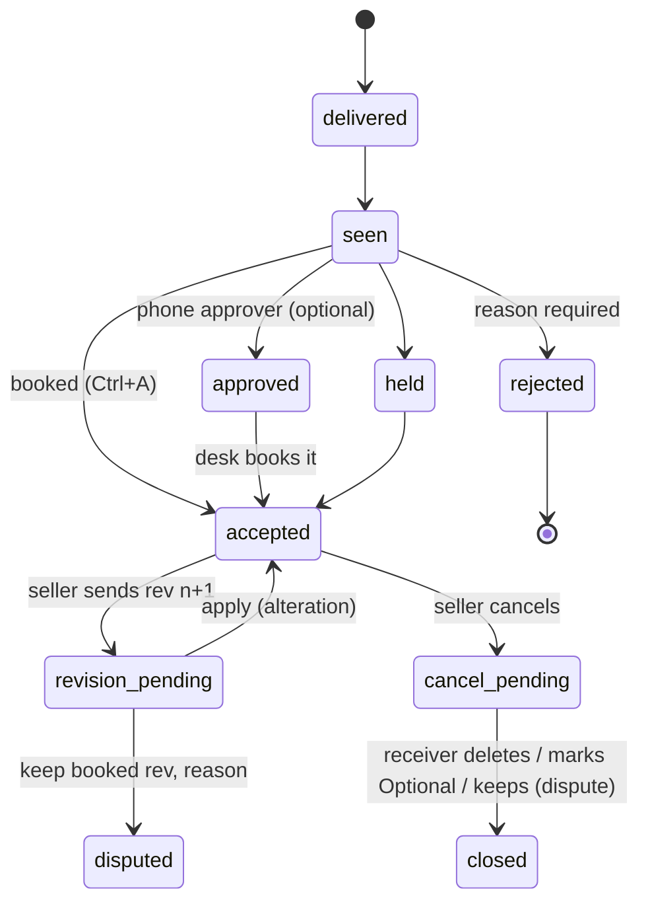

# Comsky Connect: a seller's sale becomes the buyer's purchase draft

> **Status:** research + design, decision-grade. **Date:** 2026-10-15. **Scope:** one ask from the
> consultants' 2026-10-15 list (below). Nothing here is built. Code references are to `main` as of
> commit `7927626` plus the uncommitted working tree.
>
> **The ask (verbatim):** "If two businesses both use Comsky and one makes a sale to the other, the
> buyer should get a notification (if they have linked with the seller as vendor/customer) so the
> reverse transaction (purchase, payment received, inward/outward) is reflected easily."

---

## 0. TL;DR

1. **Build it in two credential-free steps, then add GSTN data.** Step 1 is a **Supplier Inbox** that turns
   e-invoice JSON files and GSTR-2B rows the buyer already has into **draft** purchase vouchers. It runs
   entirely in the client and needs no backend. Step 2 is **Comsky Connect**: two companies link by mutual
   invite, and the seller's invoices, notes, delivery notes and payment advices arrive in the buyer's inbox
   with item lines. The buyer maps and accepts each one into a voucher. Nothing ever posts without a person.
2. **One inbound pipeline, many sources.** Connect documents, e-invoice JSON, QR scans and GSTR-2B/IMS rows
   all normalise to one canonical document (e-invoice INV-01 shape plus a Comsky extension). They share one
   mapper that learns party, item, ledger and unit mappings per counterparty GSTIN.
3. **Connect does not replace GSTR-2B.** Under s.16(2)(aa), input tax credit still depends on the invoice
   appearing in GSTR-2B. Connect is a faster, item-level data-entry source, and each booked bill stays
   flagged "awaiting 2B" until the existing reconciliation (`src/ui/gst/gstr2b.tsx`) matches it.
4. **Blockers are ours, not a partner's.** A cross-tenant feature cannot ship on the current HTTP-only,
   demo-grade backend (HANDOFF §2 trust map). Before launch we need TLS, `FORCE` RLS on the new tables and a
   cross-tenant isolation test. **GSP/ASP credentials are needed only for phase 4**: the GSTN-verified badge,
   IMS sync and auto-fetching supplier e-invoices.
5. **Effort:** about 10-13 engineer-weeks to reach a working Comsky-to-Comsky network (phases 0-2), plus 4-6
   weeks for payments and mobile, plus 3-5 weeks of GSP work once a contract exists.

---

## 1. What the ask really needs

### 1.1 The problem underneath

Every B2B transaction between two Indian SMBs is typed **twice**: once as the seller's Sales, once as the
buyer's Purchase. Some of it is typed a third time, by the buyer's accountant, when GSTR-2B does not match.
The double entry causes three costs that the consultants see every day:

- **Keying time and errors.** Wrong rate, wrong HSN, or a transposed invoice number that breaks 2B matching.
- **ITC leakage.** A bill that is keyed late or wrong misses the GSTR-3B cycle.
- **Balance disputes.** At year-end the two parties' ledgers disagree and a CA chases balance confirmations.

The ask names three reverse transactions:

| Seller does | Buyer should get | Accounting type |
|---|---|---|
| Sales invoice | Purchase draft | stock + accounting |
| Payment received, or rather **buyer pays** | Receipt draft at the **seller** (payment advice) | accounting |
| Delivery note (outward) | Receipt note draft (inward) | stock only |

So the flow is **bidirectional**: whoever creates the document sends it, and the counterparty receives it.

### 1.2 What the buyer already gets from the government, and why that is not enough

| Source | What it carries | Latency | Who it covers | Credentials to automate |
|---|---|---|---|---|
| **GSTR-2B** | Invoice-level header and **rate-wise** taxable value and tax. **No HSN, item, quantity or unit.** b2b fields per a GSP's schema doc: `ctin, trdnm, inum, typ, dt, val, pos, rev, itcavl, rsn, srctyp, irn, items[num, rt, txval, igst, cgst, sgst, cess]` ([Vayana GSTR-2B API doc](https://docs.enriched-api.vayana.com/routes/basic/gstn/apis/returns/Gstr-Download-Lite-Api/gstr-2b/)) | Monthly. Generated on the 14th from what suppliers filed ([GSTN Nov-2024 newsletter](https://gstcouncil.gov.in/sites/default/files/2025-01/november_2024_newsletter.pdf)) | Every registered supplier that files GSTR-1/IFF | Manual JSON download: none. API: GSP + taxpayer OTP |
| **IMS** (Invoice Management System) | The same records, near real time, with Accept / Reject / Pending actions. No action means deemed acceptance ([Tally on IMS](https://tallysolutions.com/gst/ims-impact-on-gstr-2b-gstr-3b/), [Tally Oct-2025 changes](https://tallysolutions.com/gst/gst-return-filing-critical-changes/)) | As soon as the supplier **saves** in GSTR-1/IFF/1A ([Zoho IMS FAQ](https://www.zoho.com/in/books/academy/taxes-and-compliance/ims-in-gst.html)) | Same | Portal UI: none. API: GSP + OTP |
| **e-Invoice JSON** (IRP) | **Item level**: HSN, description, quantity, unit, rate, tax, plus a signed JWT | At IRN generation (same day) | Only suppliers above the ₹5 crore AATO e-invoice threshold, since 1 Aug 2023 ([EY alert](https://www.ey.com/en_in/alerts-hub/2023/05/cbic-lowers-turnover-threshold-for-e-invoicing-to-inr5-crores-with-effect-from-1-august-2023)) | Manual download from the e-invoice portal: recipient login only. Since Oct 2023 recipients can download single or monthly bulk JSON, **available for 6 months** ([Sovos](https://sovos.com/regulatory-updates/vat/india-new-e-invoice-download-functionality/)). API: GSP |
| **Signed QR** on the printed invoice | Seller and buyer GSTIN, document number, type, date, value, line count, main HSN, IRN (JWT, SHA256-RSA) ([Masters India](https://www.mastersindia.co/gst/signed-qr-code-e-invoicing-system/)) | At receipt of goods | e-invoiced suppliers | None (camera) |
| **Comsky Connect** (proposed) | Everything on the invoice **plus** the seller's item identity, batch/expiry, bill-wise due date, order reference, and payments, notes, delivery notes and orders | Seconds after the seller saves | Only counterparties who are on Comsky and linked | None external |

**Conclusions:**

- The government rails give the buyer **truth for ITC** (2B/IMS) but not **data for entry**. GSTR-2B has no
  items, and the e-invoice JSON only exists for suppliers above ₹5 crore.
- Payments, delivery notes, orders and unregistered or small suppliers are carried by **no** government
  rail.
- Connect's value is therefore: **item-level, same-day, full document set, any size of counterparty.** Its
  limit is that both sides must be on Comsky. That is why step 1 (file-based sources) must ship first:
  it gives value from day one with zero counterparties on the network.

### 1.3 User stories

Personas: **S** = seller company's operator, **B** = buyer company's operator, **O** = owner or approver
on a phone, **CA** = the accountant serving both.

1. **Link (S or B).** From a party ledger (Sundry Debtors or Creditors) that has a GSTIN, I press one key to
   "Invite to Connect". I get a link or code to send by email or WhatsApp. When the counterparty accepts, the
   ledger shows "Connected" and which documents flow (invoices, notes, payments, delivery notes).
2. **Send (S), keyboard-first.** I save a Sales voucher with Ctrl+A as always. If the party is linked and
   auto-send is on, it goes, and a toast says "Sent to Sharma Traders via Connect". Otherwise one key sends
   it from the voucher, or from Day Book on a selected row. No new prompt is inserted into the frozen
   voucher field order.
3. **Receive (B).** The sidebar "Today" shows "3 bills from suppliers". `G` then `I` opens **Connect Inbox**
   (proposed chord, free in `G_CHORDS`, `src/ui/overlays.tsx`). Arrow keys walk the list. Enter opens the
   **prefilled Purchase voucher in the normal VoucherScreen**, so every existing guard applies. Ctrl+A books
   it and marks the document Accepted.
4. **Map once, never again (B).** The first bill from a supplier asks me to map their "Tata Salt 1kg" to my
   "Salt - Tata 1 Kg" and their 18% lines to my "Purchase @18%" ledger. The second bill arrives fully mapped,
   and anything guessed rather than remembered is highlighted.
5. **Already keyed (B).** If I keyed the bill by hand before the Connect copy arrived, the inbox says
   "Looks like Purchase #212 of 3 Oct" and offers **Link** instead of creating a duplicate.
6. **Seller corrects (S → B).** The seller alters an invoice I have already booked. My inbox shows
   "Revision 2" with a field diff. I apply it (an alteration through the normal path) or dispute it. My books
   never change by themselves.
7. **Seller cancels (S → B).** My inbox flags "Cancelled by seller" against Purchase #212. I decide whether
   to delete it, keep it (dispute) or mark it Optional.
8. **Pay and advise (B → S).** I record a Payment against the supplier's bill, deducting TDS u/s 194Q. The
   seller receives a payment advice (UTR, bill allocations, TDS). Accepting it drafts their Receipt:
   Dr Bank, Dr TDS Receivable, Cr Party, Agst Ref to their own invoice.
9. **Approve on the phone (O).** On my phone (the SPA as a PWA) I see the inbox and press Approve, Reject
   (with a reason) or Hold. Approved documents with complete mappings are booked by the next desktop session
   and appear in Today. This ties to the separate voucher-approvals ask.
10. **Non-Comsky supplier (B).** I drop a month's e-invoice JSON (downloaded from the e-invoice portal), or a
    GSTR-2B JSON, onto the inbox. Item-level drafts come from the e-invoice. Header plus rate-wise drafts come
    from 2B "Only in 2B" rows.
11. **Non-Comsky buyer (S).** My customer is not on Comsky. Sending emails them the PDF, an e-invoice-shaped
    JSON and an invite: "Get bills from all your suppliers automatically". This is the growth loop (§4.13).
12. **Balance confirmation (CA).** For any linked pair, both sides see "your books say ₹4,12,300 Cr; theirs
    say ₹4,07,300 Dr; the difference is Debit Note DN/07 not yet accepted". This also feeds the separate
    sync-mismatch ask.

### 1.4 Non-goals (v1)

- **No auto-posting** into the receiver's books, ever. Draft and review is what Xero and QuickBooks also do
  (§2.3).
- **No money movement.** Connect carries payment *advice*, not payments, so no RBI licence is needed (§5.6).
- **No open, Peppol-style protocol.** India is not on Peppol (§2.3). The canonical model is designed so an
  access point could be added later.
- Not a replacement for IMS actions on the GST portal, and not an IRN generator (that is the separate
  e-invoicing ask).

---

## 2. Landscape (researched 2026-10-15)

### 2.1 Indian statutory rails and access model

- **e-Invoice (IRP).** Mandatory above ₹5 crore AATO since 1 Aug 2023 (Notification 10/2023-CT,
  [EY](https://www.ey.com/en_in/alerts-hub/2023/05/cbic-lowers-turnover-threshold-for-e-invoicing-to-inr5-crores-with-effect-from-1-august-2023)).
  For AATO of ₹10 crore and above, documents must be reported **within 30 days** of their date, enforced at
  the IRP from 1 Apr 2025 ([Taxmann](https://www.taxmann.com/post/blog/time-limit-of-30-days-for-reporting-e-invoice-on-irp-portal-for-taxpayers-with-aato-of-10-crores-and-above-gstn-update/)).
  Recipients can download e-invoices issued to them (single as PDF or JSON, monthly bulk as JSON). The JSON
  is retained for 6 months, and the same is reachable "via API calls through ... GSPs"
  ([Sovos](https://sovos.com/regulatory-updates/vat/india-new-e-invoice-download-functionality/),
  [ClearTax](https://cleartax.in/s/e-invoice-download)).
  API access routes are direct (large taxpayers), via a GSP, or via a GSTN-identified ERP, with sandbox
  testing first ([ClearTax](https://cleartax.in/s/e-invoicing-api-integration-modes)).
- **Signed invoice and QR.** The QR is a JWT signed by the IRP (SHA256-RSA), verifiable offline with the
  GSTN-provided public key ([Masters India](https://www.mastersindia.co/gst/signed-qr-code-e-invoicing-system/)).
  *Not verified:* where an ASP without IRP API credentials can obtain the current public key. Treat
  signature verification as phase 4 until confirmed.
- **GSTR-2B and IMS.** IMS has been live since 14 Oct 2024. Recipients accept, reject or keep pending the
  records suppliers saved or filed in GSTR-1/1A/IFF. GSTR-2B is generated on the 14th from those actions, and
  actions can change until GSTR-3B is filed, with a recompute
  ([GSTN newsletter Nov 2024](https://gstcouncil.gov.in/sites/default/files/2025-01/november_2024_newsletter.pdf),
  [GSTN advisory 13-11-2024 via taxo](https://taxo.online/latest-news/13-11-2024-advisory-regarding-ims-during-initial-phase-of-its-implementation/)).
  From October 2025 credit notes can be held pending and ITC can be reversed partially
  ([Tally](https://tallysolutions.com/gst/gst-return-filing-critical-changes/)). *Not verified* against a
  primary GSTN source as of today.
- **ITC condition.** s.16(2)(aa) CGST, in force since 1 Jan 2022, allows ITC only when the supplier has
  furnished the invoice and it is communicated to the recipient, in practice via GSTR-2B
  ([TaxGuru](https://taxguru.in/goods-and-service-tax/restriction-avail-itc-section-16-2-aa-cgst-act.html)).
  **Design consequence:** a Connect-booked bill is not ITC-eligible until 2B matches it.
- **GSP/ASP model.** Third-party software reaches a taxpayer's GST data only through a GSTN-licensed **GSP**.
  The taxpayer enables API access on the portal (Profile > Manage API Access), picks the GSP-ASP pair and a
  session of 6 hours to 30 days, and approves with an OTP to the GST-registered mobile
  ([Tally](https://tallysolutions.com/gst/how-to-view-and-manage-asp-access-on-the-gst-portal/),
  [Quicko](https://learn.quicko.com/gst-portal-manage-api-access)).
  **This OTP is the only strong, government-backed proof that a user controls a GSTIN** (§5.2).
- **Public taxpayer search.** The "Search Taxpayer" public API returns legal and trade name, status,
  constitution, registration date and addresses without consent, but **only via a GSP**, and it returns **no
  email or mobile** ([Vayana docs](https://docs.enriched-api.vayana.com/routes/basic/gstn/apis/public/Search-Taxpayer/0-search-taxpayer-vthree-oh/)).
  So public data cannot be used to send a verification code to a GSTIN's owner.

### 2.2 Indian competitors: what they actually ship

| Product | Party-to-party exchange? | What they do instead | Evidence |
|---|---|---|---|
| **TallyPrime** | **None found.** Tally "Synchronisation" (Tally.NET / IP sync) moves masters and vouchers between **locations of the same business** (HO and branch), client-server, needs the same release on both ends | Downloads IMS inward invoices after a GST-portal login + OTP, then accept/reject/pending, recompute 2B, upload IMS actions; GSTR-2B reconciliation; "GST portal view" of a voucher. 7.0 adds JSON data exchange and PrimeBanking | [IMS download](https://help.tallysolutions.com/download-ims-inward-invoices/), [Manage IMS](https://help.tallysolutions.com/tally/manage-ims-inward-supplies/), [Sync](https://help.tallysolutions.com/tally-prime/data-management/synchronise-data/), [7.0 notes](https://help.tallysolutions.com/release-notes-tallyprime-7-0). Sales-to-purchase mirroring exists only as bespoke TDL add-ons (freelance listings; not verified as products) |
| **BUSY** | None found | GSTR-2B download (OTP or manual) and reconciliation; e-invoice JSON is **outward only**; its FAQ says e-invoices cannot be reconciled in BUSY; Excel voucher import | [2B FAQ](https://busy.in/faqs/how-to-import-purchase-data-in-busy-for-reconcilation-with-gstrb-answerid-56038/), [e-invoice FAQ](https://busy.in/faqs/taxation/e-invoice-generation/58/) |
| **Marg ERP** | Reportedly "Purchase Import" of a supplier's sale bill (pharma/FMCG distribution) | **Not verified.** Only a third-party listing mentions it ([alternatives.co](https://alternatives.co/software/marg-erp/about/)); no Marg documentation found | Treat as unverified |
| **GoFrugal** | File-based: per-distributor field-mapping template plus an item-mapping step, Excel/CSV, reused per distributor | This is the closest Indian precedent to our **learned mapping** | [GoFrugal purchase import](https://community.gofrugal.com/portal/en/kb/articles/purchase-import) |
| **Zoho Books (India)** | **No cross-organisation mirroring.** Zoho says invoices across orgs must be handled separately; import is the workaround. Auto bill creation exists only via **Peppol** in Peppol countries | GSTR-2B reconciliation. **Vendor portal**: vendors upload invoice PDFs/images, the buyer accepts and they become bills | [Zoho KB](https://www.zoho.com/books/kb/invoices/invoice-between-organizations.html), [Vendor portal](https://www.zoho.com/in/books/help/vendor-portal/), [community request](https://help.zoho.com/portal/fr/community/topic/automated-intercompany-transaction?page=58) |
| **Vyapar / myBillBook** | Nothing found in this research | Not researched further | Unverified |

**Reading:** no Indian desktop-class product ships a native "my sale becomes your purchase draft" network.
Everyone, Tally included, routes the buyer through GSTN data (header and rate-wise) or through file import
plus mapping. That gap is real. It is also not permanent: Tally's 7.0 JSON exchange would let it add one.

### 2.3 Abroad: the precedents for exactly this

- **Xero Network Key (Xero-to-Xero).** Each organisation has a private key and shares it with a
  counterparty. The sender stores the key on the contact, and an approved invoice lands in the recipient's
  Xero as a **draft bill**, which the recipient codes and approves. Sharing a key grants no login or data
  access ([third-party KB](https://helpdesk.scoutsqld.com.au/portal/en/kb/articles/xero-to-xero),
  [Standard Ledger](https://support.standardledger.co/knowledge/how-can-i-send-invoices-from-xero-to-another-xero)).
  User reports say it was missing in Xero's "New invoicing", and AU/NZ/UK users are steered to Peppol
  eInvoicing instead ([Xero ideas forum](https://productideas.xero.com/forums/939198-for-small-businesses/suggestions/47768777-xero-to-xero)).
  **Lesson:** a closed network gets superseded once an open, government-backed rail exists. In India that
  rail is IRP plus IMS, and it already carries invoice data, so Connect must lean on it, not compete with it.
- **QuickBooks Business Network (US).** Connected businesses send invoices that become **bills "for
  review"** in the other company's QuickBooks Online. When paid via QuickBooks Bill Pay, the payer's invoice
  is marked paid on the other side. Users can hide their business from network search. It was free with QBO
  at launch and extended to all accountant firms from October 2025
  ([Intuit press release](https://investors.intuit.com/news-events/press-releases/detail/86/intuit-quickbooks-business-network-to-accelerate-and-automate-b2b-payments-for-millions-of-u-s-businesses),
  [CPA Practice Advisor 2022](https://www.cpapracticeadvisor.com/2022/04/11/new-quickbooks-business-network-automates-and-streamlines-collaboration-for-quickbooks-online-customers/48932/),
  [Intuit ProAdvisor handout Sep 2025](https://staticassets.goldcast.io/public_images/organization/c1847aac-670a-476f-9c63-ad93ce43b7eb/PVuaz3W2RbiLBCXnLLir_September2025__ProAdvisor_InTheKnow_Handout.pdf)).
  The "4.5 million members" figure is press coverage, not verified
  ([Nasdaq](https://www.nasdaq.com/articles/intuit-intu-ups-quickbooks-business-networks-availability)).
  **Lessons:** consent-based connection, draft-for-review, an opt-out of discoverability, and payment status
  flowing back to the seller.
- **Peppol (EU/APAC).** A four-corner model: sender, sender's access point, receiver's access point,
  receiver. Routing goes through SML/SMP lookup, transport is AS4, and the Peppol Directory is a public search
  ([e-rechnung-bund.de](https://e-rechnung-bund.de/en/faq/peppols-technical-solution-the-four-corner-model/),
  [eConnect](https://econnect.eu/en/docs/knowledge/peppol/what-is-peppol/peppol-explained)).
  Belgium made domestic B2B e-invoicing mandatory from 1 Jan 2026, with Peppol as the default
  ([Forvis Mazars](https://www.forvismazars.com/be/en/insights/newsletters-client-alerts/newsletters/mandatory-b2b-e-invoicing-in-belgium)).
  **India is not on Peppol.** Its e-invoicing is a national clearance model through the IRP
  ([Qvalia 2026 country guide](https://qvalia.com/peppol-global-reach-2026-the-complete-country-guide/);
  no primary OpenPeppol member list was checked).
  **Lesson:** keep our envelope format-neutral and route by identifier (GSTIN), the way Peppol routes by
  participant ID, so an access point can be added if India ever joins.

### 2.4 B2B networks and partners in India

- **Vayana Network** is a GSP (claims more than 20% e-invoicing share, self-reported) and a trade-finance
  network that "authenticates transactions between buyers and sellers" for lenders. It also sells a
  QR / e-invoice verification API ([Entrepreneur](https://india.entrepreneur.com/finance/vayana-network-raises-inr-283-crore-in-series-c-round/396719),
  [Vayana verify-QR API](https://docs.enriched-api.vayana.com/routes/enriched/Trade-Verification-Service/Verify%20EInvoice/apis/Verify-Qrcode/verify-qrcode/)).
  It is relevant as a **GSP candidate** and as a later **invoice-financing** partner: a buyer-accepted Connect
  invoice is a strong financing signal. It does not replace Connect.
- **Other GSPs** (Quicko, ClearTax, Masters India, IRIS, Adaequare). Quicko documents metered per-call
  billing for ASPs with a one-time onboarding fee and an annual fee, and lists GSTR-2B and "fetch e-invoice
  data for the last 6 months" APIs ([Quicko billing](https://help.quicko.com/portal/en/kb/articles/understanding-quicko-gsp-billing-for-asps),
  [Quicko APIs](https://help.quicko.com/portal/en/kb/articles/gst-apis-available-via-quicko-gsp)).
  **No GSP publishes per-call prices.** A quote is needed (§8).
- **Tally partner ecosystem.** The owner's own channel. Distributor-and-retailer clusters (pharma, FMCG,
  hardware) are where "purchase import" already has demand (GoFrugal, and reportedly Marg). That is the
  natural beachhead (§4.13).

### 2.5 Cost lines

| Item | Needed for | Cost | Confidence |
|---|---|---|---|
| Our own infra (Postgres, Fastify) | Phases 1-3 | Marginal on the existing VM | Known |
| TLS certificate | Phase 0 (blocker) | Free (Let's Encrypt DNS-01). Needs a comhard.in DNS API token, which is **internal** | Known (HANDOFF §2) |
| Email (invites, notifications) | Phase 2 (optional; copy-link works without it) | Low, SMTP/SES-class | Not researched |
| Web Push (PWA) | Phase 3 | Free. VAPID keys are self-generated; iOS needs an installed PWA | Known (standard) |
| WhatsApp utility template | Phase 5 (optional) | About ₹0.13 per message in India since the July 2025 per-message pricing, plus a BSP fee; Meta INR billing becomes mandatory in 2027 | Third-party figure ([MyOperator](https://support.myoperator.com/portal/en/kb/articles/whatsapp-has-shifted-to-per-message-pricing-effective-july-1-2025-based-on-message-categories-and-your-recipient-s-country-in-india-there-are-three-paid-categories), [Meta pricing](https://developers.facebook.com/docs/whatsapp/pricing)) |
| GSP (ASP partnership) | Phase 4 | One-time onboarding + annual + metered per call (Quicko model). One third-party site quotes a ClearTax compliance bundle "from ₹7,777/month" | **Unverified; get quotes** ([rfp.wiki](https://www.rfp.wiki/accounting-finance/tax-software/avalara/cleartax)) |
| Peppol access point | n/a | n/a for India | n/a |

---

## 3. Options compared

| # | Option | What the buyer gets | Effort | External cost | Dependency | Risk |
|---|---|---|---|---|---|---|
| A | **Status quo**: 2B recon only (exists: `src/ui/gst/gstr2b.tsx`) | Match/mismatch report; keys every bill by hand | 0 | 0 | none | Falls behind; consultants' ask unmet |
| B | **Supplier Inbox from files**: e-invoice JSON (single/bulk) + GSTR-2B "Only in 2B" become **drafts**, with learned mapping | Item-level drafts from suppliers above ₹5 cr; header-level from everyone else | 3-4 wk | 0 | none (manual portal download by the user) | Low. Client-only, offline, reversible |
| C | **Comsky Connect** native network: invite-linked companies exchange invoices, notes, DN/RN, payment advice | Same-day, item-level, full document set, any size of counterparty | 5-7 wk (after phase 0) | ~0 | **TLS + RLS hardening** (internal) | Medium. Cross-tenant security; cold-start network effect |
| D | **GSP-powered auto-fetch**: IMS + recipient e-invoice download + GSTN-OTP verification | B without the manual download, nightly; IMS actions from inside Comsky | 3-5 wk + contract lead time | GSP fees (unquoted) | GSP/ASP contract; each customer enables API access + OTP every ≤30 days | Medium. Vendor lock-in, OTP friction, per-call cost |
| E | **Partner network** (e.g. a GSP's B2B / financing network) | Depends on the partner | 2-4 wk integration | Revenue share / fees | Contract; their roadmap | High strategic risk: our moat lives in someone else's network |
| F | **Open protocol / Peppol-style AP** | Interop with non-Comsky software | 8+ wk | AP certification | India not on Peppol | Premature |

**Recommendation: B, then C, then D.** B and C need no external credentials. C reuses B's pipeline and
mapper. D adds coverage and the verified badge once a GSP is contracted. E only for financing, later.
F not now, but the envelope keeps it possible.

---

## 4. Recommended architecture on our stack

### 4.1 Principles

1. **The server is a mailbox, not a bookkeeper.** It stores and routes signed-off documents between consenting
   companies. It never writes into a receiver's books. Vouchers are created by the receiver's client through
   `putDoc`, so the outbox, audit trail, operator rights (`checkWrite`), period lock and every VoucherScreen
   guard apply unchanged. This also respects ARCHITECTURE.md §5: "engines stay client-side".
2. **Draft, never post.** Accepting means "open the prefilled voucher, and Ctrl+A books it". A batch accept
   exists only for fully-mapped documents with no warnings, as one undo step.
3. **One pipeline, many sources.** Connect, e-invoice JSON, QR, GSTR-2B and (later) IMS all become a
   **Canonical Document (CDM)**, then go through the **mapper**, then a **draft voucher**.
4. **Pairwise consent.** A link is between two **companies** (`tenant_id` + `cid` + GSTIN), not two tenants.
   One tenant can hold many companies (ARCHITECTURE §4). Either side can pause or revoke.
5. **Shared envelope, private receipt.** The sender sees only what it needs (delivered, accepted, rejected
   and reason). The receiver's voucher id, ledgers and mappings never cross back.
6. **Every inherited value is visible.** This is the Phase-20/21 GOTCHA ("A carried/held value must always be
   visible"): the draft banner names the source, and every guessed mapping is highlighted.

### 4.2 Concepts

| Concept | Meaning | Lives in |
|---|---|---|
| **Endpoint** | A company that opted into Connect: `(tenant_id, cid, gstin, display_name, trust_level)` | server `connect_endpoint` |
| **Link** | A consented relationship between two endpoints, with role (A is B's customer / vendor / both), scopes (invoices, notes, payments, DN/RN, orders, statements), status, auto-send | server `connect_link` |
| **Document** | An envelope `(link, kind, source_doc_id)` with **revisions** (rev 1..n), each carrying a CDM payload + hash | server `connect_document`, `connect_revision` |
| **Receipt** | The receiver's private state: decision, decided by, booked voucher ref, notes | server `connect_receipt` (receiver-only RLS) + client cache |
| **Mapping memory** | Per counterparty GSTIN: party ledger, items, rate→purchase ledger, units (+factor), godown, cost centre | client master table `connectMaps` (**synced via the normal change_log**, so every device of the receiver shares it) |
| **Provenance** | `Voucher.connect = { src, docId?, rev?, senderGstin, irn?, hash, awaiting2B }` | optional field on `Voucher` (no Dexie bump for the field itself) |

### 4.3 The Canonical Document (CDM)

**Decision:** the CDM **is the e-invoice INV-01 JSON shape** (`Version, TranDtls, DocDtls, SellerDtls,
BuyerDtls, ItemList, ValDtls, RefDtls, PayDtls ...`) plus one namespaced extension object `x` for what the
IRP schema lacks. Reasons:

- e-Invoice JSON from **any** supplier's software parses with zero translation.
- Comsky already builds this shape for the mock IRN (`buildPayload` in `src/ui/gst/einvoice.tsx`). It should
  be lifted into a pure `src/core/einvPayload.ts` and fixed: it currently writes the state **name** into
  `Stcd`/`Pos`, where the schema wants the 2-digit code. `stateCodeOf` in `src/core/gstStates.ts` now exists
  for exactly this.
- A later real-IRN integration and a hypothetical Peppol mapping both start from the same object.

`x` (Comsky extension, all optional, sender-chosen, **allow-listed**, never a raw voucher dump):

```jsonc
"x": {
  "kind": "invoice | credit_note | debit_note | delivery_note | payment_advice | order",
  "srcDocId": "uuid",          // sender's voucher id: opaque, stable across revisions
  "fy": "2026-27",
  "lines": [{ "slNo": "1",
              "itemRef": "uuid",           // sender's StockItem.id: the most stable mapping key
              "partNo": "TS-1KG", "alias": "Salt Tata 1kg",
              "unit": "BOX", "uqc": "BOX", "altQty": 12,
              "batch": "B-2291", "mfg": "2026-08-01", "exp": "2027-07-31",
              "discountPct": 2 }],
  "bills": [{ "ref": "INV/26-27/041", "due": "2026-11-14" }],   // bill-wise New Ref + due date
  "orderRef": "PO-778",          // buyer's PO number, if the seller captured it
  "tcs": { "section": "206C(1H)", "amount": 412 },
  "roundOff": -0.44,
  "terms": "string",             // printed terms ONLY; internal narration is NOT sent by default
  "pdfHash": "sha256",           // hash of the rendered PDF the buyer can also download
  "payment": {                   // kind = payment_advice only
    "date": "2026-10-20", "amount": 98000, "mode": "NEFT", "utr": "HDFCN52026102012345",
    "alloc": [{ "ref": "INV/26-27/041", "amount": 100000 }],
    "tds": [{ "section": "194Q", "amount": 2000 }] },
  "cancelled": false
}
```

**Never sent:** cost or valuation, godown, internal narration (opt-in only), operator, ledger ids, the
company's other parties, bank details of the **sender's own** account (see the fraud note in §5.4).

Source fidelity:

| Source | Items/HSN/qty | Tax | Item identity | Payments/DN/orders | Authenticity |
|---|---|---|---|---|---|
| Connect (Comsky seller) | yes | yes | `x.lines.itemRef` (exact) | yes | linked endpoint (+ GSTN badge in phase 4) |
| e-Invoice JSON | yes | yes | `PrdDesc` + `HsnCd` (+ `Barcde`) | no | IRP-signed (verification phase 4) |
| Signed QR scan | header + main HSN | value only | no | no | IRP-signed |
| GSTR-2B row | **no** | rate-wise | no | no | GSTN (the ITC truth) |
| IMS (GSP) | **no** | rate-wise | no | no | GSTN |

Rate-wise sources (2B, IMS) draft an **accounting invoice**: one purchase ledger per rate slab, learned per
supplier. That is the right shape when the buyer keeps no inventory for that supplier, for example services
or expenses.

### 4.4 Flows

```mermaid
sequenceDiagram
  autonumber
  participant S as Seller client (cid S)
  participant API as Comsky backend
  participant B as Buyer client (cid B)
  S->>API: POST /connect/invites {endpoint S, counterpartyGstin, role}
  API-->>S: invite URL / code (token shown once)
  Note over S,B: sent out of band: email, WhatsApp, phone
  B->>API: POST /connect/invites/:token/accept {endpoint B}
  API->>API: check endpoint B GSTIN == invited GSTIN; link = active
  API-->>S: SSE nudge (link active)
  S->>S: Ctrl+A saves Sales voucher (outbox, normal sync)
  S->>API: POST /connect/documents {link, kind:invoice, srcDocId, CDM}
  API->>API: validate (GSTINs match link, arithmetic, size); rev = 1; state = delivered
  API-->>B: SSE nudge; B pulls GET /connect/inbox?since=
  B->>B: map (memory + review) and open prefilled Purchase in VoucherScreen; Ctrl+A books it
  B->>API: POST /connect/documents/:id/decision {rev:1, accept}
  API-->>S: outbox feed: accepted (no buyer internals)
```

Revision after acceptance: the seller re-sends with a new payload hash, so rev 2 is created and rev 1 is
superseded. The buyer's inbox shows a diff against the booked voucher, and the buyer chooses "Apply
revision" (an alteration through the normal path) or "Dispute". Cancellation is a re-send with
`x.cancelled = true`.

### 4.5 Backend (Fastify + Postgres, `backend/`)

**Migration `backend/sql/007_connect.sql`** (sketch, not final):

```sql
CREATE SCHEMA IF NOT EXISTS connect;

CREATE TABLE connect.endpoint (
  id            uuid PRIMARY KEY DEFAULT gen_random_uuid(),
  tenant_id     uuid NOT NULL REFERENCES tenant(id) ON DELETE CASCADE,
  cid           text NOT NULL,
  gstin         text NOT NULL CHECK (gstin ~ '^[0-9]{2}[A-Z0-9]{13}$'),
  display_name  text NOT NULL,
  discoverable  boolean NOT NULL DEFAULT false,          -- exact-GSTIN lookup only; default off
  trust_level   text NOT NULL DEFAULT 'self'             -- self | invite | gstn_otp (phase 4)
                CHECK (trust_level IN ('self','invite','gstn_otp')),
  verified_at   timestamptz,
  status        text NOT NULL DEFAULT 'active',          -- active | paused | closed
  created_at    timestamptz NOT NULL DEFAULT now(),
  UNIQUE (tenant_id, cid)
);
-- at most ONE GSTN-verified claim per GSTIN; unverified duplicate claims allowed but flagged to admin
CREATE UNIQUE INDEX endpoint_one_verified ON connect.endpoint(gstin) WHERE trust_level = 'gstn_otp';

CREATE TABLE connect.link (
  id               uuid PRIMARY KEY DEFAULT gen_random_uuid(),
  a_endpoint       uuid NOT NULL REFERENCES connect.endpoint(id),
  b_endpoint       uuid NOT NULL REFERENCES connect.endpoint(id),
  a_tenant_id      uuid NOT NULL, b_tenant_id uuid NOT NULL,   -- denormalised for RLS predicates
  b_is_to_a        text NOT NULL CHECK (b_is_to_a IN ('customer','vendor','both')),
  scopes           jsonb NOT NULL DEFAULT '{"invoice":true,"note":true,"payment":true,"dn":true,"order":false,"statement":false}',
  status           text NOT NULL CHECK (status IN ('invited','active','paused','revoked')),
  invite_hash      text UNIQUE,                     -- sha256(token); token shown once (api_key pattern)
  invite_gstin     text,                            -- the GSTIN the inviter typed; must equal the acceptor's
  invite_expires   timestamptz,
  created_by       uuid, activated_at timestamptz, revoked_at timestamptz, revoked_by uuid,
  CHECK (a_endpoint <> b_endpoint)
);
CREATE UNIQUE INDEX link_pair ON connect.link (LEAST(a_endpoint,b_endpoint), GREATEST(a_endpoint,b_endpoint))
  WHERE status IN ('invited','active','paused');

CREATE TABLE connect.document (
  id                 uuid PRIMARY KEY DEFAULT gen_random_uuid(),
  link_id            uuid NOT NULL REFERENCES connect.link(id),
  sender_endpoint    uuid NOT NULL, receiver_endpoint uuid NOT NULL,
  sender_tenant_id   uuid NOT NULL, receiver_tenant_id uuid NOT NULL,
  kind               text NOT NULL,
  src_doc_id         text NOT NULL,                 -- sender's voucher id
  doc_no             text NOT NULL, doc_date date NOT NULL, fy text NOT NULL,
  total              numeric(16,2) NOT NULL,
  irn                text,
  current_rev        int NOT NULL DEFAULT 1,
  state              text NOT NULL,                 -- delivered|seen|approved|accepted|rejected|held|cancelled
  created_at         timestamptz NOT NULL DEFAULT now(),
  UNIQUE (sender_endpoint, src_doc_id)
);
-- Rule 46: a document number is unique per FY per GSTIN (expression index, not a table constraint)
CREATE UNIQUE INDEX document_number ON connect.document (sender_endpoint, kind, fy, upper(doc_no));

CREATE TABLE connect.revision (
  document_id  uuid NOT NULL REFERENCES connect.document(id),
  rev          int  NOT NULL,
  payload      jsonb NOT NULL,                      -- the CDM
  payload_hash text NOT NULL,                       -- sha256(canonical JSON); same hash = idempotent no-op
  created_at   timestamptz NOT NULL DEFAULT now(),
  PRIMARY KEY (document_id, rev),
  UNIQUE (document_id, payload_hash)
);

CREATE TABLE connect.receipt (                      -- RECEIVER-PRIVATE
  document_id     uuid PRIMARY KEY REFERENCES connect.document(id),
  receiver_tenant_id uuid NOT NULL,
  decided_rev     int, decision text, decided_by uuid, decided_at timestamptz,
  voucher_ref     text,                             -- receiver's voucher id; never shown to the sender
  note            text
);

-- Append-only feed: the inbox/outbox cursor (same contract as change_log.seq)
CREATE TABLE connect.feed (
  seq          bigint GENERATED ALWAYS AS IDENTITY PRIMARY KEY,
  tenant_id    uuid NOT NULL,                       -- whose feed this row belongs to
  endpoint_id  uuid NOT NULL,
  document_id  uuid, link_id uuid,
  event        text NOT NULL,                       -- doc.delivered | doc.revised | doc.cancelled | doc.decided | link.*
  actor        uuid, ts timestamptz NOT NULL DEFAULT now(),
  prev_hash    text, row_hash text                  -- optional hash chain (ARCHITECTURE §8)
);
CREATE INDEX ON connect.feed (tenant_id, seq);
```

**Row-level security:** policy-enforced, two walls. Do **not** copy the P4 pattern: `api_key` and
`webhook_endpoint` go through `ownerQ`, which bypasses RLS (`backend/src/platform.js`, `006_p4.sql`).
That is acceptable for per-tenant metadata. It is not acceptable for data whose whole point is crossing
tenants.

```sql
ALTER TABLE connect.document ENABLE ROW LEVEL SECURITY;
ALTER TABLE connect.document FORCE  ROW LEVEL SECURITY;
CREATE POLICY doc_party_read ON connect.document FOR SELECT USING (
  sender_tenant_id   = current_setting('app.tenant_id', true)::uuid OR
  receiver_tenant_id = current_setting('app.tenant_id', true)::uuid);
CREATE POLICY doc_sender_insert ON connect.document FOR INSERT WITH CHECK (
  sender_tenant_id = current_setting('app.tenant_id', true)::uuid);
CREATE POLICY doc_party_update ON connect.document FOR UPDATE USING (
  sender_tenant_id   = current_setting('app.tenant_id', true)::uuid OR
  receiver_tenant_id = current_setting('app.tenant_id', true)::uuid);
-- revision: readable by either party via a document join; insert by sender only
-- receipt: USING/WITH CHECK (receiver_tenant_id = current tenant) — the sender can never read it
-- feed:    USING (tenant_id = current tenant)
-- endpoint/link: readable by the owning tenant; the counterparty's endpoint reaches the client only
--          through a SECURITY DEFINER view exposing (id, display_name, gstin, trust_level)

REVOKE INSERT, UPDATE, DELETE ON ALL TABLES IN SCHEMA connect FROM comhard_app;
GRANT  SELECT ON ALL TABLES IN SCHEMA connect TO comhard_app;
-- every write goes through SECURITY DEFINER functions owned by a dedicated NOLOGIN role
-- (comhard_connect_fn, no BYPASSRLS), so RLS still bounds them to the caller's tenant:
--   connect_send(link, kind, src_doc_id, payload)      -- sender side; checks link active + scope + GSTINs
--   connect_decide(doc, rev, decision, voucher_ref, note) -- receiver side only; 409 on stale rev/decided
--   connect_supersede/cancel                           -- sender side only
--   connect_invite_create / connect_invite_accept      -- accept matches invite_gstin to acceptor GSTIN
```

Wall 1: the app role cannot write these tables at all, so column-level rules (who may change `state`)
live in function bodies. Wall 2: RLS with `FORCE` bounds even those functions to rows where the caller's
`app.tenant_id` is a party. Each function is invoked inside the existing `withTenant()` transaction
(`backend/src/db.js`).

**Endpoints** (new `backend/src/connect.js`, registered in `server.js`; add `/connect` to `API_PREFIXES`):

| Method | Path | Who | Notes |
|---|---|---|---|
| POST | `/connect/endpoints` | owner/admin | register `{cid, gstin, displayName}`; GSTIN checksum validated server-side (port `gstinCheckChar` from `src/core/gstin.ts`) |
| GET/PATCH | `/connect/endpoints[/:id]` | owner/admin | discoverable toggle, pause |
| POST | `/connect/invites` | operator with masters right | `{endpointId, counterpartyGstin, role, scopes}` → `{url, code}`; expiry 14 days |
| GET | `/connect/invites/:token` | public, rate-limited | minimal preview: inviter display name, masked GSTIN, role |
| POST | `/connect/invites/:token/accept` | owner/admin of the accepting company | fails unless the acceptor endpoint's GSTIN equals `invite_gstin` |
| GET | `/connect/links`; POST `/connect/links/:id/{pause,resume,revoke}`; PATCH `/connect/links/:id` | owner/admin | scopes, auto-send |
| POST | `/connect/documents` | sender | idempotent on `(sender, src_doc_id, payload_hash)`; returns `{docId, rev, state}` |
| GET | `/connect/inbox?since=` / `/connect/outbox?since=` | receiver / sender | feed rows + current envelope/revision; page size 200 |
| POST | `/connect/documents/:id/decision` | receiver | `{rev, decision: approve|accept|reject|hold, voucherRef?, note?}`; **409** with current state if already decided or stale rev |
| GET | `/connect/documents/:id/revisions` | either party | diff source |
| GET | `/connect/lookup?gstin=` | authenticated | only `discoverable` endpoints; exact GSTIN; 30/hour per tenant |

**Server-side validation of every send:** schema validation; payload ≤ 256 KB and ≤ 1,000 lines;
`SellerDtls.Gstin` = sender endpoint GSTIN; `BuyerDtls.Gstin` = receiver endpoint GSTIN (stops
mis-addressing); line arithmetic foots to `ValDtls.TotInvVal` within ₹1; kind is within the link's scopes;
link status is `active`. The server **does not** judge tax correctness. That is the receiver's review,
the same as on paper.

**Realtime:** reuse `notifyTenant()` from `backend/src/realtime.js` with a distinct `event: connect` line.
The hub is in-memory and single-instance, which is acceptable at this tier and is already on the P4+ list
to move to Redis.

**Webhooks:** emit `connect.document.received` and `connect.document.decided` through `deliverEvent()`
(`platform.js`), so tenants' own systems can react. The egress allow-list (ARCHITECTURE §8) applies.

**Entitlements:** `getEntitlement().canSync` gates `/sync/push` today (`backend/src/sync.js`). **Receiving
must never be gated**, or a lapsed buyer bounces a paying seller's documents. Sending can be plan-gated.
Plan caps are display-only today (CLAUDE.md), so any Connect limit must be enforced in `connect.js`, not
assumed.

**Idempotency note:** `change_log` has no `change_uid` yet. ARCHITECTURE §6 designs it, but `001_p1.sql`
never built it, so a retried `/sync/push` can append duplicate rows. That is harmless for whole-doc puts.
Connect does not depend on it: its own idempotency keys are `(sender_endpoint, src_doc_id)` plus
`payload_hash`.

### 4.6 Client (Vite/React/Dexie, `src/`)

- **Dexie v8** (`src/data/db.ts`): add `connectInbox: 'id, cid, state, senderGstin, docDate'`. This is a
  **local cache, not in `ALL_TABLES`, never outboxed**: each device pulls `/connect/inbox` itself, with the
  cursor in `meta`. Also add `connectMaps: 'id, cid, counterpartyGstin, kind'`, a **synced master** that goes
  into `ALL_TABLES` and `COLLECTIONS` (`store.ts`) and follows the "new master table" checklist in CLAUDE.md.
- **Types** (`src/types.ts`): `ConnectMap`, `ConnectEnvelope`, and the optional `Voucher.connect` provenance.
  An optional field needs no Dexie bump. `exportCompany`/`importCompany` carry `connectMaps` automatically
  once it is in `ALL_TABLES`.
- **Screens** (new screen checklist: `Screen` union → `router.tsx` → crumb → `MenuScreen.tsx` +
  `modern/CommandPalette.tsx` + `overlays.tsx` GoTo):
  - `connectInbox`: list with keyboard row navigation (reuse `useRowNav` from `src/ui/reports.tsx`).
    Enter opens the review/draft. Proposed chords: `G I` (Inbox) and `G N` (Connections). `I` and `N` are
    unused in `G_CHORDS` (`src/ui/overlays.tsx`). All bindings must pass the `?`-sheet review; existing
    keys are frozen.
  - `connections`: endpoints, links, invite, pause/revoke, scopes, auto-send.
  - **Draft voucher:** extend `{ s: 'voucher'; base; editId?; dupId? }` (`store.ts` line 62) with
    `draftId?: string`, mirroring how `dupId` prefills from a source (`VoucherScreen.tsx` ~line 1001). This is
    cross-cutting, so it is edited **by hand and sequentially** (HANDOFF §4). The banner reads
    "From Connect · Sharma Traders · INV/26-27/041 · rev 1 · IRN present". Guessed fields are highlighted.
    Recalled bill-wise rows stay "held" until they pass the bill-wise prompt, per the GOTCHA about recalled
    bill-wise rows posting On Account.
  - **Send:** from the Sales voucher's button bar and from Day Book. No new field in the frozen field order.
- **Engines:** a pure `src/core/connectMap.ts` (CDM → draft + deltas, no React/Dexie), so it gets a
  `scripts/assert/connect.assert.ts` suite like the other 15. Also `src/core/einvPayload.ts`
  (voucher → CDM, lifted from `einvoice.tsx`) and parsers in `src/core/inbound/` (e-invoice JSON
  single/bulk, QR JWT payload, GSTR-2B b2b).

### 4.7 Mapping and learning

The cascade is per line, and each step is shown to the user:

| Field | 1. Remembered (`connectMaps`) | 2. Deterministic | 3. Suggested (never auto-picked) | 4. Create |
|---|---|---|---|---|
| Party | by counterparty GSTIN | ledger with the **same GSTIN** under Sundry Creditors/Debtors | trade-name fuzzy | new ledger prefilled from `SellerDtls` (state from GSTIN's first 2 digits) |
| Item | `x.lines.itemRef` (Connect) or normalised `PrdDesc` + `HsnCd` | buyer item whose `alias`/`partNo` equals sender name/partNo (pickers already match `PopupItem.alt`) | same HSN + name similarity, top 3 | new item prefilled (HSN, rate, taxability, unit via UQC → `Unit.uqc`) |
| Unit | remembered with an **explicit factor** (BOX → 12 NOS) | same UQC | none | ask. **Never infer a factor**: the GOTCHA "never let magnitude shorthand near a QUANTITY" applies |
| Purchase ledger | per (supplier, rate slab) | the only purchase ledger with that `gstRate` | none | ask |
| GST | **as charged by the seller**: snapshot `InventoryLine.gstRate/taxability` from the CDM; intra/inter from seller state code vs `Pos` | | | If the buyer's item master rate differs, show a delta ("supplier charged 12%, your master says 18%"), the same way ghost recall (`src/core/recall.ts`) surfaces rather than inherits differences |
| ITC eligibility | buyer's ledger `itcBlocked` (17(5)) | | | |
| RCM | `TranDtls.RegRev = 'Y'` → `Voucher.rcm = true` | | | |
| Bill-wise | New Ref = seller doc number, due date from `x.bills` or the ledger's `creditPeriodDays` | | | |
| supplierInvNo/Date | `DocDtls.No/Dt`, so the existing GSTR-2B match key (GSTIN + invoice number, `gstr2b.tsx`) matches with no extra work | | | |

Memory is written **only on Ctrl+A**, never on a cancelled draft. A corrected suggestion overwrites the
memory, and `hits`/`lastUsed` decay stale entries.

**Voucher-base mapping, with one hazard verified in code:**

| Sender's document | Receiver's draft | Why |
|---|---|---|
| Sales / e-invoice `INV` | **Purchase** | stock in, ITC |
| Credit Note / `CRN` | **Debit Note** | Comsky's `DebitNote` is inward and reduces ITC (`gstr2b.tsx` lines 130-135) |
| Seller's debit note (upward revision) / `DBN` | **Purchase** (supplementary), **never Credit Note** | Comsky's `CreditNote` is **outward**: `gstr1.ts` line 447 puts it in GSTR-1, so mapping it here would file the buyer's purchase adjustment as the buyer's own outward credit note. How a seller records an upward-revision debit note in Comsky today must be confirmed before shipping |
| Delivery Note | Receipt Note | stock only |
| Buyer's Payment (+ TDS) | seller's **Receipt** | Dr Bank (learned), Dr TDS Receivable (learned), Cr Party, Agst Ref; `instrument` = UTR, `instrumentType` = mode, so BRS can match later |
| Purchase Order (buyer) | Sales Order (seller) | phase 3 |

If the receiver's company has `features.inventory` off, item lines collapse into an accounting invoice per
rate slab.

### 4.8 Edits, cancellations, duplicates

**State machine (receiver view):**



**Rules:**

- **The receiver's books never change without a person.** A revision or cancellation produces an inbox task,
  not an edit.
- **Period lock.** If the booked voucher is on or before `CompanySecurity.lockedThrough`, or its month's
  GSTR-3B is filed, "Apply revision" is refused, with the advice "record a Debit/Credit Note instead".
- **IRN-bearing documents.** An IRN cannot be edited, only cancelled within 24 hours on the IRP. If a
  revision arrives with the **same IRN** and a different payload, the receiver sees "Registered invoice
  unchanged, this revision is not the legal invoice", and the sender sees a warning at send time.
- **Receiver deletes its booked voucher.** The client notices (the `voucher_ref` voucher is gone) and posts
  `decision: unbooked`. The sender sees "Accepted, then removed by buyer" only if the owner decides senders
  may see it (§8, Q6).

**Duplicate prevention, four layers:**

1. **Server:** `UNIQUE (sender_endpoint, src_doc_id)` and `UNIQUE (sender_endpoint, kind, fy, doc_no)`. A
   decision on a decided revision returns **409**.
2. **Client, same document:** before drafting, search `vouchers` where `connect.docId` equals this document
   (pulled by normal sync from any of the buyer's devices). If found: "Already booked as Purchase #212".
3. **Client, manual entry:** Purchase or Debit Note with the same party GSTIN + normalised `supplierInvNo` +
   FY becomes "Link to Purchase #212?". Linking sets provenance via an alteration and shows any amount diff.
4. **Cross-source:** the same invoice arriving via Connect **and** e-invoice JSON **and** 2B dedupes on IRN
   when present, otherwise on (seller GSTIN, FY, doc type, normalised number). The number is unique per FY
   per GSTIN under Rule 46.

### 4.9 Payments, notes, inward/outward

- **Payment advice (buyer → seller).** Sent from a saved Payment voucher to a linked vendor (one key, or
  auto). Allocations come from the voucher's bill-wise `Agst Ref` rows; TDS comes from the TDS assist
  (`computeTds`, whole rupees since Phase 16). The seller's draft Receipt is flagged "**advice, not proof of
  funds**" until BRS clears it.
- **Credit/debit notes:** per the mapping table, with `RefDtls.PrecDocDtls` (original invoice number/date)
  carried so the buyer's draft links its bill-wise reference.
- **Delivery note → receipt note:** stock only. When the invoice follows, the buyer's draft offers to
  attach the receipt note. This is the existing caution: the HANDOFF §7 delivery-note-then-unlinked-invoice
  double count must be guarded in the draft.
- **Balance statement (phase 3):** for an active link with `statement` scope, each side publishes a
  monthly closing-balance figure plus open-bill list for that counterparty. The service shows both and the
  documents explaining the gap, for example items not yet accepted.

### 4.10 Non-Comsky counterparties

**Inbound (buyer on Comsky, supplier not):**

| Source | How it arrives | Credentials | Phase |
|---|---|---|---|
| e-Invoice JSON, single or monthly bulk | User downloads from the e-invoice portal (recipient login) or receives it by email, then drops it on the Inbox | None for us | 1 |
| GSTR-2B JSON | User downloads from the GST portal; parser exists in `gstr2b.tsx`; "Only in 2B" rows become drafts | None for us | 1 |
| Signed QR | Phone camera on the printed invoice → header draft; full lines when the JSON arrives | None (verification in phase 4) | 3 |
| IMS / recipient e-invoice fetch | Nightly via GSP; IMS accept/reject from inside Comsky | **GSP contract + per-customer API-access enable + OTP (≤30-day session)** | 4 |
| PDF/image | OCR | Not recommended for v1 | n/a |

**Outbound (seller on Comsky, buyer not):** "Send" offers email, WhatsApp (phase 5) or a copy-link. The
link opens a public, tokenised, expiring page with the invoice PDF and downloads: e-invoice-shaped JSON and
CSV. A Tally-importable purchase voucher XML is **experimental**: `src/core/tallyExport.ts` exists, but the
buyer's ledger names are unknown, so a Tally import would create stray ledgers. Ship only behind a warning.
The page also carries the invite (§4.13).

### 4.11 Offline behaviour

| Situation | Behaviour |
|---|---|
| Seller offline at save | Voucher saves locally as today. Send is queued in a local `connectQueue` (Dexie, device-local) and retried when online. Idempotency (`src_doc_id` + hash) makes a double send from two devices a no-op |
| Seller alters the voucher while offline twice | Only the latest payload is sent; intermediate states are never revisions |
| Receiver offline | Inbox shows the cached `connectInbox`; the user can map and **book offline** (the voucher goes to the outbox as normal). The decision is queued and posted on reconnect |
| Two receiver devices book the same document offline | The second decision gets **409**. That device shows "Also booked on another device as Purchase #213. Delete this copy?" Books are never auto-deleted; the duplicate guard (layer 2) also catches it after sync |
| Revision arrives while a draft is open | Draft banner: "rev 2 arrived. Reload draft?" |
| Link revoked while offline | Queued sends fail with a clear error; already-delivered documents stay in the receiver's inbox (they are the receiver's records too) |
| Backend down | Books unaffected (local-first invariant, ARCHITECTURE §2); only the exchange pauses |

### 4.12 Audit trail

- **Server:** `connect.feed` is append-only, with an actor on every event (send, revise, cancel, decide,
  link changes). It can carry the hash chain ARCHITECTURE §8 designs for `change_log`.
- **Client:** the booked voucher's normal outbox row (user + operator stamped, `db.ts` `putDoc`) plus
  `Voucher.connect` provenance. The Edit Log (`src/ui/admin/AuditLog.tsx`) shows "Created from Connect
  document …, rev 1, accepted by Ravi (Data Entry)".
- **Evidence:** the sender can prove what it delivered and when (revision payload + hash + feed timestamp).
  The retention period is an owner/counsel decision (§8, Q7).

### 4.13 The growth loop

1. **Seller-led:** every invoice to a non-Comsky buyer carries "Get this as a ready purchase bill. Join
   Comsky Connect free". The landing page converts into a **free Connect Inbox tier**: receive, view, export,
   balance statements, no Books subscription. Reuse the pattern of the hidden zero-price `unlimited` plan
   (CLAUDE.md) as a `connect_free` plan.
2. **Buyer-led:** "Ask your suppliers to send bills via Connect" bulk-invites Sundry Creditors that have a
   GSTIN and an email or phone in the ledger master. The supplier's incentive is the payment advice and
   faster payment.
3. **Reseller-led:** the owner's Tally-partner channel seeds **clusters** (a distributor and its retailers).
   One distributor brings dozens of buyers who each receive dozens of invoices a month.
4. **Inter-company:** two companies in the **same tenant** with each other's GSTIN in their ledgers get an
   auto-suggested link. Distinct-GSTIN stock transfers are taxable supplies, and groups double-key them today.

**Metrics:** share of B2B sales vouchers going to linked parties; invites sent per active company; invite →
signup; signup → first accepted document; median time from seller save to buyer booking; drafts booked
without edits (mapping quality).

**Honest cold-start note:** the network is worth little until a cluster is on it. Phase 1 (files) is what
makes the inbox useful on day one. Phase 2 makes it compounding.

---

## 5. Security, privacy and legal

### 5.1 Prerequisites from the trust map (hard blockers for phase 2)

- **TLS.** HANDOFF §2 says "HTTP only, no TLS". Cross-tenant commercial documents and invite tokens must not
  travel in clear text. Phase 0 ships HTTPS (DNS-01 cert, internal credential).
- **RLS discipline.** `FORCE` on every `connect.*` table; writes only through definer functions; the app
  role holds no `BYPASSRLS` (§4.5).
- **A cross-tenant CI test** proving that tenant C (no link) reads zero Connect rows, that a sender cannot
  read `receipt`, and that a receiver cannot `connect_send` as the sender. There is no CI today (trust map).
  This test is the release gate.
- SSE currently accepts the access token in `?access=` (`realtime.js`). Keep Connect data off that channel:
  nudges only, never payloads.

### 5.2 Identity: who really owns a GSTIN?

There is no credential-free, government-backed way to prove GSTIN control. Public search returns no contact
details (§2.1). So trust is **tiered and shown on screen**:

| Tier | How earned | What it unlocks |
|---|---|---|
| `self` | GSTIN typed, checksum valid (`gstin.ts`), not cancelled (optional check via GSP in phase 4) | Can accept invites; cannot be discovered |
| `invite` | The counterparty **already had this GSTIN in its own ledger** and sent the invite to a contact it trusts. Trust is pairwise, scoped to that link | Normal Connect use within that link |
| `gstn_otp` | GSP taxpayer-API OTP to the GST-registered mobile (phase 4) | "GSTN-verified" badge, discoverability, unique claim (`endpoint_one_verified`) |

Abuse cases:

- **Impersonation.** Someone claims a GSTIN to receive another company's invoices. Mitigated because links
  need the **sender's** explicit invite to a GSTIN the sender already trusts. Duplicate unverified claims on
  one GSTIN alert the admin portal.
- **Enumeration.** Lookup is exact-GSTIN only, discoverable-only, rate-limited, and returns a display name,
  nothing more.
- **Spam.** No unlinked sends. Per-link rate limits. The receiver can pause or revoke.

### 5.3 What crosses the tenant boundary

Only the allow-listed CDM (§4.3): what is on the printed invoice plus the `x` extension, with internal
narration excluded unless opted in. The buyer is already entitled to the invoice. The receiver's decisions
cross back as **state only**, never its voucher, ledgers or mappings.

### 5.4 Fraud note: a network can amplify invoice fraud

Fake-supplier invoices and changed bank details are the standard B2B payment frauds. Connect must:

- never let a document change where money is paid;
- highlight any bank detail in `PayDtls` that differs from the last one seen for that party
  ("Bank account changed since last bill. Verify by phone");
- show the link's trust tier on every inbox row.

### 5.5 DPDP Act 2023 + Rules

- The **DPDP Rules were notified on 13/14 Nov 2025**. The Board is constituted now, consent-manager
  registration starts around Nov 2026, and the substantive obligations (notice, consent, breach reporting)
  apply around **May 2027**. Sources differ by a day on exact dates
  ([AZB & Partners](https://www.azbpartners.com/bank/indias-digital-personal-data-protection-act-phased-rollout-and-key-compliance-milestones/)).
  Connect would launch inside that window, so build to the end state now.
- **Roles:** each tenant is the data fiduciary for its parties' data, and Comsky is its processor. For the
  Connect **directory** (endpoint names and GSTINs, discoverability), Comsky decides purpose and means, so it
  is likely a **fiduciary** for that slice. Discoverability is opt-in with a notice. *Counsel to confirm.*
- **Personal data inside "business" data:** a proprietor's GSTIN embeds a personal PAN, and invoices can
  carry names, phone numbers and addresses. Data minimisation (§5.3) and pairwise purpose limitation apply.
  Comsky must not mine exchange data across tenants (prices, volumes) for its own purposes without consent.
  Put this in the terms.
- **Erasure vs retention:** follows ARCHITECTURE §8 (statutory carve-out, crypto-shred of non-required PII).
  Exchange payloads should not outlive their purpose. Proposed: full payload for 13 months after decision,
  then hash and metadata only. Each side's books keep their own statutory copy (§8, Q7).
- **Cross-border:** India-region hosting (ARCHITECTURE §8). Connect webhooks fall under the egress
  allow-list.

### 5.6 GST and RBI

- **Connect is a delivery channel, not a registration.** For a seller under Rule 48(4) (e-invoice mandatory),
  an invoice issued without an IRN is, on our reading of Rule 48(5), **not treated as an invoice**. The
  buyer's ITC on it is then at risk. So the inbox shows "Seller is e-invoice-mandated (has IRNs on other
  bills) but this document has no IRN". *Rule text not re-verified in this research; counsel to confirm.*
- **ITC:** Connect-booked bills carry `awaiting2B = true` until 2B matches (s.16(2)(aa)). IMS actions stay
  on the portal (or via GSP in phase 4). Connect's accept/reject is **not** an IMS action, and the UI must
  never imply it is.
- **RBI:** Connect only carries payment *advice*; no funds move, so no payment-aggregator authorisation is
  involved. If "Pay now" is ever added, it goes through a licensed PA or bank partner, never Comsky's own
  account.

---

## 6. MVP without credentials vs what needs a partner

| Capability | External credentials? | Notes |
|---|---|---|
| Supplier Inbox from e-invoice JSON (single + monthly bulk) | **No** | User downloads with their own login; we parse locally |
| Drafts from GSTR-2B "Only in 2B" | **No** | Parser exists (`gstr2b.tsx`) |
| Learned mapping, dedupe, draft voucher, 2B-awaiting flag | **No** | Pure client |
| Comsky-to-Comsky links, send, inbox, decisions, revisions, cancellations | **No external**; **internal TLS required** | Our backend only |
| Payment advice, DN/RN, PO/SO, balance statements | **No** | |
| Phone approve/reject (PWA) + Web Push | **No** | VAPID self-generated |
| Email invites/notifications | Our own SMTP/SES account | Copy-link works with none |
| WhatsApp notifications | **Yes**: Meta WABA + BSP, template approval | Phase 5 |
| GSTN-verified badge (OTP) | **Yes**: GSP/ASP contract | Customer enables API access per GSTIN |
| Auto-fetch IMS + recipient e-invoices; IMS actions from Comsky | **Yes**: GSP | Session ≤30 days, then re-OTP |
| IRP signature verification of JSON/QR | **Probably**: needs the IRP public key | Not verified whether available without API registration |
| Real IRN on outgoing invoices | **Yes**: GSP or IRP API registration | Separate e-invoicing ask |

**Answer: yes, a useful MVP needs no external credentials.** Phases 1-3 are all ours. The only gate is our
own production hardening.

---

## 7. Phased plan

Estimates are engineer-weeks for one senior full-stack engineer working with AI assistance, the staffing
HANDOFF §2 recommends. They include assertion suites and an adversarial review pass (HANDOFF §4).

| Phase | Scope | Effort | Exit criteria |
|---|---|---|---|
| **0. Hardening** | HTTPS on the app/API; `FORCE` RLS pattern + definer-function role; cross-tenant isolation test in a minimal CI; fix the `Stcd`/`Pos` state-code bug in the e-invoice payload | 1.5-2 wk (TLS is already Phase B #1) | Isolation test green as the real app role; HTTPS only |
| **1. Supplier Inbox (files)** | `core/einvPayload.ts`, `core/inbound/*` parsers (e-invoice JSON single/bulk, 2B b2b), `core/connectMap.ts` + assertions, Dexie v8 (`connectInbox`, `connectMaps`), Inbox screen, `draftId` path in VoucherScreen, provenance, 4-layer dedupe, `awaiting2B` cleared by 2B recon | 3-4 wk | A month of real supplier e-invoice JSON books with ≥90% of lines auto-mapped from the second bill on; zero duplicates against hand-keyed bills |
| **2. Connect Comsky-to-Comsky** | `007_connect.sql`, `connect.js` endpoints, invites (copy-link), links UI, send + auto-send, inbox/outbox feeds + SSE, decisions + 409, revisions/cancellations with diff, period-lock and IRN rules, admin view of duplicate GSTIN claims | 5-7 wk | Two tenants on staging exchange invoice → purchase, CN → DN, revision, cancel, offline double-book → 409 path; isolation suite green |
| **3. Beyond invoices + mobile** | Payment advice with TDS → Receipt draft; DN → RN; PO → SO; balance statements; PWA inbox with approve/reject/hold + Web Push; QR scan header drafts; email invites; free `connect_free` plan | 4-6 wk | A cluster pilot (one distributor + 5 retailers via the partner channel) runs a month |
| **4. GSP** (contract first) | ASP onboarding with one GSP; GSTN-OTP verification badge; nightly IMS + recipient e-invoice fetch; IMS actions from the inbox; (opt.) IRP signature verification | 3-5 wk **after** contract + sandbox; lead time unknown | Verified endpoints; IMS state shown beside Connect state |
| **5. Reach** | WhatsApp notifications (WABA/BSP), experimental Tally-XML purchase export for non-Comsky buyers, financing-partner hook (accepted invoice as signal) | 2-4 wk | Optional |

**Total to a working network (0-2): about 10-13 weeks. With payments and mobile (0-3): about 14-19 weeks.**
Phase 1 can start immediately and in parallel with phase 0, because it is client-only.

---

## 8. Open questions for the owner

1. **Pricing:** is receiving always free (recommended, it is the growth loop)? Is sending a paid-plan
   feature, or free up to N documents a month?
2. **Free tier:** do we offer a receive-only `connect_free` tier to non-customers, and with what limits
   (companies, months of history)?
3. **Beachhead:** which partner-channel cluster pilots phase 3 (pharma, FMCG, hardware distribution)? Who
   at the reseller owns onboarding?
4. **GSP choice:** which GSP do we approach for phase 4 (Vayana, Quicko, ClearTax, Masters India, IRIS)?
   Get written per-call quotes for GSTR-2B, IMS, e-invoice fetch, taxpayer search and OTP auth at a stated
   monthly volume. Is the same GSP also wanted for real IRN (the e-invoicing ask)?
5. **Auto-send default:** off (explicit send) or on for linked parties? Recommended: off for the first
   invoice to each link, then the user chooses.
6. **What the sender may see:** delivered / seen / accepted / rejected + reason are proposed. Should
   "seen" receipts and "accepted then removed" be visible to the sender? (Privacy vs dispute resolution.)
7. **Retention:** how long does the server keep full exchange payloads (proposed 13 months, then
   hash-only)? This needs counsel alongside the GST retention period and DPDP.
8. **Narration:** may senders opt in to sharing internal narration, or only printed "terms"?
9. **Discoverability:** do we ever allow search by name (QuickBooks-style), or only exact-GSTIN lookup
   (recommended)?
10. **Legal review:** counsel sign-off on (a) Comsky as fiduciary for the directory, (b) the Rule 48(5)
    warning wording, (c) terms forbidding cross-tenant data use.
11. **Mobile:** is a PWA acceptable for the approve-on-phone story, or is a native app on the roadmap?
    It changes push reliability on iOS.

---

## 9. Codebase references used

`backend/sql/001_p1.sql`, `002_p2.sql` (RLS pattern), `003_saas.sql` (plans/entitlements), `005_p3.sql`,
`006_p4.sql` (ownerQ tables), `backend/src/db.js` (`withTenant`), `sync.js` (push/pull, `canSync`),
`platform.js` (API keys, `deliverEvent`), `rest.js` (DISTINCT-ON reads, no materialised tables), `realtime.js`
(SSE hub), `tenancy.js`; `src/data/db.ts` (outbox, `putDoc`, `applyRemote`, Dexie v7, `ALL_TABLES`),
`src/types.ts` (`Voucher`, `InventoryLine` GST snapshot, `Ledger`, `StockItem`, `Role`, `CompanySecurity`),
`src/ui/gst/einvoice.tsx` (`buildPayload`, mock IRN), `src/ui/gst/gstr2b.tsx` (2B parse + match key),
`src/core/gstr1.ts` (CreditNote outward), `src/core/gstin.ts` (checksum), `src/core/gstStates.ts`
(`stateCodeOf`), `src/core/recall.ts` (deltas surfaced, not inherited), `src/keys.ts` + `src/ui/overlays.tsx`
(G-chords), `src/state/store.ts` (Screen union, `dupId`), `src/ui/VoucherScreen.tsx` (`dupSrc` prefill),
`docs/ARCHITECTURE.md` §4-§8, `docs/HANDOFF.md` §2/§4/§7.

## 10. Sources (web, accessed 2026-10-15)

Statutory and GSTN: [GSTN newsletter Nov 2024 (IMS)](https://gstcouncil.gov.in/sites/default/files/2025-01/november_2024_newsletter.pdf) ·
[IMS advisory 13-11-2024 (taxo)](https://taxo.online/latest-news/13-11-2024-advisory-regarding-ims-during-initial-phase-of-its-implementation/) ·
[GSTR-2B user manual](https://tutorial.gst.gov.in/userguide/returns/Manual_gstr2b.htm) ·
[GSTR-2B API schema (Vayana)](https://docs.enriched-api.vayana.com/routes/basic/gstn/apis/returns/Gstr-Download-Lite-Api/gstr-2b/) ·
[e-invoice ₹5 cr threshold (EY)](https://www.ey.com/en_in/alerts-hub/2023/05/cbic-lowers-turnover-threshold-for-e-invoicing-to-inr5-crores-with-effect-from-1-august-2023) ·
[30-day IRN limit (Taxmann)](https://www.taxmann.com/post/blog/time-limit-of-30-days-for-reporting-e-invoice-on-irp-portal-for-taxpayers-with-aato-of-10-crores-and-above-gstn-update/) ·
[Recipient e-invoice JSON download (Sovos)](https://sovos.com/regulatory-updates/vat/india-new-e-invoice-download-functionality/) ·
[e-invoice download (ClearTax)](https://cleartax.in/s/e-invoice-download) ·
[e-invoice API modes (ClearTax)](https://cleartax.in/s/e-invoicing-api-integration-modes) ·
[Signed QR (Masters India)](https://www.mastersindia.co/gst/signed-qr-code-e-invoicing-system/) ·
[s.16(2)(aa) (TaxGuru)](https://taxguru.in/goods-and-service-tax/restriction-avail-itc-section-16-2-aa-cgst-act.html) ·
[Manage API Access (Tally)](https://tallysolutions.com/gst/how-to-view-and-manage-asp-access-on-the-gst-portal/) ·
[Manage API Access (Quicko)](https://learn.quicko.com/gst-portal-manage-api-access) ·
[Search Taxpayer API (Vayana)](https://docs.enriched-api.vayana.com/routes/basic/gstn/apis/public/Search-Taxpayer/0-search-taxpayer-vthree-oh/).

Competitors: [Tally IMS download](https://help.tallysolutions.com/download-ims-inward-invoices/) ·
[Tally manage IMS](https://help.tallysolutions.com/tally/manage-ims-inward-supplies/) ·
[Tally IMS impact](https://tallysolutions.com/gst/ims-impact-on-gstr-2b-gstr-3b/) ·
[Tally Oct-2025 return changes](https://tallysolutions.com/gst/gst-return-filing-critical-changes/) ·
[TallyPrime 7.0 notes](https://help.tallysolutions.com/release-notes-tallyprime-7-0) ·
[Tally synchronisation](https://help.tallysolutions.com/tally-prime/data-management/synchronise-data/) ·
[BUSY 2B FAQ](https://busy.in/faqs/how-to-import-purchase-data-in-busy-for-reconcilation-with-gstrb-answerid-56038/) ·
[BUSY e-invoice FAQ](https://busy.in/faqs/taxation/e-invoice-generation/58/) ·
[GoFrugal purchase import](https://community.gofrugal.com/portal/en/kb/articles/purchase-import) ·
[Marg (third-party listing)](https://alternatives.co/software/marg-erp/about/) ·
[Zoho: invoices between orgs](https://www.zoho.com/books/kb/invoices/invoice-between-organizations.html) ·
[Zoho vendor portal](https://www.zoho.com/in/books/help/vendor-portal/) ·
[Zoho IMS FAQ](https://www.zoho.com/in/books/academy/taxes-and-compliance/ims-in-gst.html) ·
[Zoho community: intercompany](https://help.zoho.com/portal/fr/community/topic/automated-intercompany-transaction?page=58).

Abroad and networks: [Xero network key (third-party KB)](https://helpdesk.scoutsqld.com.au/portal/en/kb/articles/xero-to-xero) ·
[Xero-to-Xero (Standard Ledger)](https://support.standardledger.co/knowledge/how-can-i-send-invoices-from-xero-to-another-xero) ·
[Xero ideas forum](https://productideas.xero.com/forums/939198-for-small-businesses/suggestions/47768777-xero-to-xero) ·
[Intuit QBBN press release](https://investors.intuit.com/news-events/press-releases/detail/86/intuit-quickbooks-business-network-to-accelerate-and-automate-b2b-payments-for-millions-of-u-s-businesses) ·
[QBBN launch (CPA Practice Advisor)](https://www.cpapracticeadvisor.com/2022/04/11/new-quickbooks-business-network-automates-and-streamlines-collaboration-for-quickbooks-online-customers/48932/) ·
[Intuit ProAdvisor handout Sep 2025](https://staticassets.goldcast.io/public_images/organization/c1847aac-670a-476f-9c63-ad93ce43b7eb/PVuaz3W2RbiLBCXnLLir_September2025__ProAdvisor_InTheKnow_Handout.pdf) ·
[Nasdaq on QBBN](https://www.nasdaq.com/articles/intuit-intu-ups-quickbooks-business-networks-availability) ·
[Peppol four-corner (e-rechnung-bund)](https://e-rechnung-bund.de/en/faq/peppols-technical-solution-the-four-corner-model/) ·
[Peppol explained (eConnect)](https://econnect.eu/en/docs/knowledge/peppol/what-is-peppol/peppol-explained) ·
[Belgium 2026 mandate (Forvis Mazars)](https://www.forvismazars.com/be/en/insights/newsletters-client-alerts/newsletters/mandatory-b2b-e-invoicing-in-belgium) ·
[Peppol country guide 2026 (Qvalia)](https://qvalia.com/peppol-global-reach-2026-the-complete-country-guide/) ·
[Vayana Series C (Entrepreneur)](https://india.entrepreneur.com/finance/vayana-network-raises-inr-283-crore-in-series-c-round/396719) ·
[Vayana QR verify API](https://docs.enriched-api.vayana.com/routes/enriched/Trade-Verification-Service/Verify%20EInvoice/apis/Verify-Qrcode/verify-qrcode/) ·
[Quicko GSP billing](https://help.quicko.com/portal/en/kb/articles/understanding-quicko-gsp-billing-for-asps) ·
[Quicko GSP APIs](https://help.quicko.com/portal/en/kb/articles/gst-apis-available-via-quicko-gsp) ·
[ClearTax pricing (third-party)](https://www.rfp.wiki/accounting-finance/tax-software/avalara/cleartax).

Privacy and messaging: [DPDP Rules timeline (AZB)](https://www.azbpartners.com/bank/indias-digital-personal-data-protection-act-phased-rollout-and-key-compliance-milestones/) ·
[Meta WhatsApp pricing](https://developers.facebook.com/docs/whatsapp/pricing) ·
[WhatsApp India rates (MyOperator)](https://support.myoperator.com/portal/en/kb/articles/whatsapp-has-shifted-to-per-message-pricing-effective-july-1-2025-based-on-message-categories-and-your-recipient-s-country-in-india-there-are-three-paid-categories).

**Could not verify:** Marg's purchase-import behaviour; any Vyapar/myBillBook network feature; GSP per-call
prices; whether the IRP signing public key is obtainable without API registration; the exact Rule 48(5)
wording; IMS changes after Oct 2025 against a primary GSTN source; the current QuickBooks Business Network
member count.
