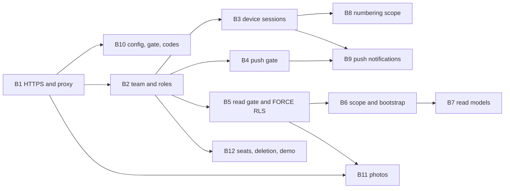
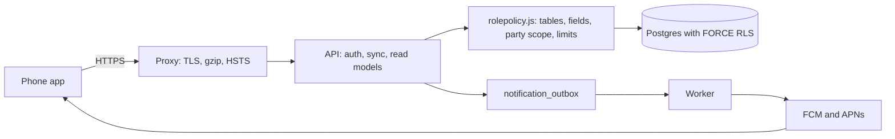

# Mobile backend readiness: what the cloud must do before a phone app can serve owners and salespeople

> **Status:** research and code audit, written 2026-10-21. Nothing here is built, deployed or committed. The audit read `backend/`
> as it is in the working tree today, which includes parity wave 3's uncommitted `backend/src/numbering.js` and
> `backend/sql/008_voucher_series.sql`. A parity gate and an MCP-server build were running in the same tree, so a line number can
> drift by a few lines if those files change before this is read.
> **Method:** every claim about our code carries a file and line. External facts are tagged.
> **Evidence tags:** `[C]` read in this repo (file:line) · `[W]` primary page fetched and read · `[Ws]` search summary only, page
> not read · `[J]` judgement, or arithmetic from cited inputs · `[unverified]` stated but not checked. Every source is paraphrased;
> the URLs are in section 15.
> **Measured here:** the payload figures in section 5.2 come from running the repo's own deterministic book generator
> (`scripts/perf/synth.ts`) and the sample-company builder (`scripts/seed/run.mjs`) in a scratch directory. No repo file was
> written, no server was started, nothing touched the VM.
> **Naming:** "README S3" and the like mean the shared-piece table in [docs/research/README.md](README.md); "ARCHITECTURE" is `docs/ARCHITECTURE.md`.
> **Related docs:** [ARCHITECTURE.md](../ARCHITECTURE.md) (the cloud design; sections 6 and 7 are the nearest),
> [README.md](README.md) (shared platform pieces S1 to S14, reused here by name), [approvals-workflows.md](approvals-workflows.md),
> [attachments-drives.md](attachments-drives.md), [customer-vendor-portal.md](customer-vendor-portal.md). This doc does not pick the app's
> technology (native, React Native, Capacitor or a PWA); where the choice changes a backend need, section 10.4 says so.

---

## 0. Verdict

**The sync core is a sound base for offline orders. The backend is not yet safe to hand to a salesperson, and a phone cannot afford
today's pull.** Five things stand between this tree and a store release, in this order: HTTPS, a second identity per tenant, a
server-side authorisation gate on push, pull and REST, a pull a phone can afford, and push notifications. The rest is polish.

1. **HTTPS is a hard blocker (section 9).** The VM serves plain HTTP on `books.comhard.in:1036`. iOS refuses cleartext to a public
   hostname unless the app carries an App Transport Security exception that App Review must be persuaded to accept; an Android app that targets
   Android 9 (API 28) or later refuses it unless the app opts in; Google Play's Data safety form cannot truthfully say "encrypted in transit"; and a PWA cannot
   register a service worker or web push from an HTTP origin. Ports 80 and 443 on that host belong to a different app, so the
   certificate has to be issued by DNS-01 and served on a non-standard port, or the provider must re-route 443. Either way it is
   days of work plus one owner action on DNS.
2. **One login per tenant is real, and worse than "no invites" (section 3).** Registration always creates a new tenant. No route adds a
   second member. If a member is added by SQL they can cancel the subscription, mint a write-scope API key and read everything, and
   removing them does not cut their access, because a token's tenant is trusted without a membership check. Refresh-token rotation has no
   grace window, so a lost response on a weak network revokes the whole session.
3. **Authorisation is client-side only (section 4).** The cloud log is one shared stream. `/sync/pull` hands every member every
   document of every company, including operator PIN hashes and the company passcode vault, which the REST API deliberately strips.
   A salesperson role needs server enforcement at four points (pull projection, push gate, REST, read models) and cannot be done with
   row-level security alone.
4. **A phone cannot afford today's pull (section 5).** The pull has no company, table, type, date or party filter; it returns every
   revision, not current state; and nothing is compressed. Measured: a 50,000-voucher book is 102 pages and 45.6 MB raw; 250,000
   vouchers is 502 pages and 227 MB. The same pages compress about 10 to 1, so the fix that costs half a day (gzip) removes
   90 percent of the bytes, and a scoped bootstrap removes most of the rest.
5. **Voucher numbering from wave 3 fits orders and receipts, not offline invoices (section 6).** A clash is reported, never renumbered,
   and an invoice already shared on WhatsApp cannot be renumbered. Offline invoicing needs a per-rep or per-device series, which the
   series key can take with one new column.
6. **Push does not exist (section 7).** No token table, no sender, no event source: webhooks fire only from REST writes, never from
   the sync path that devices use. Build a device table, a durable outbox and an FCM adapter; keep an in-app inbox as the source of truth.
7. **Photos are designed, not built (section 8).** The body limit (20 MB) is smaller than the 25 MB blob the design assumes.
8. **The API has no pagination on REST lists, no ETags, no compression, no rate limit outside login, no app-version gate and a CORS
   policy that blocks custom headers (section 10).**
9. **Seats are not enforced and a store release forces three more features (section 11):** in-app account deletion, a demo account
   with a live backend, and a billing screen that does not sell in the iOS build. Deleting a user today would also delete every change-log row
   they wrote, because of a `CASCADE` (section 3.3, A11).
10. **Effort (section 12), by judgement:** a trusted-staff internal pilot is about 3 to 4 engineer-weeks; a v1 for real customers with
    owners and confined salespeople is about 15 to 23 engineer-weeks, of which roughly 45 to 65 days overlap the platform pieces the other research already
    plans (README S1 to S13, by my reading of its estimates). Almost all of it can be built and tested without the VM; certificate issuance, deployment and the store
    and push accounts need the owner.

### 0.1 The brief's premises, checked

| Premise | Verdict | What the code says |
|---|---|---|
| One login per tenant; no team invites | **Confirmed, with two corrections** | Schema allows many members (`membership.role`, `002_p2.sql:12-18`; `/auth/switch`, `tenancy.js:43-48`), but the only INSERT into `membership` is registration (`tenancy.js:10`). And a member, once added, is not a limited user: only the conflict-report routes read a role (`sync.js:59-62`, `380-495`). |
| Operator rights are enforced on the client only | **Confirmed** | `access.ts:12-14` says so itself. The server accepts any well-formed table name and never reads the payload on push (`sync.js:188-192`, `226-231`). |
| The VM serves plain HTTP | **Confirmed, and 80/443 are unavailable** | `docs/HANDOFF.md:57-59, 89-91`: only ports 1306, 1036, 1038 reach the box; `books.comhard.in:80/443` is a different app. |
| There is no push service | **Confirmed** | `backend/package.json:13-20` lists six dependencies, none for mail or push; a search of `backend/src` for FCM, APNs, web-push and mail libraries finds nothing. `deliverEvent` is called only from REST writes (`rest.js:74, 88`). |
| No partial sync; a device pulls a whole company | **Confirmed, and understated** | A device pulls the whole **tenant** (every company) and **every revision** of every document, not current state (`sync.js:359-365`). The only parameters are `since` and `device` (`sync.js:345-346`). |

Two statements in `docs/research/README.md` are now stale and should not be repeated: that the client never subscribes to the SSE stream (it does:
`src/sync/realtime.ts`, committed in `a0fffd6`, started at `src/sync/sync.ts:893`) and that it never calls `next-number` (the working tree has
`src/sync/numbering.ts` and `src/core/vchNumbering.ts`, which call `/sync/next-number` at `core/vchNumbering.ts:394-396`).

---

## 1. Who the phone is for, and what each person needs from the backend

Two groups, designed for from the start, as asked.

- **Business owner or approver.** Wants the pulse (money owed to them, owed by them, cash, today's sales and collections), approvals of
  exceptions, and an alert when a large payment arrives or a customer goes over a limit. Reads far more than writes. Often runs more than one firm.
- **Salesperson**, in three working styles. *Field sales* takes orders, checks a party's position, collects payment, logs visits, often
  on a weak network. *Van or route sales* raises invoices on the spot and hands over a printed or WhatsApp copy. *Counter staff* does the
  same indoors. All three need to work for a shift without a network and must be confined to what their job needs.

Two Indian precedents show how competitors split this, and both agree with the design below. Marg ERP ships separate free iPhone apps:
one for the owner (outstanding and post-dated cheques, salesperson GPS location, temporary credit limits, multi-company performance) and one
for the salesman (real-time order capture, party-wise ordering, outstanding, bill-by-bill collection, a cart editable offline) `[W]`
(Marg eOwner and eOrder App Store listings). Zoho Books ships a standard role "Staff (Assigned Customers Only)" that sees all modules
and transactions, but only for customers assigned to that user; its help page does not say how reports, items or vendors are filtered, and says nothing
about discounts or hiding purchase prices `[W]` (Zoho users help page). The confinement unit in both is the assigned party.

| Capability | Owner | Field | Van or counter | Backend today | Section |
|---|---|---|---|---|---|
| Sign in on their own phone, with their own identity; be switched off when the phone is lost or they leave | yes | yes | yes | Missing | 3 |
| Business pulse: receivables, payables, cash, sales and collections today | yes | no | no | Missing as a server figure. The engines exist on the client but read the whole voucher log | 5.6 |
| Approve a discount, a credit-limit breach or a large payment, with a push | yes | no | no | Missing (designed: `approvals-workflows.md`) | 4.2, 7 |
| Party position: outstanding, overdue bills, credit headroom, last receipt | no | yes | yes | Missing as a figure. `exposureOf` loops every voucher (`core/creditLimit.ts:49-56`) | 5.6 |
| Item price and stock available, by godown | no | yes | yes | Stock needs purchase vouchers, which a rep must not receive: needs a server figure | 4.2 R8 |
| Take a sales order offline | no | yes | no | Partly: the type exists (`types.ts:13`), numbering and sync work, authorisation does not | 4, 5.7, 6 |
| Raise an invoice offline and share it (WhatsApp, UPI QR) | no | no | yes | Client has share and UPI (`core/share.ts`, `core/upi.ts`); numbering needs per-rep series | 6 |
| Collect payment against bills and share the receipt | no | yes | yes | As for invoices | 6 |
| Log a visit, follow-up or lead | no | yes | no | `leads`, `leadActivities` exist (`types.ts:571-599`); `Lead.owner` is free text (`types.ts:581`); no visit record | 4.2 |
| Attach a photo: cheque, delivery proof, bill | yes | yes | yes | Designed only | 8 |
| Push: payment received, approval requested, credit exceeded, overdue | yes | own targets | no | Missing | 7 |
| Several firms on one login | yes | no | no | Tenant switch exists (`tenancy.js:43-48`); company-level scope does not | 4.3 |
| Salesperson location or route tracking | optional | n/a | n/a | Missing; privacy-sensitive (DPDP) | 13 |

---

## 2. The backend as built

| Surface | Routes | Auth | Where |
|---|---|---|---|
| Accounts | `POST /auth/register`, `/auth/login`, `/auth/refresh`, `/auth/logout`, `/auth/change-password`, `/auth/switch`; `GET /me`, `/tenants` | none for the first four; Bearer for the rest | `auth.js:14-94`, `tenancy.js:31-49` |
| Sync | `POST /sync/push`, `GET /sync/pull`, `GET /sync/events` (SSE), `/sync/conflicts*` | Bearer; the stream takes the token in `?access=` | `sync.js:177-495`, `realtime.js:41-68` |
| Numbering | `POST /sync/next-number`, `/claim`, `/release` | Bearer, and the 402 write gate | `sync.js:299-341`, `numbering.js` |
| REST | `GET/POST/DELETE /v1/:collection[/:docId]` | `X-API-Key`, or a Bearer token with read and write | `rest.js:31-90`, `platform.js:19-35` |
| Integrations | `/api/keys`, `/api/webhooks` | Bearer, **no role check** | `platform.js:76-117` |
| Billing | `/api/billing/*` | Bearer, **no role check** | `billing.js:4-41` |
| Admin | `/admin-api/*` | an admin JWT signed with the same secret | `admin.js:27-129` |
| Inbound | `/webhooks/razorpay` | HMAC (mock verifier returns true) | `webhooks.js:13-19`, `billing/mock.js:10` |
| Absent | push, e-mail, attachments, device list, app config, role policy, account deletion | n/a | grep of `backend/src` |

Process facts that matter for a phone fleet: one Node process with an in-memory rate limiter and SSE hub (`ratelimit.js:8`,
`realtime.js:4-11`); a Postgres pool of 10 (`db.js:8`); a 20 MB body limit (`server.js:28`); `trustProxy: true` with no proxy in
front (`server.js:29`); CORS reflecting any origin but allowing only GET, POST and OPTIONS and only two request headers
(`config.js:42-47`, `server.js:32-36`); a JWT secret that defaults to a public string when the environment does not set one (`config.js:27`).

---

## 3. Auth

### 3.1 How login works today `[C]`

- E-mail and password. Passwords are Argon2id (`auth.js:30, 47`); the policy is 8 to 128 characters, not common, not the e-mail
  (`passwordPolicy.js:18-19`), applied when a password is set (`auth.js:22-23`, `changePassword.js:63`).
- A login mints an **access token**, a 1-hour HS256 JWT carrying user id, tenant id and a token-family id (`tokens.js:7-9`,
  `config.js:28`), and an **opaque refresh token**, stored only as its SHA-256, valid 30 days (`tokens.js:21-23`, `config.js:29`).
- Every login starts a new **token family** (`tokens.js:15-18`), which is the unit of revocation: each authenticated request checks that
  its family is not revoked, one query per request (`tokens.js:34-37`).
- `/auth/refresh` consumes the presented refresh token and issues a new pair in the same family; presenting an already-consumed one revokes
  the whole family (`tokens.js:43-63`). Change-password revokes every other family of the account (`auth.js:77-83`).
- A second credential type exists for `/v1` only: an API key (`ck_` prefix, stored as SHA-256, `read` and `write` scopes), which names a tenant and never a person (`platform.js:9-35`, `81-90`).
- The only rate limits in the product are on register, login, change-password and admin login: five failures lock a key for a minute,
  doubling to 15 minutes, keyed on e-mail and IP together (`ratelimit.js:3-6`, `auth.js:16, 25, 44`).

### 3.2 The single-login-per-tenant model, checked `[C]`

Registration creates a user, a new tenant, an owner membership and a 7-day Pro trial in one go (`auth.js:30-35`, `tenancy.js:7-12`,
`subscription.js:7-16`). Login resolves the tenant as the user's oldest membership (`auth.js:50`, `tenancy.js:14-17`). Nothing inserts
another membership. The product therefore has one real principal per tenant, shared by every device and person in the office, with the
operator PIN model (`access.ts`) layered on top and never reaching the server (`db.ts:53-55`: the operator is "local audit trail only").

### 3.3 Findings that bite on a phone

| # | Finding | Evidence | Why it matters on a phone |
|---|---|---|---|
| A1 | **Anyone can register**, and each registration makes a new empty tenant with a trial | `auth.js:14-38` | A salesperson who installs the app and taps Register gets their own empty company. The app needs an invite-only join path and must not offer Register to a joiner. |
| A2 | **No invite, member-list, disable or remove routes** | the only `INSERT INTO membership` is `tenancy.js:10` | Nothing to build the team flow on. |
| A3 | **A member has the owner's powers**, except on the conflict report | billing: `billing.js:5-20`; API keys and webhooks: `platform.js:81-107`; the only role reads: `sync.js:59-62, 380-495` | A rep could cancel the subscription, mint a write-scope key and register a webhook to copy every new voucher to a server of their choice. |
| A4 | **Removing a member does not cut access.** A token's tenant is trusted; membership is checked only by `/auth/switch` | `tokens.js:29-39`, `authenticate.js:8-14`, `tokens.js:55-61` (refresh re-embeds the family's tenant without looking at membership), `tenancy.js:26-29, 43-48` | A rep who leaves keeps syncing until their family is revoked by hand. ARCHITECTURE section 7 specifies a per-request membership check; it was not built. |
| A5 | **Refresh rotation has no grace window.** The old refresh token is revoked the moment a new one is issued, and a replay revokes the family | `tokens.js:49-57`; the client retries with the same token after a network error (`sync.ts:253-255`) | The classic mobile failure: the server rotates, the response is lost in a tunnel, the retry is read as theft, and the session dies while the rep is out of coverage. |
| A6 | **The client treats any non-OK refresh as a dead session** | `sync.ts:256` (the comment says 401 only; the code does not) | A 502 during a deploy, a 429 or a captive-portal page signs a salesperson out mid-shift. Fix in the client; the server should return stable codes (section 10). |
| A7 | **A device id is a self-declared string** and the device registry is informational | format check only: `conflict.js:79-81`, `sync.js:180-182`; `sync_device` stores label and last cursor, 500 per tenant: `007_sync_conflicts.sql:42-51`, `conflict.js:95`; `token_family` has no device columns: `001_p1.sql:13-18`, `002_p2.sql:35` | There is no list of "my phones" and no way to revoke one phone. |
| A8 | **Login is throttled by IP as well as e-mail** | `auth.js:41-44`, `ratelimit.js:41-45` | Mobile carriers share addresses (CGNAT). Five wrong passwords from anyone on that address lock every user on it. ARCHITECTURE section 7 (line 974) says e-mail should be the primary key and IP only a backstop; the code uses both together. `clientIp` also trusts the first `X-Forwarded-For` value while `trustProxy` is on with no proxy (`ratelimit.js:41-45`, `server.js:29`), so the IP key is spoofable. |
| A9 | **`app_user.email` is `NOT NULL UNIQUE` and register demands an `@`** | `001_p1.sql:7`, `auth.js:18` | Field staff often have no work e-mail `[J]`; a phone number has nowhere to live. |
| A10 | **The web client keeps tokens in `localStorage`** | `sync.ts:38-39, 213-215` | A native app must use the OS keychain (iOS) or keystore (Android). Client work, noted so it is not forgotten. |
| A11 | **Deleting a user deletes their change history.** `change_log.user_id` is `REFERENCES app_user ON DELETE CASCADE` and no later migration changed it | `001_p1.sql:36`; `006_p4.sql:32` drops only `NOT NULL` | Both Apple and Google require in-app account deletion (section 11). Implemented as `DELETE FROM app_user` it would erase every voucher revision the person wrote from the shared log, which is also the audit trail. ARCHITECTURE section 4 specifies `RESTRICT`. |

### 3.4 Why a salesperson needs their own identity

Six reasons, each of which fails today with a shared login `[J]`:
accountability (the change log's `user_id` is the only server-side author: `sync.js:228`, and with a shared login every edit is "the
office"); revocation (one lost phone must not mean changing the office password); confinement (scope attaches to a person); approvals
(maker and approver must differ: `approvals-workflows.md` section 4.4); targeted push (a notification needs a recipient); and seats (billing
counts people, section 11).

### 3.5 What a team and invite flow needs

| Piece | What v1 needs | Today | Note |
|---|---|---|---|
| User identity | Login id that is an e-mail or a phone number; `email` nullable; unique phone; status (invited, active, disabled); display name | `app_user(email NOT NULL UNIQUE, password)`, `001_p1.sql:5-10` | ARCHITECTURE section 7 already sketches `status`; add phone. |
| Server roles | `membership.role` with real meaning (owner, admin, manager, sales, accountant, viewer) plus a role-policy record per tenant (section 4) | role text column, comment lists owner, admin, member (`002_p2.sql:15`) | One `requireTenantRole` helper on billing, keys, webhooks and conflicts (A3). |
| Invites | Table of one-time invites (hashed token, role, expiry about 72 h, optional phone or e-mail hint, created by, used at); create, list, revoke, accept routes | none | Accept sets the password. Per-tenant cap by plan seats (section 11). |
| Delivering an invite | **No e-mail sender is needed for v1.** The owner shares the invite link from their own WhatsApp, the way `core/share.ts:1-6` already works: the app opens the person's own WhatsApp or mail with the text typed in and sends nothing itself | no sender exists (`backend/package.json:13-20`) | An e-mail sender (SES Mumbai or ZeptoMail with SPF and DKIM, README S7) is a later convenience. SMS needs DLT registration and `approvals-workflows.md` section 3.4 does not recommend it. |
| Password policy | Reuse as is; the rep sets it once and unlocks the app with biometrics or a device PIN held client-side | exists | Recovery is an owner-issued reset link (same mechanism), not a self-service e-mail flow. |
| Refresh per device | Already one family per login (`tokens.js:15-18`); add device id, label, platform, app version, last seen, push token to a `device_session` (ARCHITECTURE section 7, "Tokens" table at line 987) | none | Cap devices per user. |
| Device registration | `/auth/login` carries `deviceId` and `deviceLabel`; the server issues a short series code for numbering (section 6) | self-declared only | Reuse the client's existing device id (`sync.ts:152-159`). |
| Revoke a lost phone or a departed rep | List sessions; revoke one or all; disabling a member revokes every family and makes refresh fail; membership re-checked on each request, or a per-member `epoch` in the token | family revoke exists (`tokens.js:65-72`); membership is never checked (A4) | The check is one indexed query, the same cost class as the family check at `tokens.js:34-37`. |
| Refresh grace | Accept the immediately previous refresh token for about a minute and answer with the same successor, or make refresh idempotent on the token hash | none (A5) | Keep reuse detection for anything older. |
| Token audience | Add `aud` and a type claim so a future portal or API token can never be used as a tenant token | none (`tokens.js:7-9`) | README S2 requires it before any portal. |
| Remote wipe | `wipe_requested_at` on the device record, returned on the next authenticated call and carried by a data push; the client erases its database and keys | none | Honest limits in 3.6. |

### 3.6 A lost phone and remote wipe: what can and cannot be promised

- **Immediate and reliable:** revoking the token family stops that phone from syncing on its next request, because every request checks the
  family (`tokens.js:34-37`). The access token's own hour of validity does not matter, since the family check refuses it.
- **Best effort:** the data already on the phone stays until the app contacts the server (a flag returned with the next response, or a data
  push) or the person wipes it. A phone kept in airplane mode is never told. `[J]`
- **What reduces the exposure:** keep tokens and the local database key in the OS keystore, bound to the screen lock; keep the replica small
  by scope (section 5), so a stolen phone holds one rep's parties and not the company; never put purchase cost or other reps' parties on a phone that
  does not need them. These matter more than the wipe.
- **Not possible from here:** destroying a key on an offline phone. The OS-level find-and-erase belongs to the person.

---

## 4. Authorisation

### 4.1 What is enforced where today

| Rule | Where it lives | Does the server see it? |
|---|---|---|
| Which screens a role may open | `SCREEN_AREA`, `access.ts:108-178` | No |
| Voucher area, type allow-list, action list, date window, period lock | `voucherDenial`, `access.ts:249-279`; `Role` fields `types.ts:683-696`; lock `types.ts:702` | No |
| Write guard on every save | `writeDenial`, `access.ts:351-369`, called from `putDoc` and `deleteDoc` (`access.ts:9-10`, `db.ts:12`) | No. `/sync/push` accepts any well-formed table name and never reads the payload (`sync.js:188-192`, `194-200`, `226-231`) |
| Who the operator is | a PIN `User` doc, signed in locally; the operator label is local only (`db.ts:53-55`) | The cloud log records the account, not the person at the keyboard |
| A member's tenant role | `membership.role` | Only the conflict-report routes (`sync.js:59-62`, `380-495`) |
| API key scope | `read` or `write` on a key; a Bearer token gets both | Yes, but it is not role-aware (`platform.js:31`) |
| Collections an outside caller may write | `REST_DENIED` = companies, users, roles, einvoices, customFields (`restPolicy.js:13-27`) | Yes |
| Fields a stale or unversioned write may not move | `PROTECTED_FIELDS` and `UNVERSIONED_PROTECTED` (`conflict.js:38-57`, `186-208`) | Yes. This is the only field-level rule the server has |

`access.ts:12-14` states the limit in its own header: a control for people sharing a screen, not a data-security boundary.

**Read-side and write-side holes a salesperson account would expose** `[C]`:

- **F1. Pull hands every member the secrets.** `/sync/pull` returns `payload` as stored (`sync.js:366-369`). The REST layer strips the
  company `vault`, `vaultLegacy` and `security` and every operator `pinHash` before returning a document, because a salted hash of a 4 to 6 digit PIN
  falls to offline guessing in seconds (`restPolicy.js:29-39`). Sync does no such stripping. With one shared principal this is moot; the day a rep is a member it is the
  first thing to fix.
- **F2. `/v1` with a Bearer token is read and write on everything** (`platform.js:31`, `rest.js:31-76`). Reads accept any collection name of the right shape
  (`rest.js:33`, `restPolicy.js:16`), including `users` and `roles`.
- **F3. Any member can mint a write-scope API key or a webhook** (`platform.js:81-107`): a copy-everything-out path with no log a rep can be asked about.
- **F4. Any member can cancel or re-plan the subscription** (`billing.js:5-20`), and with the mock gateway "subscribe" activates instantly with no payment
  (`billing/mock.js:6-8`, `subscription.js:58`).
- **F5. Push is unconstrained.** Any table, any payload (`sync.js:188-192`; the reason is in `conflict.js:59-64`: a newer client may sync a table this server has
  never heard of, and refusing the batch would strand its outbox).
- **F6. The server trusts what the client says about itself:** `creditOverride` on a voucher (`types.ts:1076-1084`), the `sys` flag on a pushed row
  (`sync.ts:627`, `sync.js:199`), the voucher's `base` and `typeId`.

### 4.2 What a salesperson role needs from the server

Each row is one rule the server must apply. "Client today" is what exists in `access.ts` or the voucher screen; none of it reaches the server.

| # | Control | A salesperson example | Client today | The server must |
|---|---|---|---|---|
| R1 | **Table read list** | May read vouchers (own, and for assigned parties), the ledgers of assigned parties plus the few non-party ledgers a receipt needs (Cash, bank), stock items, groups, units, godowns, allowed price levels, voucher types, leads, activities, the company (redacted). Never users, roles, employees, pay heads, budgets, e-invoices, TDS natures | Screens only (`access.ts:108-178`); data is not read-gated | Apply a per-role table list in pull and in REST |
| R2 | **Table write list** | May write vouchers (orders, receipts; invoices for van sales), leads, lead activities, a new visits record | `TABLE_AREA`, `access.ts:323-335`, on save | Reject any other table, per row, with a code (ARCHITECTURE section 6 item 6, lines 797-816: reject the row, not the batch, and never drop queued work silently) |
| R3 | **Voucher-type allow-list** | Sales order and receipt only | `Role.voucherBases`, `types.ts:691`, `access.ts:262-264` | Compare `payload.base` (`types.ts:995`) and check the `typeId` really belongs to that base in the current voucher-type master, so a forged `base` fails |
| R4 | **Action list** | Create only; no alter or delete | `Role.voucherActions`, `types.ts:692` | Decide create or alter from whether a prior revision of that document exists; `op: 'delete'` is a delete |
| R5 | **Own-record rule** | May alter only a document they created, and only until it is invoiced or approved | None | Compare the prior revision's `user_id` with the caller (the log already stores it: `sync.js:228`) |
| R6 | **Party scope** | Only parties assigned to them (Zoho and Marg precedent, section 1) | None; `Lead.owner` is free text (`types.ts:581`); no assignment field on `Ledger` (`types.ts:288-369`) | Resolve every party leg of a voucher (`partyId`, `types.ts:1000`, plus the ledger ids in `entries`) against an assignment, and refuse or flag a leg outside it |
| R7 | **Field-level hiding** | No purchase cost or margin: `openingRate`, `openingValue`, `standardCostRate` (`types.ts:506-513`), the BOM (`types.ts:523`); no other parties' `openingBalance` or `openingBills` (`types.ts:312`); no price levels they may not quote (`StockItem.prices`, `types.ts:522`); no company `vault` or `security`; no `pinHash`. Purchase, stock-journal, physical-stock and payroll vouchers are excluded wholesale | None | Project documents by role in pull and REST (a jsonb key-removal per table is enough), and **re-inject hidden fields on any permitted write to such a document**, or forbid the write. The mechanism that already exists is `conflict.js:186-208`, generalised |
| R8 | **Figures that need hidden data** | Stock available by godown; a party's true outstanding | Computed on the device from the whole voucher log (`core/creditLimit.ts:49-56`) | Serve them as server read models (section 5.6): once R7 hides purchases, a phone cannot compute stock, and with a date window it cannot compute outstanding |
| R9 | **Write limits** | Maximum voucher value; maximum discount per line (`InventoryLine.discountPct`, `types.ts:951`) and per voucher; allowed price levels; a price floor; a back-date window | Date window and period lock only (`access.ts:268-278`; `Role.dateFrom/dateTo`, `types.ts:693-694`; `lockedThrough`, `types.ts:702`). No value, discount or floor field exists | New policy fields. A cost-based floor can only be judged on the server, since cost is hidden from the phone. The server-side period lock is specified in ARCHITECTURE lines 818-839 and is not built |
| R10 | **Approval for exceptions** | A discount over the cap, a credit-limit breach, a large receipt: held for the owner | A credit-limit override with a typed reason (`core/creditLimit.ts`, `types.ts:1076-1084`), no hold | Accept the row as pending (the server owns `optional` and the approval state for a held voucher: `approvals-workflows.md` section 4.5), push the approver, show the rep "awaiting approval". **Recompute exposure on the server** instead of trusting `creditOverride`. The research already advises gating orders, discounts and credit breaches rather than every invoice (`docs/research/README.md:73-75`, GST time-of-issue risk) |
| R11 | **Integration surfaces owner-only** | A rep cannot make keys, webhooks, change plan, or call `/v1` | Admin screens only | One `requireTenantRole` on billing, keys and webhooks (A3); `/v1` through the same role policy |
| R12 | **Audit** | Rejected rows, approvals, scope changes, device revocations | The Edit Log is local | Append-only audit table (README S4) |
| R13 | **Volume limits** | At most N rows per push; a request budget per user | Client batches 300 (`sync.ts:45`) | Cap rows per push; token-bucket per user and device (section 10) |

### 4.3 Extending row-level security without breaking sync

**What exists.** Row-level security is switched on for the tenant-keyed tables with one policy each, keyed on `app.tenant_id`, which every business query sets as the
first statement of a transaction (`002_p2.sql:55-69`, `db.js:20-33`). The runtime connects as `comhard_app` (`db.js:7-8`); identity, billing and key lookups use the owner
pool, which bypasses RLS (`db.js:9-16`). It is `ENABLE`, not `FORCE` (`docs/HANDOFF.md:92-93`), so the isolation holds only while the runtime role is not the table owner.

**What PostgreSQL gives us** `[W]` (PostgreSQL row-security page): policies are per table, command and role; no policy means no rows; permissive policies combine with OR and
restrictive ones with AND, so a restrictive policy can be added on top of an existing permissive one without editing it; owners bypass unless `FORCE` is set; a policy that
reads other tables costs more and is open to race conditions under READ COMMITTED, with a `SECURITY DEFINER` lookup as one mitigation. What RLS does **not** do is reshape a document:
it chooses rows, not fields, and our log is a stack of revisions of JSON documents.

**Recommended structure, three layers** `[J]`:

1. **The hard boundary, hardened and kept** (README S4, ARCHITECTURE section 4, lines 288-341): `FORCE` RLS, a non-owner runtime role, the designed `app.cids`
   company predicate, and a cross-tenant isolation suite run against a scratch database as the first backend CI. Nothing in this doc weakens it.
2. **Role policy in one pure module**, `backend/src/rolepolicy.js`, written like `conflict.js`: no I/O, bundled by the assertion suites so it is tested without a database
   (`conflict.js:1-5` is the precedent). Two functions: `readPlan(role, scope)` returns the tables, voucher bases, hidden fields and party filter for pull and REST;
   `judgePush(role, scope, change, prior)` returns accept, reject with a code, or accept with a flag. Push, pull v2, REST and the read models all call it, so there is one place to audit and one set of
   golden tests.
3. **A database backstop for the few highest-impact rules**: restrictive policies keyed on two more per-request settings, `app.role` and `app.scope_id`, set in `withTenant`
   (`db.js:20-33`). Full-rights roles leave them unset or `*`, so today's clients and today's sync are unchanged. Party-level rules go into the database only through a lookup
   table read by a `SECURITY DEFINER` function, and only if the application layer proves insufficient.

**Columns the filters need.** `change_log` has no queryable column inside the payload (`001_p1.sql:34-44`); its indexes are `(user_id, seq)`, `(tenant_id, seq)` and
`(tenant_id, tbl, doc_id, seq)` (`001_p1.sql:45`, `002_p2.sql:51`, `007_sync_conflicts.sql:54`). Add, populated in the same transaction as the insert: `base`, `doc_date`, `party_ids text[]` (GIN index), and a
`doc_current` table (one row per document, the latest non-deleted revision). ARCHITECTURE section 5 already chose "jsonb plus extracted columns" and "materialized document tables"; neither is built.
`doc_current` also serves the REST list, which today scans the whole log with `DISTINCT ON` on every call (`rest.js:38-40`).

**Hazards when scope is added to sync, and the fix for each:**

| # | Hazard | Fix |
|---|---|---|
| H1 | **Scope grows.** A party is assigned to a rep later; its old rows have a `seq` below the rep's cursor, so the cursor query never returns them | A `scope_version` in the token and in every pull answer; a mismatch makes the client discard its cursor and re-bootstrap (the same rule ARCHITECTURE section 6, lines 654-676, gives for joining a tenant) |
| H2 | **Scope shrinks.** A party is unassigned; the phone keeps its data | Send an evict instruction, or re-bootstrap and replace the local scope; never rely on the phone to forget |
| H3 | **Hidden fields round-trip.** The phone edits a ledger it received without the hidden fields and pushes the whole document back, erasing them for everyone. The app already has this bug class: a form that rebuilds an object drops fields it does not own (CLAUDE.md, Phase 24 gotchas) | Confined roles do not write masters (recommended: a rep proposes a change as a new record the back office applies), or the server merges hidden fields back before storing |
| H4 | **The high-water mark.** Pull reads `MAX(seq)` first and returns only rows up to it, so a cursor never skips a committed row (`sync.js:352`, `db.js:36-52`) | Unaffected: extra predicates only remove rows, so the invariant "every visible row at or below the mark is eventually returned" holds while scope is static; H1 covers it changing |
| H5 | Echo suppression and "superseded by this device's own later write" (`sync.js:359-365`) | Unaffected |
| H6 | A forged report: any member may upload a mismatch report that an administrator can later "put back" (`sync.js:441-462`) | Already bounded by `versionBelongs` (`conflict.js:370-376`); keep the endpoint admin-only for confined roles |

---

## 5. Sync for phones

### 5.1 The protocol as built `[C]`

- **Push** (`POST /sync/push`): the device sends `{deviceId, deviceLabel, changes[]}`; each change is `{cid, table, op, docId, payload, ts, base?, restoreId?, sys?}`
  (`sync.js:177-200`, client `sync.ts:615-630`). The client sends 300 per request (`sync.ts:45`). The server takes a per-tenant advisory lock so `seq` order equals commit order
  (`sync.js:205`, `db.js:36-52`), loads the other devices' later revisions of each document, plans accept-and-record, inserts, and nudges the tenant's other devices
  (`sync.js:206-295`). Last push wins; a write made without seeing another device's newer revision is accepted **and recorded** with both versions
  (`conflict.js:6-22`, `177-232`).
- **Base revision** (`base`): the pull cursor at the moment the row was written, stamped client-side (`baseline.ts:47-53`) and sent only while it belongs to this server and
  account (`sync.ts:625`). A client that sends none is judged against that device's last pull cursor (`conflict.js:146-150`).
- **Pull** (`GET /sync/pull?since&device`): up to 500 rows, ascending `seq`, from the committed high-water mark; this device's own echoes and any revision it has since superseded are
  suppressed (`sync.js:343-374`). **There is no filter by company, table, type, date, party or role, and no collapse to the latest revision.**
- **Entitlement:** an expired or cancelled tenant gets 402 on push and on number calls; pull still works (`sync.js:53-57`, `184-187`).
- **Realtime:** an SSE stream per tenant in one process's memory, a `ping` event every 25 seconds, a `nudge` when the log advances (`realtime.js:11-68`). The client's fallback poll is
  30 s with the stream down and 120 s with it up, jittered 25 percent, with a 70 s silence watchdog (`realtimeCore.ts:29-38`, `sync.ts:867-872`).

### 5.2 Measured payloads

Method: the repo's own generator (`scripts/perf/synth.ts`) builds a book of N vouchers; every document is wrapped in the exact envelope `/sync/pull` returns
(`sync.js:366-369`: seq, cid, table, op, docId, payload, ts, deviceId, userId); sizes are bytes of the JSON a page carries; compression is measured on real
500-row pages (12 pages spread over the log, gzip level 6, brotli quality 5). The sample company comes from `scripts/seed/run.mjs`.

| Book | Rows | Pages of 500 | Raw | gzip | brotli |
|---|---|---|---|---|---|
| Sample company (43 vouchers) | 157 | 1 | 97.5 KB | 10.3 KB, measured | 8.0 KB, measured |
| 2,000 vouchers | 2,863 | 6 | 2.20 MB | 0.23 MB | 0.19 MB |
| 50,000 vouchers | 50,863 | 102 | 45.6 MB | 4.6 MB | 4.0 MB |
| 250,000 vouchers | 250,863 | 502 | 227.2 MB | 21.8 MB | 19.1 MB |

The gzip and brotli columns for the synthetic books are the measured per-page ratio (about 0.10 and 0.085) applied to the total `[J]`.
A voucher envelope averages 893 to 907 bytes; a sales-invoice document is 884 bytes at the median, 1.27 KB at the 90th percentile and 1.6 KB at most.
The masters (863 rows: the company, 28 groups, 500 ledgers, 300 items, and a few units, stock groups, godowns and voucher types) are 0.41 MB raw at every size.

**What a scoped bootstrap would carry** (same books; slice = Sales, Receipt, Sales Order and Credit Note vouchers of the last 90 days):

| Slice | 2,000 | 50,000 | 250,000 |
|---|---|---|---|
| Masters only | 0.41 MB | 0.41 MB | 0.41 MB |
| Masters plus 90 days, all parties | 0.70 MB | 8.3 MB | 39.5 MB |
| The same for one rep with a fifth of the parties `[J]` | 0.47 MB | 2.0 MB | 8.2 MB |
| The same, gzip at about 0.10 `[J]` | 0.05 MB | 0.20 MB | 0.8 MB |

**Caveats, so the numbers are not over-read.** The generator models a plausible stationery trader and says itself that its shape is an assumption, not a measured customer (`docs/PERF.md:119`); it holds 500 ledgers and 300 items at every
size and one financial year; every document is written once. A real tenant has edits (each voucher edit is another 0.9 KB revision, each ledger edit another whole ledger) and more masters, so a real first sync is
**larger** than these figures, by an amount I could not measure (no customer data; section 14). Repetitive synthetic names probably make the compression ratio optimistic `[J]`. PERF.md puts the
generated book in memory at 6 MB, 59 MB and 277 MB for 2k, 50k and 250k vouchers on desktop Node (`docs/PERF.md:108-113`); how a mid-range Android WebView holds that is not measured. At 5 Mbps sustained, 227 MB
is about six minutes of transfer and 22 MB about 35 seconds `[J]`; the device's own writes to IndexedDB are probably slower than the link `[unverified]`.

### 5.3 What partial sync would take

| Cut | Possible today? | What it takes | Effort `[J]` |
|---|---|---|---|
| Resume from a cursor (`since`) | Yes (`sync.js:345, 362`) | Nothing | 0 |
| Compression | No: no compress plugin (`backend/package.json:13-20`), no proxy in front | Fastify compress plugin, or the TLS proxy of section 9 | 0.5 day |
| By company (`cid`) | No: `cid` is a column but not in the pull predicate | A parameter, and an index on `(tenant_id, cid, seq)` | 0.5 day |
| By table | No | A parameter, and an index on `(tenant_id, tbl, seq)` | 0.5 day |
| By voucher type | No: `base` exists only inside the JSON | A generated or insert-time `base` column | 1 day |
| By date window | No: `payload->>'date'` is text inside the JSON | A `doc_date` column and index; plus the carried position of 5.6 so balances stay right | 2 days, plus design |
| By assigned party | No: party ids sit in `partyId` and inside `entries[]` | `party_ids text[]` at insert, a GIN index, an assignment record, `scope_version` | 4 to 6 days |
| Current state only (no history) | Only through the REST list, un-paginated (`rest.js:38-40`) | `doc_current` written in the push transaction, plus a backfill | 4 to 6 days |
| A snapshot with a pinned sequence, then a tail | No | `GET` bootstrap that streams `doc_current` in keyset pages and returns the `snapshotSeq` it reflects; the device then tails from exactly that value (ARCHITECTURE section 6 item 2, lines 654-676, designed, not built) | 5 to 8 days |
| Resumable bootstrap | Natural: pages are keyset by `seq`, and the client stores the cursor with each applied page in one transaction (`sync.ts:697`, `db.ts:413-439`) | Keep it for the new path | 0 |

Compatibility: keep `/sync/pull` exactly as it is for existing clients and put the new behaviour behind a protocol header (ARCHITECTURE section 6 item 5, lines 785-796,
names `X-Sync-Proto: 2`). Add an index on `(tenant_id, tbl, seq)` first: a table-filtered pull for 500 ledgers among 250,000 voucher rows otherwise scans the tenant's log to find them `[unverified; not benchmarked]`.

### 5.4 The invariants a scoped sync must keep

1. A bootstrap is pinned to one snapshot sequence and the tail starts at exactly that sequence (a tail from a live `MAX(seq)` silently skips what landed in between: ARCHITECTURE lines 654-676).
2. The scope is part of the cursor's namespace. Today the namespace is server and account (`baseline.ts:28`); add `scope_version`.
3. Becoming visible forces a re-bootstrap (H1); becoming invisible forces an evict (H2).
4. The old pull stays byte-compatible. A phone app that ships in the store lives for weeks on old versions, so the server must keep serving them (section 10.2).
5. Every cut is applied on the server from the caller's token, never from a request parameter the client could widen.

### 5.5 Battery and data

- **Polling.** With the stream down the client polls every 30 s: 2,880 requests a day. An empty pull is about 1 KB each way with headers `[J]`, so about 3 MB a day; with the stream up (120 s) about 0.7 MB.
  A native app should not poll in the background at all: refresh on open, on foreground, after a push, and on a manual pull `[J]`.
- **The stream.** One SSE connection per foreground device, a ping every 25 s (`realtime.js:62`), which keeps the cellular radio awake `[J]`. The stream cannot survive a backgrounded or dozing phone, so
  it is a foreground optimisation; background delivery is push (section 7).
- **A write per read.** Every pull upserts the device's row (`sync.js:371`). Harmless at tens of devices; worth removing from the read path before hundreds.
- **The pool.** Ten Postgres connections (`db.js:8`), each pull holding one for a transaction of three statements. At a few hundred active phones the pool queue, not Postgres, is the limit `[J]`; no load test
  exists (`docs/HANDOFF.md:94-95`).
- **Networks.** Android is about 92 to 93 percent of Indian mobile in StatCounter's 2026 pages `[Ws]`. Aggregate median mobile download speeds in Ookla coverage are high (tens to over 100 Mbps in 2024 to 2025 reports, 2026 value not
  confirmed) `[Ws]`, but a rep in a warehouse, market lane or basement does not live at the median: the design assumption is a connection that drops for minutes `[J]`.

### 5.6 Two shapes for the phone's data, and what each asks of the backend

| | **A. Scoped replica** | **B. Thin, online-first with a write queue** |
|---|---|---|
| Phone holds | Masters and the rep's own vouchers; runs the engines | Nothing durable but a queue and a small cache |
| Offline | Full for a shift | Reads from cache; writes queue |
| Backend asks | Scope, projection and a bootstrap (4.3, 5.3, 5.4) | Read endpoints and typed write endpoints |
| Fit | **Salesperson** (offline is not negotiable) | **Owner** (a read-mostly pulse) |

**Recommendation `[J]`:** A for salespeople, B for owners, and both read the same server read models, because R7 and a date window each break an on-device engine:

- `party_position(party, asOf)`: closing balance with side, bills outstanding with ageing, credit limit and headroom, last receipt, last order.
- `stock_position(item, godown, asOf)`: quantity available, by godown, computed from every inventory movement including the purchases a rep must not see.
- `pulse(asOf)`: receivables, payables, cash and bank, sales and collections today and month to date, pending approvals, overdue count.

Each answer carries the `snapshotSeq` it reflects. **The phone overlays its own unsent vouchers on the figure and says so** ("as at 11:40, plus 2 unsent"): an invoice adds to the balance, a receipt reduces it, an order changes nothing, so the overlay is
exact for what the phone itself holds, and honest about what it does not.

These need the engines on the server: an esbuild bundle of `src/core` for Node, as `scripts/seed/run.mjs:13` already does for the sample builder and `scripts/perf/run.mjs:6, 12` does for the engines (README S10, 1 to 1.5 weeks shared), and an index on `(tenant_id, tbl, doc_id, seq DESC)`.
The Dashboard's one-pass index takes about 64 ms for a 250,000-voucher book on a desktop, and the whole default board about 718 ms (CLAUDE.md, Phase 28, "Cost, plainly"), so computing a pulse on request is feasible `[J]`; caching by `snapshotSeq` is cheap.

A different route to the same end, to prototype before committing `[J]`: **a window plus a carried position.** `core/splitCompany.ts:1-40` already computes, for any date, every ledger's closing balance, every outstanding bill on its original date, stock by godown and pending
orders, and verifies them against the old books. The server could hand a rep the last 90 days of vouchers plus each in-scope party's position at the window start as `openingBalance` and `openingBills`, and the phone computes forward with the unchanged engines. The risk is a back-dated edit before the window, which changes
the carried position and so needs regeneration and a version bump; the benefit is that nothing in the phone's engines changes.

An **owner replica** is reasonable only for a small book: a 2,000-voucher book is 0.23 MB compressed, a 50,000-voucher book 4.6 MB (table in 5.2) `[J]`. Above roughly 20,000 vouchers `[J]` the owner should use read models and cache.

### 5.7 Offline orders: conflicts, revisions, and what changes under a rep

**The rules as built.** A new voucher has a new `docId`, so it has no other revisions and cannot conflict with itself (`conflict.js:177-232`). A rep who is offline for three days stamps every row with an old
`base`, which only matters for edits to existing documents. The push never inspects references (`sync.js:194-200`): a voucher naming a deleted party, a changed price or a lowered credit limit is accepted without a word.
Two failure modes are recorded, not blocked: an edit on a stale base (`edit-edit`, `edit-delete`, `delete-edit`) and two vouchers with one number (`duplicate-number`), both in the Sync Mismatch Report visible to owners and admins only (`sync.js:380-436`, open rows capped at 2,000: `conflict.js:90`).

| What changes while the rep is offline | Today | Needed |
|---|---|---|
| The party's credit limit is lowered, or the party is now over it | Order is accepted; nothing is checked server-side; `creditOverride` is whatever the client wrote | Recompute exposure from the read model on push; accept and **flag** (R10); owner notified |
| The party is deleted or disabled | The order stands and points at nothing | Accept with a warning code (`party-missing`) in the push answer; an inbox item for the owner |
| An item's selling rate or price level changes | The order carries the rate the rep saw | Accept; flag if below the current floor; the invoice, not the order, fixes the rate |
| An item's GST rate changes (dated history) | Orders post nothing; tax is computed at invoice | Nothing |
| An item is discontinued or out of stock | Nothing | Informational warning |
| Back office edits the party's address while the rep edits its phone | Whole-document last write wins: the second push erases the first person's field, and the loser is recorded in the report | Confined roles do not write masters (H3); a change request record instead. Per-field `patch` for masters is designed (ARCHITECTURE lines 785-796) and not built |
| The rep's party is reassigned | Nothing | Accept the queued order and flag it (do not drop offline work: ARCHITECTURE lines 797-816) |
| The subscription lapses | Push answers 402; rows stay queued on the phone (`sync.ts:632-638`) | A clear message that names the owner; a grace period; the owner pushed. Offer a share-as-PDF or WhatsApp fallback (`core/share.ts`) so the order is not stranded |
| The rep's account is revoked | Refresh fails; queued rows are stuck on a phone nobody can sync | An export or share of the pending orders before wiping; the owner decides |
| A retried push after a lost response | Appended again at a higher `seq`; the same device is not compared with itself, and another device's newer edit in between is recorded as a conflict while the retried older version wins (`sync.js:80-88`, `conflict.js:182`) | `changeUid` idempotency (ARCHITECTURE lines 634-652; README S3). Phones lose responses far more than offices do |

### 5.8 Realtime on a phone

The SSE stream carries the access token in its query string (`realtime.js:39-42`); the server redacts it in its own log (`logging.js:7-9`) but any proxy or CDN access log will not, so scrub `access=` there too
(the comment at `src/sync/realtime.ts:22-25` says the same). React Native has no `EventSource` without a polyfill `[unverified]`. None of this survives background execution, so the nudge for a phone that is not in the foreground is a push (section 7).

---

## 6. Numbering for offline devices

### 6.1 What wave 3 built `[C]`

- **One counter per series**: company x voucher type x numbering window (`''`, a financial-year start date, or a month), in `voucher_series`, with a ledger of every number issued or claimed whose primary key is the number itself,
  so a number can never be issued twice in a series whatever the application does (`008_voucher_series.sql:18-39`, `numbering.js:1-30`). The server issues the number only; prefix, suffix, padding and tokens stay on the client
  (`numbering.js:7-10`, `types.ts:537`).
- **Three calls** (`sync.js:299-341`): *reserve* at Accept, idempotent on a per-voucher key, never below the device's own next number (`numbering.js:119-128`, `203-218`); *claim* of a number a device issued while offline, which is confirmed if free and
  reported as `taken` if another voucher holds it, never renumbered (`numbering.js:137-149`, `221-234`); *release* of a reservation whose voucher was never saved, only while it is the newest number (`numbering.js:155-160`, `237-249`).
  They are behind the 402 write gate (`sync.js:310-312`). The older per-type block allocator, `{typeId, count}` up to 1,000, is unchanged (`sync.js:325-341`).
- **Client** (`src/sync/numbering.ts`, uncommitted): asks only at Accept, so an abandoned voucher burns nothing (`numbering.ts:82-104`); offline it numbers from its own count and marks the voucher `provisional` (`types.ts:1040-1045`);
  at the next sync it claims first, before it pushes (`sync.ts:811-818`, `828`); a clash marks the voucher `clash`, records a `duplicate-number` mismatch and leaves the number alone until an administrator renumbers it in an explicit, confirmed act that
  refuses an invoice the IRP already holds (`numbering.ts:153-251`).

### 6.2 What that gives an offline rep, and what it does not

- **Orders and non-statutory receipts: adequate.** Two reps offline can issue the same local number; the first to sync keeps it, the second is flagged, and an order number can be changed without a legal consequence.
- **Invoices: not adequate.** A van or counter sale is printed or sent on WhatsApp on the spot. A clash found a day later means two documents with one number in one financial year, and renumbering a document the customer holds is the act the wave-3 design
  rightly makes explicit and rare. CGST Rule 46 asks for a consecutive serial number, one or multiple series, unique for the year `[W second-hand: via approvals-workflows.md:135; the CBIC page itself would not load here]`.
- **There is no per-person series.** The key is `(cid, typeId, win)` (`numbering.js:59-67`). The server does not check that `typeId` names a real voucher type (`numbering.js:48`, `60-64`), so a series per rep could be faked with one voucher-type master per rep. That multiplies
  masters and runs into the cap of 20,000 series a tenant (`numbering.js:39`): 50 reps x 5 types x 12 monthly windows x 5 years is 15,000 per company `[J]`. Not recommended.

### 6.3 Recommended: a scope on the series, and a code per rep or device

1. Add `scope text NOT NULL DEFAULT ''` to `voucher_series` and `voucher_number_issue` and put it in each primary key, in the per-series lock key (`numbering.js:170-171`) and in `cleanSeries` (`numbering.js:59-67`). Existing rows keep scope `''`, so every current caller behaves as today.
2. The server hands each registered device a short **series code** (for example `RV`), recorded on the device session (section 3.5). A voucher type's prefix gains a `{rep}` token next to `{fy}`, `{yy}`, `{yyyy}` and `{mm}` (`types.ts:537`).
3. A device that holds a code **issues from its own counter with no network at all.** Nobody else issues in that series, so no clash is possible; the server only records the high-water mark through the existing claim call and the primary key still refuses a duplicate. No block allocator is needed unless several devices must share one series, in which case the legacy
   `{typeId, count}` allocation is extended with the scope. The claim call takes one number per request today (`numbering.js:87-95`), so a rep's day of vouchers needs a batch claim (many numbers, one call) or a claim of the high-water mark; about a day more.
4. Gaps: a series with one issuer is consecutive as long as that device never skips; a cancelled voucher keeps its number (CLAUDE.md, cancel voucher). Give a person with two devices a code each.
5. Orders and collection receipts use the same mechanism, which also gives the owner cash control per rep.
6. IRP-safe formats (at most 16 characters, no leading zero) belong in the prefix template validation (README S11).

Effort about 3 to 5 days with the migration, the extension of `scripts/assert/vchnumbering.assert.ts` and the real-Postgres harness `scripts/pg/numbering-pg.mjs`; depends on device registration (B3). **Ask the owner's CA** whether several per-rep series under one GSTIN are acceptable for van sales
(section 13).

---

## 7. Push notifications

### 7.1 State `[C]`

Nothing exists: no device-token table, no sender, no mail or push dependency (`backend/package.json:13-20`). The only server-initiated channels are the SSE nudge (`realtime.js:26-30`), which needs an open foreground connection, and outbound webhooks. **Webhooks fire only from the REST
write routes** (`rest.js:74, 88`); a voucher a phone pushes through `/sync/push` fires none (`sync.js` never imports `deliverEvent`). Delivery is in-process with three attempts, 0.5 and 1 second apart (`platform.js:52-73`), so a restart loses what is in flight. It is a best-effort hook, not a queue.

### 7.2 What it needs

A durable event path and a device registry. A sketch, not a migration:

```sql
CREATE TABLE device_session (                 -- section 3.5; one row per signed-in phone
  id uuid PRIMARY KEY DEFAULT gen_random_uuid(),
  tenant_id uuid NOT NULL REFERENCES tenant(id),
  user_id uuid NOT NULL REFERENCES app_user(id),
  family_id uuid REFERENCES token_family(id), -- revoking the device revokes this family
  device_id text NOT NULL, label text, platform text, app_version text, os_version text,
  series_code text,                           -- numbering scope, section 6
  push_provider text, push_token text, push_token_at timestamptz,
  last_seen_at timestamptz, wipe_requested_at timestamptz, revoked_at timestamptz,
  UNIQUE (user_id, device_id)
);
CREATE TABLE notification_outbox (            -- written in the SAME transaction as the event (README S7)
  id bigint GENERATED ALWAYS AS IDENTITY PRIMARY KEY,
  tenant_id uuid NOT NULL, user_id uuid, event text NOT NULL, dedupe_key text NOT NULL,
  payload jsonb NOT NULL, channel text NOT NULL, status text NOT NULL DEFAULT 'pending',
  attempts int NOT NULL DEFAULT 0, next_attempt_at timestamptz NOT NULL DEFAULT now(),
  created_at timestamptz NOT NULL DEFAULT now(),
  UNIQUE (tenant_id, dedupe_key, channel)
);
```

Plus a registration route (token, provider, app version) called on every launch, a drain worker with backoff (README S6, 3 to 5 days), a provider adapter with a `mock` first (README S5), per-user preferences and a digest mode (`approvals-workflows.md` section 6.9), and
removal of a token when the provider says it is invalid.

### 7.3 Events, and where each comes from

| Event | Source in our system | Needs server engines? | Recipient |
|---|---|---|---|
| Payment received | A Receipt voucher arriving through push (its base and party leg are in the payload). A bookkeeping event, not a UPI callback: Comhard does not hold or route customer money (`docs/research/README.md:139-142`) | No | Owner; the rep whose party it is |
| Approval requested, decided | The server-owned approval state (`approvals-workflows.md` section 4.5, 6.2) | No | Approver; maker |
| Credit limit exceeded | A pushed voucher carrying `creditOverride` (`types.ts:1021`); a trustworthy version recomputes exposure (R10) | Flag: no. Recompute: yes | Owner |
| New order from a rep | A Sales Order arriving through push | No | Owner, back office (digest-able) |
| Overdue, collection due | A daily job over open bills; the engine must age against `ageClock`, never period end (CLAUDE.md, Phase 28 gotcha) | **Yes** (S10 and S6) | Owner digest; the rep for their own parties |
| Lead assigned, follow-up due | `leads.nextFollowUp` (`types.ts:571-585`); `Lead.owner` is free text, so an assignee id is needed first | No | Rep |
| Trial ending, subscription lapsed | The subscription row (`subscription.js:25-45`) | No | Owner |
| Device revoked, wipe | The device record | No | That device (data push) |

**Webhooks reuse:** `deliverEvent(tenantId, event, data, seq)` dedupes on `(endpoint, event, seq)` (`platform.js:38-50`, `006_p4.sql:43`) and can be the model. The route in is the problem: emit domain events from the push transaction through the server-authored-row hook (README S3),
write them to the outbox, and let webhooks and push be two subscribers of one durable stream.

### 7.4 Provider options

| Provider | Covers | Server needs | Facts | Note |
|---|---|---|---|---|
| **FCM HTTP v1** | Android; iOS through an APNs key uploaded to Firebase | A Firebase project and a service-account credential in the secrets vault (README S5) | 4,096-byte payload for both message types; store each token with a timestamp and refresh it at least about monthly; a registration idle about a month is stale and an Android one expires after 270 days; `UNREGISTERED` (404) means delete it `[W]` | Works for any client stack `[J]`. Firebase pricing not checked |
| **Expo push service** | Android and iOS for an Expo or React Native app | An Expo project; an access token enforced in the EAS dashboard | 100 messages per request, 600 per second per project, 4 KiB payload, receipts best read after about 15 minutes and cleared after 24 hours, `DeviceNotRegistered` means stop sending; without the enforced access token a leaked push token lets anyone send as you `[W]` | Only if the client is Expo. The overview page was thin; the sending page was read |
| **Web push (VAPID)** | Android Chrome PWA; iOS 16.4+ only after Add to Home Screen | HTTPS, service worker, manifest, a web-push library | Second-hand, from `approvals-workflows.md` section 3.4 (not re-fetched here): iOS 16.4+ only after Add to Home Screen, and some reliability complaints | The cheap first step for a PWA; Android is about 92 to 93 percent of Indian mobile `[Ws]` |
| **WhatsApp** (Meta Cloud API or a BSP) | Any phone | Business verification, template approval, recipient opt-in, an HTTPS webhook | About Rs 0.13 to 0.15 per utility message, third-party figures not checked against Meta (`docs/research/README.md`, conflicts item 10) | For owner alerts and digests, not for reps |
| SMS | Any phone | DLT registration | Not recommended (`approvals-workflows.md` section 3.4) | |

### 7.5 Delivery is a hint, not a guarantee

FCM normal priority can be held while a phone dozes; high priority is meant for notifications a person will see, and if such messages repeatedly fail to produce one FCM may downgrade the app instance's priority, judged over about seven days `[W]`. Android manufacturers' battery managers
kill background apps, with Huawei, Xiaomi, OnePlus and Samsung rated worst on the tracking site `[W]`, and Xiaomi, Oppo and Vivo are common in India `[J]`. So: the **in-app inbox and sync are the source of truth**; a push only says "open the app"; an approval is never carried only in a push; lock-screen text is minimal
("Payment of Rs 1.2 lakh received") with a per-tenant private-notifications switch, and line items, GSTINs and bank details never travel through a third-party channel (`approvals-workflows.md` section 6.9).

### 7.6 What the owner must supply

A Firebase project and its service-account key; an Apple Developer Program membership and an APNs auth key for iOS; a Google Play developer account; the provider decision (FCM or Expo), which follows from the client stack. Deep links from a notification into the app need an HTTPS host
(section 9) and, on both platforms, a verification file served from it `[unverified]`. No secret goes into a repo file (`docs/HANDOFF.md:63-66`).

---

## 8. Attachments and photos

**State.** Designed in full, built not at all (`attachments-drives.md`). The design: attachment metadata rides sync like any document; the bytes go on a separate channel, `PUT /attachments/blob/:sha256` up to 25 MB, check-then-upload, idempotent on the SHA-256, with a per-tick byte budget so a photo never delays the books; uploads get 402 on a lapsed
tenant while downloads always work (section 5.4, lines 432-470); read access is tenant-wide today and `sensitive` is a client-side flag (section 5.6, lines 540-550); the local quota and Safari's 7-day eviction of script-written storage are in section 5.7 (lines 552-575).
`docs/research/README.md:52` makes real customers' cloud uploads wait for TLS and an off-box India backup.

**What a phone adds to that design:**

1. **Body limit.** The server accepts 20 MB per request (`server.js:28`), under the design's 25 MB blob. A per-route limit, or a 15 MB cap, and above all **client-side downsizing** of document photos (a 2,000-pixel long edge at JPEG quality 70 to 80 is typically a few hundred KB `[J]`), since phone cameras produce several MB.
2. **Resumable upload.** A single PUT of a few MB restarts from zero when the network drops. Add a chunked or ranged upload keyed by the SHA-256 so a retried chunk is idempotent `[J]`, about 3 to 4 days.
3. **Wi-Fi-only and low-data switches**, and a queue behind the books (the design's second queue already says so).
4. **Scope.** A rep may fetch only attachments of vouchers and parties in their scope (R6). The design resolves the key from the RLS-filtered row; it must also pass role policy. `sensitive` (a cheque image carries an account number) must be enforced on the server, not on the client.
5. **Privacy.** Strip EXIF location unless proof of visit is the purpose, and then record consent: a rep's location is the employee's personal data (DPDP) `[J]`.
6. **Quota.** The first enforced plan limit (README S13). 30 reps x 20 photos a day x 0.5 MB is 300 MB a day, about 6.6 GB over 22 working days `[J]`; the VM's disk size is not known to me.
7. Signed, short-lived download links and a signature-capture PNG use the same path (README S9).

Effort: S9 is 10 to 14 days and shared; the mobile deltas add about 4 to 6. Tier 2.

---

## 9. TLS: HTTP-only against iOS and Android rules

### 9.1 What is deployed `[C]`

`http://books.comhard.in:1036/comhard/books/` and the admin portal on `:1038`, plain HTTP (`docs/HANDOFF.md:57-59, 62`). Only ports 1306 (SSH), 1036 and 1038 reach the VM; `books.comhard.in:80/443` is a different application (`docs/HANDOFF.md:57-58`). The trust map lists "HTTP only, no TLS" and
names the options: a DNS-01 certificate served on `:1036`, or the provider routing 443 to the VM (`docs/HANDOFF.md:89-91`). The web client already works around HTTP: a `crypto.randomUUID` polyfill and a warning that IndexedDB may not be durable (`docs/HANDOFF.md:81-82, 89-90`).
`config.appUrl` defaults to `https://books.comhard.in` (`config.js:49`) but nothing reads it.

### 9.2 iOS: App Transport Security `[W]`

Source: Apple's Info.plist key reference, the NSAppTransportSecurity section (archived documentation). Apple's current "Preventing Insecure Network Connections" page returned no body in my fetch, so current wording could differ `[unverified]`.

- **Default:** HTTPS, TLS 1.2 or later, forward-secret AES cipher suites, and a server certificate that chains to a trusted root, with an RSA key of at least 2048 bits or an EC key of at least 256 bits, signed with SHA-256 or stronger.
- **Scope:** public host names. The page says IP addresses, unqualified names and `.local` are not covered. `books.comhard.in` is a public host name, so it is covered. Nothing in ATS depends on the port.
- **Exceptions:** `NSAllowsArbitraryLoads` (global), `NSExceptionDomains` with `NSExceptionAllowsInsecureHTTPLoads` per domain, `NSAllowsLocalNetworking`, and narrower keys for media and web views. The page says the global key, the per-domain HTTP key, the web-content and media keys and a lowered minimum TLS version
  each **trigger additional App Store review and need a justification**, and its examples of an acceptable one are a third-party server that cannot do HTTPS, or encrypted media with no personal data. Ours is a first-party server that can serve HTTPS, so the justification is weak `[J]`.
- **A loophole not to use:** by that page's wording an HTTP URL to a bare IP address is not covered by ATS. I could not confirm it for current iOS, it still sends credentials in clear, and it would draw review attention. Not a plan `[unverified]`.

### 9.3 Android: cleartext rules `[W]`

Sources: the Network Security Configuration guide and the `<application>` manifest reference.

- Cleartext is allowed by default for apps targeting API 27 or lower and **disabled by default for API 28 and higher.** An app opts in through a network security config with `cleartextTrafficPermitted="true"` on the base or on a domain entry (domain entries may include subdomains; the longest matching rule wins).
- The manifest attribute `android:usesCleartextTraffic` is ignored once a network security config is present (API 24 and up); the page adds that the attribute is being deprecated and will be ignored for apps targeting API 38 and above. Enforcement is by library, best effort: platform HTTP stacks and `WebView` honour it; `Socket` cannot.
- **Google Play's Data safety form** asks whether all user data is encrypted in transit and allows "yes" only if encryption covers everything the app and its SDKs send `[W]`. With cleartext opted in, the honest answer is no, on a public listing for an accounting product `[J]`.

### 9.4 Browsers and PWAs `[W]`

Service workers register only in a secure context, and `http://<public host>:<port>` is not one whatever the port (MDN secure contexts). Push, Web Share, notifications, `crypto.randomUUID` and persistent storage are also restricted to secure contexts; the MDN page I read confirmed only service workers,
and sent me to a list for the rest `[unverified for the others]`. So installability, an offline shell and web push all need HTTPS.

### 9.5 Wrapped web apps `[W]`

Capacitor serves the app from `https://localhost` on Android and `capacitor://localhost` on iOS by default, so every call to our API is cross-origin (section 10); its `server.cleartext` switch exists for live-reload and its docs say not to use it in production. ATS and the Android cleartext rule still apply to the WebView's requests.

### 9.6 Verdict

**HTTPS is a hard blocker for any mobile app that reaches a customer**, native or wrapped or PWA: iOS makes you argue for the exception in review, Android needs an opt-in that makes the Data safety answer "no", and a PWA does not run. Beyond the stores, the plain reason: a salesperson's password, a 30-day refresh token and the party list, GSTINs and
phone numbers cross public Wi-Fi and carrier networks in clear, and the live stream puts the access token in the URL (`realtime.js:39-42`). It is **not** a blocker for engineering, tests, emulator and development builds with explicit exceptions, or a closed pilot on fake data on Android with a per-domain opt-in. Nothing that reaches a customer should carry the exception.

### 9.7 What it takes

| Step | Detail | Who |
|---|---|---|
| Hostname | Keep `books.comhard.in` on port 1036 (it already resolves to the VM) or choose a new name. Any port works for apps and browsers; neither 1036 nor 1038 is on the Fetch standard's blocked-port list, whose nearest entries are 1719, 1720, 1723 and 2049 `[W]` | Owner decides |
| Certificate | Let's Encrypt validates by HTTP-01 on port 80, TLS-ALPN-01 on port 443, or DNS-01 on no port, the only one that can also issue wildcards, and it needs DNS API credentials or manual TXT records `[W]`. Ports 80 and 443 do not reach this VM, so **DNS-01**, unless the provider re-routes 443 (`docs/HANDOFF.md:91`). Lifetimes are shrinking: 45-day certificates are opt-in from 2026-05-13, the default becomes 64 days on 2027-02-10 and 45 days on 2028-02-16, and Let's Encrypt says manual renewal is not recommended `[W]`. So the realistic path is a **DNS API token scoped to the one zone**, used by an automated client `[J]` | Owner supplies the DNS access |
| Termination | A reverse proxy on `:1036` with Node moved to a loopback port: it renews certificates and reloads, compresses (section 5.3), sets HSTS and keeps access logs scrubbed of `access=` (`logging.js:5-9`). Terminating TLS inside Node works too but makes renewal a restart `[J]`. The admin portal on `:1038` gets the same | Engineer, on the VM |
| Code | `trustProxy` set to the proxy only, and the rate limiter keyed on the address the proxy vouches for (`server.js:29`, `ratelimit.js:41-45`, README S1); `JWT_SECRET` required at boot (`config.js:27`); `APP_URL` and `CORS_ORIGIN` set; HSTS | Engineer |
| Clients | The web client stores the sync URL it first saw (`sync.ts:54-56`): devices holding the `http://` origin need a one-time migration | Engineer |
| Verify | A real iPhone and an Android 14 phone on cellular, and a certificate check from outside | Engineer |

Effort 1.5 to 3 days of engineering `[J]` (README S1 says 2 to 4), plus the owner's DNS action and propagation. A CDN or tunnel in front is a further option I did not research; one that fronts only standard ports would need the 443 route first `[unverified]`.

---

## 10. API shape for mobile

### 10.1 Today against what a phone needs

| Concern | Today `[C]` | A phone needs | Effort `[J]` |
|---|---|---|---|
| Pagination | Pull is 500 rows, keyset on `seq` (`sync.js:20, 370`). The REST list has none: it returns the whole collection, `DISTINCT ON` over the whole log, in one response (`rest.js:31-44`) | `limit` and `after` on every list, a hard maximum page, and `doc_current` behind it | 1 day |
| Conditional requests | No `ETag` anywhere in `backend/src` | `ETag` on read models and REST (`W/"<snapshotSeq>"`) and `304` on `If-None-Match` | 1 day |
| Compression | None: no compress plugin (`backend/package.json:13-20`), no proxy | gzip or brotli: about 10 to 1 on pulled pages (5.2) | 0.5 day |
| Rate limits | Auth endpoints only (`auth.js:16, 25, 44`, `admin.js:44`, `changePassword.js:39`); `/sync/*` and `/v1` are unlimited; in-memory, one process (`ratelimit.js:8`) | A token bucket per user, device and route class; `429` with `Retry-After`; client backoff beyond the SSE reconnect it has (`realtimeCore.ts`) | 2 days |
| Idempotent push | None; a retry appends again (5.7) | `changeUid` (ARCHITECTURE lines 634-652, README S3) | in B4 |
| Error shape | Mostly `{error: text}`; only numbering returns a `code` (`sync.js:315`) | A stable machine `code` on every refusal: `trial-ended`, `forbidden-table`, `forbidden-party`, `upgrade-required`, `session-revoked`, `rate-limited`; text is localised on the phone (Hindi and regional languages) | 1 to 2 days |
| Version gate | None. `accept-version` is only logged (`logging.js:15`) | An `X-Client` header (`comsky-mobile/1.4.0 android 14`) and `X-Sync-Proto`; a public `GET /m/v1/config` with minimum and latest version per platform, a message and a maintenance flag; `426` before touching the log for a client below the minimum | 2 days |
| CORS | Reflects any origin (`config.js:42-47`); methods GET, POST, OPTIONS only; request headers `content-type` and `authorization` only (`server.js:32-36`) | See 10.3 | 0.5 day |
| Health | `{ok: true}` (`server.js:38`) | Database check, build id, minimum client | 0.5 day |
| Support | No request id in responses | `x-request-id`, so a rep can quote one | 0.5 day |

### 10.2 Version skew and forced update

A store release takes days to reach every phone, so two or more app versions are always live. Older clients drop what they do not know: an older app version re-saving a company row erased the new `ui` field for a whole workspace until the server learned to keep it against unversioned writes
(CLAUDE.md, Phase 27 gotchas; `conflict.js:54-57`). Rules `[J]`: the protocol is additive; mobile writers carry unknown fields through; the server never reads absence as intent; and `minVersion` per platform comes from `/m/v1/config` and is enforced with `426` on push.
Google Play's in-app updates offer a flexible flow (background download) and an immediate one (a full-screen, restart-to-continue flow) on Android 5 and later `[W]`; that it works only for Play-installed apps, and the update-priority value set through the Play Developer API, are general knowledge the page did not state `[unverified]`. I verified no OS-level forced-update
API on iOS, so the server gate plus a store link is the mechanism there `[J]`.

### 10.3 CORS

Native apps ignore CORS. A Capacitor WebView (origin `https://localhost` or `capacitor://localhost`) and a PWA do not. Reflecting every origin is workable while no cookie carries authority, but the allowed headers must grow to the ones the new API uses (`if-none-match`, `x-client`, `x-sync-proto`; `x-api-key` for integrations, which today fails a browser
preflight) and the methods to include `DELETE` and `PATCH` if used (`rest.js:78` already defines a DELETE route that a browser cannot call cross-origin). Once a portal or public API exists, move to an explicit allow-list.

### 10.4 What the app technology changes on the backend

| If the app is | Backend consequences |
|---|---|
| Native, React Native or Flutter | No CORS; tokens in the keychain; FCM needed; no IndexedDB, so the outbox, base revisions, conflict store and numbering are reimplemented: the sync protocol must be written down as a contract with golden tests (the assertion suites in `scripts/assert/` are the seed) |
| Capacitor-wrapped web app | Reuses the web client and its sync code; WebView origin means CORS; IndexedDB inside the WebView; the same ATS and cleartext rules; Apple's 4.2 asks for more than a repackaged site `[W]`, which offline orders, camera, push and biometrics supply |
| PWA | HTTPS mandatory; web push; iOS push only from an installed home-screen app; storage eviction (`docs/research/attachments-drives.md:563`); no store review or fee, and no store presence |

---

## 11. Billing, seats and store rules

### 11.1 Seats today `[C]`

`plan.max_users` is 2 for Starter, 10 for Pro, unlimited for Business (`003_saas.sql:56-60`). It is shown (`billing.js:22-26`) and editable by an admin (`admin.js:110-116`) and enforced nowhere (CLAUDE.md: "display-only"). The trial grants Pro for 7 days (`subscription.js:7`, `config.js:48`); an admin can extend it (`admin.js:85-92`).

### 11.2 What mobile changes

Reps outnumber desk staff and cost little to hire, so a per-seat price lands harder than on a desk product. Marg lists both of its phone apps as free on the App Store, the cost sitting in the ERP licence `[W]`. A Starter customer (a cap of 2 users) with an owner, an accountant and three reps is five users and, if the cap were enforced, would move from Rs 499 to Rs 1,499 a month on the current
plan sheet (`003_saas.sql:57-58`) `[J]`. Options for the owner: desk seats and cheaper field seats; N field seats included per plan; or per active rep. Enforcement points: invite accept (B2), device registration (B3), and the existing 402 (`sync.js:184-187`), whose message a rep must be able to read ("your company's subscription has lapsed: tell the owner") with a grace period (5.7).

### 11.3 Store rules that become backend work

- **Account deletion.** Apple's guideline 5.1.1(v) requires in-app deletion for an app that supports account creation. Google requires it in-app or by a linked web page, a web deletion URL in Play Console and an answer in the Data safety form `[W]`. Needed: a deletion route for a rep, and an export-then-delete for an owner, **after** the foreign-key fix (A11),
  with authorship pseudonymised rather than the rows deleted, because statutory retention of books outranks erasure (`attachments-drives.md` section 6.2; ARCHITECTURE section 8).
- **A demo account.** Apple's guideline 2.1(a) asks for a working demo account and a live backend during review `[W]`: a permanent demo tenant on the HTTPS host, seeded with the sample company (`scripts/seed/` already builds and loads it) on the hidden zero-price `unlimited` plan (CLAUDE.md), never expiring.
- **The encryption answer** on Google's form needs section 9.
- **Selling subscriptions in the app.** Guidelines 3.1.3(b) and (c) let an app give access to subscriptions bought elsewhere, and (c) covers apps sold to organisations for their employees; the text does not authorise selling to such customers inside the app `[W]`. I did not read 3.1.1, so the safe reading `[J, unverified]` is: the iOS build shows
  plan status read-only with no prices and no purchase link, and the owner buys on the web. The existing billing screen (`docs/HANDOFF.md:81`) and the mock gateway's instant activation (F4) must not ship in a store build.
- **Before any public launch the gateway must be live.** `billing/mock.js:6-8` activates any plan with no payment, so with the mock `subscribe` is a free upgrade for any signed-in member (`docs/HANDOFF.md:87`).

---

## 12. The minimal backend work set for a v1

### 12.1 Three tiers

- **Tier 0, internal pilot.** The owner's own company, 2 to 5 trusted staff, an Android build or an internal TestFlight, no store listing. Trusted staff see everything, with the owner's written agreement. Needs B1, a light B2 (invite by link, role gates on billing, keys and webhooks, the membership check), a light B3 (refresh grace, device label), the F1 redaction of vault and PIN hashes in pull, and compression. About 3 to 4 engineer-weeks `[J]`.
- **Tier 1, v1 for customers.** Owners and confined salespeople, a store release: B1 to B10 and B12. About 15 to 23 engineer-weeks `[J]`. Photos (B11) wait.
- **Tier 2, after v1.** Photos, the window-plus-carried-position option, an owner replica, visits and location, WhatsApp digests, an e-mail sender, MFA.

### 12.2 The work items

Efforts are engineer-days by my judgement, in the style of the README's S-piece estimates (which are themselves judgement); none is measured velocity.

| ID | Work | Closes | Days | Shares with README | Needs | Without the VM? |
|---|---|---|---|---|---|---|
| B1 | HTTPS, hostname, proxy, compression, `JWT_SECRET` required, trusted-proxy rate-limit key | Section 9; A8 | 2 to 4 | S1 | Owner DNS; VM | Config, proxy files and tests yes; issuing and deploying no |
| B2 | Team accounts and server roles: invite by link, accept, member list, disable and remove, phone or e-mail login id, `requireTenantRole` on billing, keys, webhooks and conflicts, membership check per request, seat check | A1 to A4, A9; F3, F4; R11 | 8 to 12 | S2 (most of it) | None for invite-by-link | Yes |
| B3 | Device sessions, refresh grace, token audience, session list and revoke, wipe flag | A5 to A7; 3.6 | 5 to 7 | S2 (part) | B2 | Yes |
| B4 | Push gate: `rolepolicy.js`, per-row `rejected[]`, soft warnings, `changeUid` idempotency, server-owned fields | F5, F6; R2 to R6, R9, R10; 5.7 | 10 to 14 | S3 | B2 | Yes |
| B5 | Read gate: pull and REST projection, `FORCE` RLS, a cross-tenant isolation suite | F1, F2; R1, R7; 4.3 | 8 to 12 | S4 | B2 | Yes, on a local Postgres (`scripts/pg/`) |
| B6 | Scope and bootstrap: assignment record, `doc_current`, `party_ids`, bootstrap and pull v2, `scope_version`, REST pagination and ETags | 5.3, 5.4 | 12 to 18 | S10 (index) | B5 | Yes |
| B7 | Read models: party position, stock position, pulse, on a server bundle of `src/core` | R8; 5.6 | 10 to 15 | S10 | B6 | Yes |
| B8 | Numbering scope and a series code per device | Section 6 | 3 to 5 | S11 (part) | B3 | Yes |
| B9 | Push: device tokens, outbox, worker, FCM adapter (mock first), events from the push path, preferences | Section 7 | 8 to 12 | S6, S7 | B3, B4 | Mock yes; real needs the owner's Firebase and Apple accounts |
| B10 | App config, version gate, stable error codes, rate limits, CORS, request id | Section 10 | 4 to 6 | none | B1 | Yes |
| B11 | Photos: blob store, resumable upload, scope, quota | Section 8 | 10 to 14 plus 4 to 6 | S9 | B1, B5 | Code yes; storage and off-box backup need the VM |
| B12 | Seats and entitlements, account deletion with the FK fix, demo tenant, store-build billing switch | Section 11 | 6 to 9 | S13 | B2 | Code yes; demo tenant needs the VM |

**Sum, Tier 1 without photos:** 76 to 114 days, 15 to 23 weeks at five days. **Overlap:** B1, B2 and B3 are mostly S1 and S2; B4 is S3 (12.5 to 15 days); B5 is S4 (5 to 7.5); B7 contains S10 (5 to 7.5); B9 contains S6 (3 to 5) and part of S7; B12 contains S13 (3 to 5). By my reading of the README's estimates, roughly 45 to 65 of those days are work the six asks already plan, so the
**mobile-only addition is roughly 30 to 50 days**, and the shared work is not paid twice if the platform track is built once.

### 12.3 Order and dependencies



Build B1 and B2 first, in parallel. B3, B4 and B5 follow B2 and can run side by side. B6 then B7 are the long pole: **B2, B5, B6, B7 in sequence are 38 to 57 days**. B8, B9, B10 and B12 slot in beside them once their parents land. A first usable slice for the pilot is B1, B2, B3 and the F1 redaction.



### 12.4 What can be built without the VM, and what needs the owner

**Without the VM:** all application code; the migrations as files; the pure role-policy and numbering modules and their assertion suites; the real-Postgres harness (`scripts/pg/fake-pg.mjs`, `psql-client.mjs`, `numbering-pg.mjs` exist) for the isolation suite, the scope and bootstrap tests and a load test against a
local database; the proxy configuration and a test with a local certificate; the mock push adapter; the seeded demo company (`scripts/seed/`); the written sync contract with golden tests.
**Needs the VM or the owner:** the certificate (DNS), installing the proxy and moving the port, deploying migrations (the recipe needs the owner's SSH details: `docs/HANDOFF.md:98-110`), the Firebase and Apple keys, Play and App Store accounts and the review itself, the live Razorpay gateway, the demo tenant on the live host, an optional e-mail account.
No secret goes into a file (`docs/HANDOFF.md:63-66`).

---

## 13. Decisions for the owner

1. **Hostname and port.** Keep `books.comhard.in:1036`, or a new name? Do you control DNS for the zone, and can the hosting provider route 443 to this VM? (Section 9.7.)
2. **Client technology**: native, React Native, a Capacitor-wrapped web app, or a PWA first. It sets the push provider, CORS and how much client code is rewritten (10.4).
3. **The salesperson's confinement.** Assigned parties only? Who assigns them? May a rep add a party (as a lead, or as a change request the back office applies)? Which price levels may they quote, and what is the maximum discount and the price floor?
4. **Do reps invoice, or only take orders?** Van and counter invoicing drives the numbering design (section 6) and the CA question below.
5. **Ask your CA:** are several per-rep invoice series under one GSTIN acceptable for van sales (CGST Rule 46 allows multiple series)? Should an unused number in a rep's series ever be skipped?
6. **Seat pricing**: desk seats and field seats, how many included per plan, and a trial long enough for a field pilot (7 days today).
7. **Location and route tracking.** The Marg owner app lists salesperson GPS `[W]`. It is personal data of an employee; default to not in v1 and decide on consent and retention before building.
8. **Notification text.** May amounts appear on a lock screen, or only "a payment arrived"? (A per-tenant switch is cheap.)
9. **Pilot customers**: who, how many reps, and how many vouchers a year, which decides whether an owner can hold a replica or must use read models.
10. **Accounts**: an Apple Developer membership, a Google Play developer account, a Firebase project.
11. **iOS billing stance**: plan status read-only and no purchase flow in the store build (11.3)?
12. **Retention**: how long a departed rep's authorship, and photos, are kept; the statutory books are kept regardless.

---

## 14. What I could not verify, and what to measure next

- **Revision multiplicity in real tenants.** The synthetic book writes every document once; a real first sync is larger by the number of edits. Needs a real (anonymised) change log.
- **Pull timing in Postgres.** The sizes are measured; the time of a 500-row page with RLS and the `NOT EXISTS` subquery (`sync.js:363`) at 250,000 rows was not, and `scripts/pg/` covers numbering only. No load test exists (`docs/HANDOFF.md:94-95`).
- **A 50,000-voucher replica on a mid-range Android.** PERF.md gives desktop heap only (`docs/PERF.md:108-113`).
- **Whether the VM's runtime connects as the non-owner role** (so RLS is in force) and whether `JWT_SECRET` is set. No VM access.
- **Apple.** The current ATS page did not render (the archived key reference was read); guideline 3.1.1 was not read; the guidelines fetch covered the first 100,000 of 114,428 characters; developer-programme fees and Firebase pricing were not checked.
- **Rule 46.** The CBIC page failed on a certificate error; the wording is second-hand from `docs/research/approvals-workflows.md:135`.
- **India networks.** I found no confirmed 2026 Ookla India figure; the 2024 to 2025 figures are news coverage `[Ws]`. StatCounter was a search summary `[Ws]`.
- **Competitors.** Marg's eOrder and eOwner are the App Store listings only: no live account, no check of what works offline beyond "a cart that can be edited offline", and no check of Marg's Android apps. The Zoho page does not say how reports or items are filtered for the assigned-customers role.
- **Unchecked platform details:** iOS silent-push reliability, the Android WorkManager minimum interval, `EventSource` on React Native, whether Apple and Google link verification files need anything beyond an HTTPS host, and CDN behaviour on non-standard ports.
- **Mobile OEM background limits.** The tracking site gave a ranking, not guidance; a device test on the pilot's actual phones is the only real answer.

---

## 15. Sources

Fetched and read `[W]`:

- Apple, Information Property List Key Reference, NSAppTransportSecurity (archive): https://developer.apple.com/library/archive/documentation/General/Reference/InfoPlistKeyReference/Articles/CocoaKeys.html
- Apple, App Review Guidelines (3.1.3, 4.2, 5.1.1(v), 2.1(a)): https://developer.apple.com/app-store/review/guidelines/
- Android, Network security configuration: https://developer.android.com/privacy-and-security/security-config
- Android, `<application>` element, `usesCleartextTraffic`: https://developer.android.com/guide/topics/manifest/application-element
- Android, Google Play in-app updates: https://developer.android.com/guide/playcore/in-app-updates
- Google Play Console Help, account deletion requirements: https://support.google.com/googleplay/android-developer/answer/13327111
- Google Play Console Help, the Data safety form: https://support.google.com/googleplay/android-developer/answer/10787469
- Let's Encrypt, challenge types: https://letsencrypt.org/docs/challenge-types/
- Let's Encrypt, from 90 to 45 days: https://letsencrypt.org/2025/12/02/from-90-to-45
- MDN, secure contexts: https://developer.mozilla.org/en-US/docs/Web/Security/Secure_Contexts
- WHATWG Fetch standard, port blocking: https://fetch.spec.whatwg.org/#port-blocking
- Capacitor configuration: https://capacitorjs.com/docs/config
- PostgreSQL, row security policies: https://www.postgresql.org/docs/current/ddl-rowsecurity.html
- Firebase, managing registration tokens: https://firebase.google.com/docs/cloud-messaging/manage-tokens
- Firebase, message types: https://firebase.google.com/docs/cloud-messaging/customize-messages/set-message-type
- Firebase, Android message priority: https://firebase.google.com/docs/cloud-messaging/android/message-priority
- Expo, sending notifications: https://docs.expo.dev/push-notifications/sending-notifications/ (the overview page, https://docs.expo.dev/push-notifications/overview/, was too thin to use)
- Zoho Books, users and roles: https://zoho.com/in/books/help/settings/users.html
- Marg eOrder, App Store: https://apps.apple.com/us/app/eorder/id1631309291
- Marg eOwner, App Store: https://apps.apple.com/us/app/-/id6476924466
- Don't kill my app: https://dontkillmyapp.com/ (a ranking only)

Search summaries only `[Ws]`: StatCounter, mobile OS share in India: https://gs.statcounter.com/os-market-share/mobile/india · Ookla Speedtest Global Index coverage of India's mobile speeds, for example https://telecomtalk.info/india-falls-4-ranks-in-ooklas-speedtest-global-index-for-mobile-speeds · Zoho Books help index for the assigned-customers role.

Could not fetch: Apple's current "Preventing Insecure Network Connections" page (empty body), the Firebase concept-options page (404), the CBIC Rule 46 page (certificate error), the Zoho `/in/books/help/users-roles/` URL (404).

In this repo: `backend/src/*.js`, `backend/sql/001` to `008`, `src/sync/*.ts`, `src/core/access.ts`, `src/core/creditLimit.ts`, `src/core/splitCompany.ts`, `src/data/db.ts`, `src/types.ts`, `docs/ARCHITECTURE.md`, `docs/HANDOFF.md`, `docs/PERF.md`, `docs/research/README.md`, `docs/research/approvals-workflows.md`, `docs/research/attachments-drives.md`; measurements from `scripts/perf/synth.ts` and `scripts/seed/run.mjs` run in a scratch directory.
